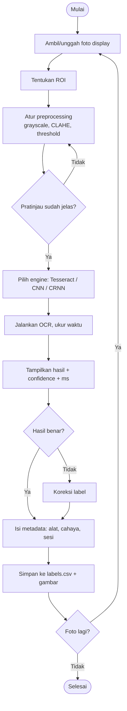
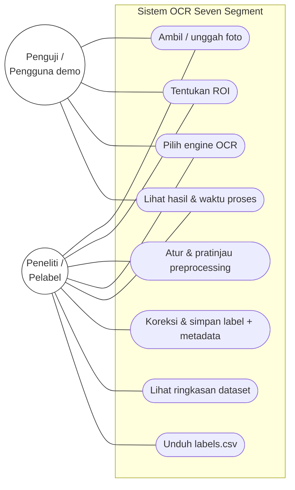

# Aplikasi OCR Seven Segment — MVP Skripsi

> Skripsi: *Analisis Komparatif Tesseract Fine-Tuned, CNN Per-Digit, dan CRNN-CTC untuk Pengenalan Angka Seven Segment pada Variasi Kondisi Citra.*
>
> Aplikasi ini punya dua peran: **(1) alat bantu pengumpulan + pelabelan data** (foto → prediksi → koreksi label → simpan CSV) dan **(2) media demo saat sidang** (satu UI untuk membandingkan tiga engine OCR).
> Kode model ada di `../pilot/` (dikerjakan terpisah); folder `app/` hanya memuat aplikasi.

---

## 1. Pemilihan arsitektur

Fokus skripsi adalah **perbandingan metode OCR**, bukan rekayasa perangkat. Jadi arsitektur yang tepat adalah yang paling cepat jadi, paling murah, dan membuat ketiga model diuji dalam lingkungan yang sama.

| Kriteria | (a) Web app Python (FastAPI/Streamlit) di laptop, HP via browser | (b) Android native / Flutter + TFLite on-device | (c) Edge: ESP32-CAM / Raspberry Pi |
|---|---|---|---|
| Kompleksitas | Rendah. Satu bahasa (Python), model dipakai langsung dari hasil training (ONNX/PyTorch). | Tinggi. Perlu Kotlin/Dart, konversi model ke TFLite, CTC decode & preprocessing ditulis ulang di Dart/Kotlin, Tesseract perlu binding (tess-two/flutter_tesseract_ocr). | Sangat tinggi. ESP32-CAM tidak sanggup menjalankan Tesseract/CRNN (RAM ±520 KB + 4 MB PSRAM) → hanya bisa jadi kamera yang mengirim foto. RPi sanggup, tapi ada pekerjaan setup OS, kamera, casing, dan daya. |
| Waktu pengerjaan aplikasi | **1–2 minggu** (MVP ini sudah jalan) | 5–8 minggu | ESP32-CAM sebagai kamera + server laptop: 3–4 minggu; RPi stand-alone: 4–6 minggu |
| Biaya hardware (**perkiraan**, harga pasar online 2026, bisa berbeda) | **Rp0** (laptop + HP yang sudah dimiliki) | Rp0 bila HP Android sudah ada; HP uji kelas bawah ±Rp1–2 juta | ESP32-CAM ±Rp75–150 rb + USB-TTL ±Rp25–50 rb; Raspberry Pi 4 (4 GB) ±Rp1,2–1,8 juta + kamera ±Rp150–400 rb + adaptor/microSD ±Rp150–250 rb |
| Risiko | Kamera HP lewat browser: `getUserMedia` butuh HTTPS bila bukan localhost → diatasi dengan `<input capture>` (tetap jalan via HTTP). Bergantung laptop + Wi-Fi saat demo. | Hasil TFLite bisa berbeda dari model asli (kuantisasi) → perbandingan antar-engine jadi tidak adil; Tesseract di Android beda versi; waktu habis untuk urusan aplikasi, bukan riset. | Kualitas kamera OV2640 rendah & fokus tetap → variabel kualitas kamera tercampur dengan variabel kondisi citra; banyak waktu habis untuk debugging hardware. |
| Kecocokan untuk S1 (komparatif OCR) | **Sangat cocok** — tiga engine jalan di mesin & preprocessing yang sama, waktu inferensi sebanding. | Cocok hanya bila skripsi menekankan *deployment mobile*. | Cocok untuk skripsi IoT/sistem tertanam, bukan untuk skripsi komparatif metode. |

### Rekomendasi: **(a) Web app FastAPI + HTML sederhana**

Alasan: biaya Rp0, MVP sudah jalan, satu kode Python dipakai untuk pelabelan data **dan** pengujian, dan semua engine diukur di perangkat yang sama sehingga perbandingan waktu proses adil. HP cukup dipakai sebagai kamera lewat browser.

**Jalur upgrade (opsional, hanya jika waktu tersisa — tulis di Bab 5 "Saran"):**
1. **v1 (sekarang):** FastAPI di laptop, HP lewat Wi-Fi yang sama, upload foto dari kamera HP.
2. **v1.5:** HTTPS lokal (`mkcert`) atau tunnel → kamera live di browser + ROI tetap untuk pengambilan cepat; mode *batch* (evaluasi satu folder uji untuk Bab 4).
3. **v2:** ekspor model terbaik ke ONNX → `onnxruntime-web` (inference di browser HP) atau TFLite → aplikasi Android ringan. Interface `OCREngine` tidak berubah, jadi hasil Bab 4 tetap valid.
4. **v3 (pengembangan lanjutan):** ESP32-CAM sebagai kamera tetap yang mengirim foto ke endpoint `/api/predict` yang sama (pembacaan meter otomatis berkala).

---

## 2. Cara menjalankan

Prasyarat: macOS/Linux, Python 3.10+ (venv di sini dibuat dengan Python 3.12 via `uv`), dan Tesseract.

```bash
cd ~/riset-seven-segment/app
brew install tesseract            # sekali saja; cek: which tesseract  (terpasang: 5.5.4)

# venv sudah dibuat di .venv. Membuat ulang bila perlu:
uv venv --python 3.12 .venv && uv pip install --python .venv/bin/python -r requirements.txt
#   (tanpa uv: python3 -m venv .venv && .venv/bin/pip install -r requirements.txt)

# Jalankan server (0.0.0.0 agar bisa dibuka dari HP di Wi-Fi yang sama)
.venv/bin/uvicorn main:app --host 0.0.0.0 --port 8000
```

- Laptop: <http://localhost:8000>
- HP: `http://<IP-laptop>:8000` (cek IP dengan `ipconfig getifaddr en0`). Tombol "Foto" membuka kamera belakang.
- Ringkasan data: `/summary` · Unduh CSV: `/api/labels.csv` · Dokumentasi API otomatis: `/docs`
- Uji otomatis: `.venv/bin/python -m pytest -q tests/`
- Gambar uji sintetis: `.venv/bin/python tools/make_test_image.py 123.4 samples/x.png --style lcd|led`

Variabel lingkungan opsional:

| Variabel | Default | Fungsi |
|---|---|---|
| `TESS_LANG` | `eng` | traineddata Tesseract. Setelah fine-tuning: salin `ssd_ft.traineddata` ke folder tessdata lalu `TESS_LANG=ssd_ft`. |
| `TESS_PSM` | `7` | page segmentation mode (7 = satu baris). |
| `CNN_MODEL_PATH` / `CRNN_MODEL_PATH` | `models/cnn_digit.onnx` / `models/crnn_ctc.onnx` | lokasi model hasil training. |
| `APP_DATA_DIR` | `data/` | lokasi dataset (tes otomatis memakai folder sementara). |

---

## 3. Fitur MVP

1. **Ambil/unggah foto** (`<input type="file" capture="environment">`, jalan di HP tanpa HTTPS).
2. **ROI manual**: seret kotak di gambar (mouse/sentuh) atau isi koordinat x, y, w, h.
3. **Preprocessing dengan pratinjau langsung**: grayscale, CLAHE (clip limit), Gaussian blur, threshold (none/Otsu/adaptive/fixed), invert, "tebalkan segmen" (erosi 3×3 untuk menyatukan celah antar-segmen), resize ke tinggi target.
4. **Pilihan engine**: Tesseract (aktif; whitelist `0123456789.`, `--oem 1 --psm 7`), CNN per-digit & CRNN-CTC (slot plugin — tampil *disabled* dengan alasan sampai file model ada).
5. **Hasil + waktu proses**: teks, keluaran mentah, confidence, waktu preprocessing / OCR / total (ms).
6. **Koreksi label & simpan** ke `data/labels.csv` + metadata (alat, kondisi cahaya, sesi, catatan, ROI, parameter preprocessing dalam JSON). Gambar asli → `data/images/`, crop ROI berwarna → `data/crops/`. Metadata alat/sesi diingat di browser (localStorage) agar pelabelan cepat.
7. **Halaman ringkasan**: jumlah data per cahaya, per alat, per sesi, per engine, tabel silang cahaya × alat, dan akurasi *indikatif* (exact match, CER, rata-rata ms) per engine × cahaya.

Kolom `labels.csv`:
`timestamp, image_file, crop_file, label, predicted, engine, confidence, ocr_ms, preprocess_ms, correct, device, lighting, session, notes, roi_x, roi_y, roi_w, roi_h, preprocess_params`

---

## 4. Arsitektur

```
app/
├── main.py               # FastAPI: routing + pengukuran waktu
├── preprocess.py         # PreprocessParams + pipeline OpenCV
├── storage.py            # labels.csv, simpan gambar, ringkasan, CER (Levenshtein)
├── ocr/
│   ├── base.py           # kontrak OCREngine / OCRResult (interface plugin)
│   ├── tesseract_engine.py  # baseline & fine-tuned (via TESS_LANG)
│   ├── model_engines.py  # STUB CNN per-digit & CRNN-CTC (+ ctc_greedy_decode sudah jadi)
│   └── __init__.py       # registry ENGINES
├── static/               # index.html, summary.html, app.js, style.css (tanpa framework)
├── tools/make_test_image.py  # generator citra seven segment sintetis
├── tests/test_app.py     # 6 uji otomatis
├── models/               # taruh .onnx di sini
├── data/                 # images/, crops/, labels.csv  (dataset hasil pelabelan)
└── samples/              # gambar uji sintetis + contoh labels.csv hasil uji
```

```mermaid
flowchart LR
  HP[HP / Laptop<br>browser] -- foto + ROI + parameter --> API[FastAPI main.py]
  API --> PRE[preprocess.py<br>crop→gray→CLAHE→threshold]
  PRE --> REG{Registry OCREngine}
  REG --> T[Tesseract<br>baseline / fine-tuned]
  REG --> C[CNN per-digit<br>.onnx]
  REG --> R[CRNN-CTC<br>.onnx]
  T & C & R --> API
  API -- teks + ms + pratinjau --> HP
  HP -- label koreksi + metadata --> API --> CSV[(data/labels.csv<br>images/ crops/)]
  CSV --> SUM[/summary/]
  CSV -. ekspor .-> COLAB[Training di Colab<br>../pilot] -. model .onnx .-> C & R
```

Endpoint: `GET /api/engines`, `POST /api/preprocess`, `POST /api/predict`, `POST /api/label`, `GET /api/summary`, `GET /api/labels.csv`.

### Menambahkan model (saat model dari Colab sudah jadi)
1. Ekspor ke ONNX (`torch.onnx.export` / `tf2onnx`) → `models/cnn_digit.onnx`, `models/crnn_ctc.onnx`.
2. `uv pip install --python .venv/bin/python onnxruntime`.
3. Lengkapi bagian `TODO` di `ocr/model_engines.py`: ukuran input, normalisasi, `segment_digits()` untuk CNN, dan `CTC_CHARSET` (wajib sama dengan saat training; index 0 = blank). Fungsi `ctc_greedy_decode()` sudah jadi dan teruji.
4. Restart server → engine otomatis aktif di dropdown.

---

## 5. Hasil uji MVP (output asli, 4 Nov 2026)

**Uji otomatis** — `pytest -q tests/`: `6 passed, 1 warning in 1.09s` (warning: deprekasi httpx di Starlette TestClient, tidak berpengaruh).

**Uji server nyata** (uvicorn di port 8765, `curl` + browser), gambar sintetis dari `tools/make_test_image.py`:

| Gambar (label benar) | Parameter preprocessing | Hasil Tesseract `eng` | Confidence | Waktu OCR |
|---|---|---|---|---|
| `uji_lcd_1234.png` (123.4) | otsu | `""` (kosong) | – | 188 ms |
| `uji_lcd_1234.png` | otsu, tebalkan 2 | `4` | 0.0 | 148 ms |
| `uji_lcd_1234.png` | otsu, tebalkan 3 | `34` | 0.28 | 243 ms |
| `uji_lcd_1234.png` | otsu, tebalkan 3, tinggi 64 | `234` | 0.22 | 228 ms |
| `uji_led_0579.png` (0579) | otsu, invert | `""` | – | 117 ms |
| `uji_led_0579.png` | otsu, invert, tebalkan 2 | `0519` | 0.82 | 116 ms |

- Engine `cnn_digit` → HTTP 503: `model belum ada: cnn_digit.onnx (stub — lihat ocr/model_engines.py)` (sesuai harapan).
- Alur UI di browser (unggah → OCR → koreksi `0519` → `0579` → simpan) berhasil: *"Tersimpan (dikoreksi). Total data: 2"*; halaman `/summary` menampilkan tabel. CSV hasil uji disimpan di `samples/hasil_uji/labels_uji_sintetis.csv` (baris 1 diisi manual lewat `curl` untuk uji endpoint, nilai `predicted=4` di situ diketik tangan; baris 2 berasal dari alur UI); `data/` dikosongkan lagi agar dataset riset tidak tercampur data uji.
- **Catatan:** Tesseract `eng` tanpa fine-tuning gagal membaca angka seven segment sintetis (0 dari 6 percobaan benar persis). Ini hanya uji fungsi aplikasi, bukan hasil penelitian, tetapi konsisten dengan motivasi skripsi: baseline Tesseract perlu fine-tuning / pembanding CNN & CRNN. Waktu ~115–245 ms/citra di laptop (Apple Silicon).

---

## 6. Rencana pengembangan per minggu (18 minggu, bisa diregangkan ke 20)

| Minggu | Kegiatan | Keluaran |
|---|---|---|
| 1 | Finalisasi judul, studi literatur, desain variabel kondisi citra (cahaya, sudut, jarak, jenis display LCD/LED, blur) | Draf Bab 1–2, matriks kondisi |
| 2 | Desain dataset (target jumlah per kondisi, pembagian train/val/test **per sesi/alat** agar tidak bocor), setup aplikasi (MVP ini) | Protokol pengambilan data, Bab 3.1 |
| 3–5 | **Pengumpulan + pelabelan data** dengan aplikasi (target mis. ≥1.500 citra, seimbang per kondisi; pantau di `/summary`) | `labels.csv`, `images/`, `crops/` |
| 5 | Baseline Tesseract `eng` (+ coba `ssd`/letsgodigital traineddata publik) di data uji | Angka baseline |
| 6–7 | Fine-tuning Tesseract (tesstrain, LSTM) — Colab/lokal | `ssd_ft.traineddata` |
| 7–9 | CNN per-digit: segmentasi digit + klasifikasi di Colab, ekspor ONNX | `cnn_digit.onnx` |
| 9–11 | CRNN-CTC di Colab (augmentasi kondisi cahaya), ekspor ONNX | `crnn_ctc.onnx` |
| 11–12 | **Integrasi model** ke `ocr/model_engines.py`, tambah mode evaluasi batch (satu folder uji → CSV metrik) | Ketiga engine aktif di app |
| 12–13 | **Pengujian**: akurasi exact-match, CER, waktu inferensi per kondisi; uji statistik (mis. McNemar antar-engine); uji black-box aplikasi | Tabel & grafik Bab 4 |
| 13–14 | Analisis kesalahan (digit tertukar 1↔7, 5↔6, titik desimal hilang), studi ablasi preprocessing (CLAHE/threshold) | Bab 4 pembahasan |
| 14–16 | Penulisan Bab 3–5, revisi pembimbing | Draf lengkap |
| 17 | Persiapan sidang: skenario demo live + video cadangan, slide | Slide, video |
| 18 (–20) | Sidang & revisi; cadangan 2 minggu untuk keterlambatan data/training | Naskah final |

Risiko jadwal terbesar: pengumpulan data dan training CRNN. Mulai pelabelan sedini mungkin; aplikasi ini justru disiapkan agar minggu 3–5 efisien.

---

## 7. Pemetaan ke bab skripsi

- **Bab 1 Pendahuluan** — latar belakang (pembacaan meter/timbangan manual), rumusan masalah, batasan (jenis display, kondisi cahaya, digit + titik desimal).
- **Bab 2 Tinjauan Pustaka** — seven segment, Tesseract LSTM & fine-tuning, CNN klasifikasi digit, CRNN + CTC, CLAHE/Otsu, metrik (accuracy, CER). Lihat `../survei_literatur_seven_segment_AMR.md`.
- **Bab 3 Metodologi & Perancangan Sistem**
  - 3.1 Alur penelitian (studi literatur → pengumpulan data → preprocessing → training 3 model → integrasi → pengujian → analisis).
  - 3.2 Desain dataset & skenario kondisi citra (tabel kondisi, pembagian data).
  - 3.3 **Diagram alir sistem** (lihat flowchart di bawah) dan arsitektur (diagram bagian 4).
  - 3.4 **Use case diagram** (di bawah) + deskripsi use case.
  - 3.5 Perancangan preprocessing & tiga model (arsitektur jaringan, hiperparameter).
  - 3.6 Perancangan antarmuka (tangkapan layar halaman Ambil & Label, Ringkasan).
  - 3.7 Rancangan pengujian (metrik, uji statistik, uji black-box).
- **Bab 4 Hasil & Pembahasan** — implementasi app, hasil per engine per kondisi, waktu inferensi, analisis kesalahan.
- **Bab 5 Kesimpulan & Saran** — termasuk jalur upgrade (on-device, ESP32-CAM).

### Diagram alir (Bab 3.3)



### Use case (Bab 3.4)



(Untuk naskah, gambar ulang use case dalam notasi UML standar dengan draw.io/StarUML; mermaid di atas cukup sebagai draf.)

---

## 8. Batasan MVP yang diketahui
- Belum ada autentikasi; jalankan hanya di jaringan lokal tepercaya.
- Gambar yang diprediksi tapi tidak dilabeli tetap tersimpan di `data/images/` — bersihkan berkala (file yang tidak ada di `labels.csv`).
- Belum ada mode evaluasi batch (direncanakan minggu 11–12).
- Kamera live (`getUserMedia`) belum dipakai karena butuh HTTPS di HP; pemakaian `<input capture>` sudah cukup untuk pengumpulan data.
