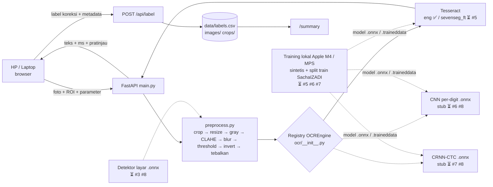
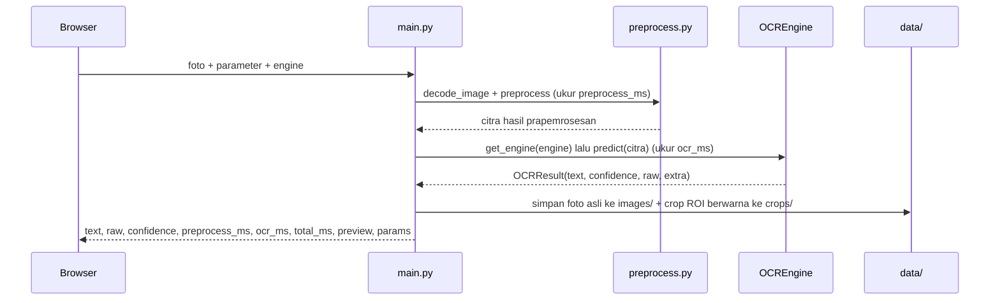
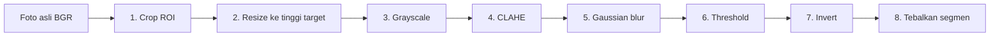
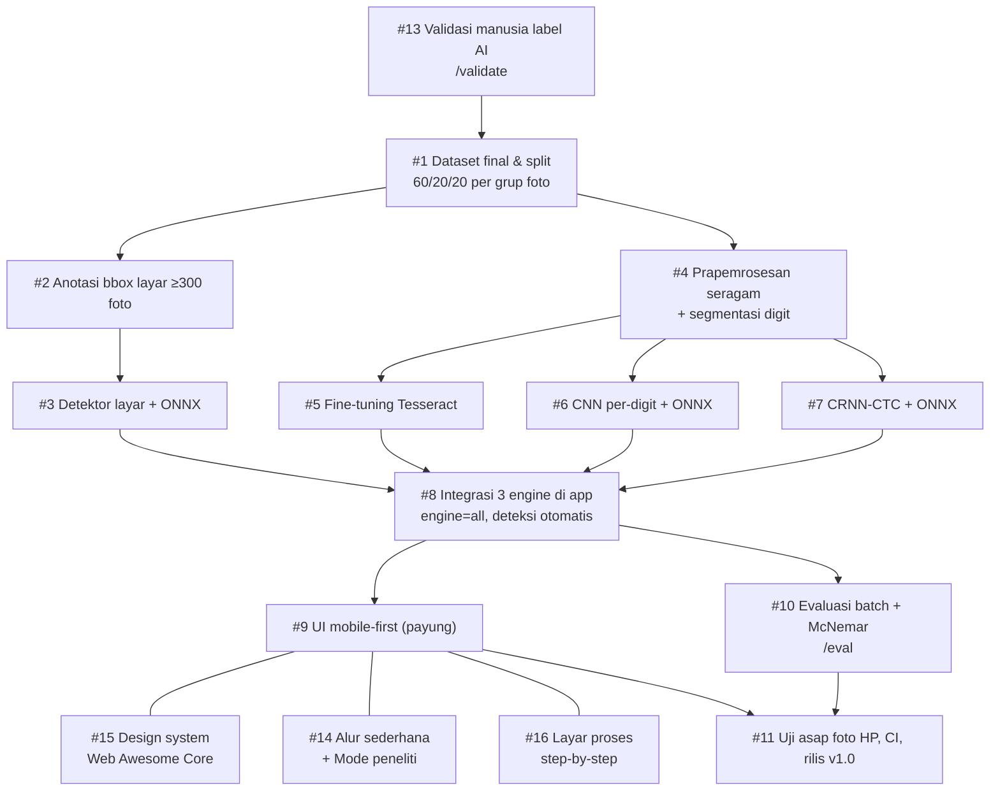
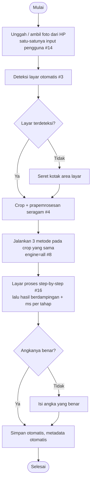
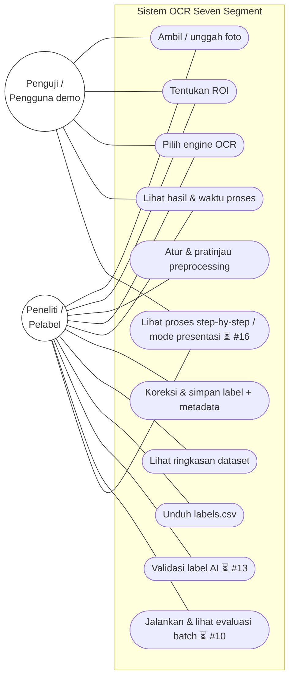

# Aplikasi OCR Seven Segment: Penjelasan Lengkap (MVP Skripsi)

> Skripsi: *Analisis Komparatif Tesseract Fine-Tuned, CNN Per-Digit, dan CRNN-CTC untuk Pengenalan Angka Seven Segment pada Variasi Kondisi Citra.*
>
> Dokumen ini menjelaskan isi folder `app/`: untuk apa aplikasinya, bagaimana kode bekerja dari foto sampai CSV, arti setiap opsi prapemrosesan, cara menambah engine OCR, dan apa yang **sudah** maupun **belum** dikerjakan. Kode model (training) ada di `../pilot/` dan nantinya di folder training baru (tiket #6, #7). Folder `app/` hanya berisi aplikasinya.
>
> Status per 5 November 2026. Setiap angka disertai file sumbernya. Penanda yang dipakai:
> - ✅ **SUDAH**: ada di kode dan sudah dijalankan.
> - ⏳ **BELUM**: direncanakan, disertai nomor tiket GitHub.

---

## Daftar isi

1. [Ringkasan 1 menit](#1-ringkasan-1-menit)
2. [Apa yang sudah dan belum ada di aplikasi](#2-apa-yang-sudah-dan-belum-ada-di-aplikasi)
3. [Kenapa web app (pemilihan arsitektur)](#3-kenapa-web-app-pemilihan-arsitektur)
4. [Cara menjalankan dan menguji](#4-cara-menjalankan-dan-menguji)
5. [Struktur folder dan arsitektur](#5-struktur-folder-dan-arsitektur)
6. [Alur request per endpoint](#6-alur-request-per-endpoint)
7. [Prapemrosesan: arti setiap opsi](#7-prapemrosesan-arti-setiap-opsi)
8. [Interface plugin `OCREngine`](#8-interface-plugin-ocrengine)
9. [Kenapa CNN dan CRNN masih stub, dan cara mengisinya (#8)](#9-kenapa-cnn-dan-crnn-masih-stub-dan-cara-mengisinya-8)
10. [Data yang disimpan (`labels.csv`)](#10-data-yang-disimpan-labelscsv)
11. [Antarmuka (frontend)](#11-antarmuka-frontend)
12. [Hasil uji MVP](#12-hasil-uji-mvp)
13. [Rencana pengembangan per tiket](#13-rencana-pengembangan-per-tiket)
14. [Pemetaan ke bab skripsi + diagram](#14-pemetaan-ke-bab-skripsi--diagram)
15. [Batasan MVP yang diketahui](#15-batasan-mvp-yang-diketahui)
16. [Bank pertanyaan dosen tentang aplikasi](#16-bank-pertanyaan-dosen-tentang-aplikasi)
17. [Glosarium](#17-glosarium)

---

## 1. Ringkasan 1 menit

**APA.** Aplikasi web kecil. Peneliti membuka halaman di browser HP atau laptop, memotret layar seven segment, menandai area layar, mengatur prapemrosesan sambil melihat pratinjau, memilih engine OCR, lalu melihat angka hasil bacaan dan waktu prosesnya. Kalau bacaannya salah, label dikoreksi lalu disimpan ke `data/labels.csv`.

**KENAPA.** Aplikasi ini punya dua peran:
1. **Alat bantu uji dan pelabelan.** Foto → prediksi → koreksi → simpan CSV. Ke depan, fitur validasi manusia atas label AI juga ditaruh di sini (#13).
2. **Media demo saat sidang.** Satu UI untuk menjalankan ketiga engine OCR pada foto dan prapemrosesan yang sama, sehingga perbandingannya adil.

**BAGAIMANA.** Server Python (FastAPI) berjalan di laptop. HP cukup membuka browser lewat Wi-Fi yang sama. Ketiga engine OCR ada di belakang satu "colokan" (interface) bernama `OCREngine`, sehingga aplikasi memanggil ketiganya dengan cara yang persis sama.

> **Analogi.** Aplikasi ini seperti meja uji di bengkel. Foto adalah "benda uji", prapemrosesan adalah "membersihkan benda sebelum diukur", dan ketiga engine adalah "tiga alat ukur berbeda" yang dicolokkan ke stopkontak yang sama (`OCREngine`). Karena stopkontaknya sama, hasil ketiganya bisa dibandingkan secara adil.

---

## 2. Apa yang sudah dan belum ada di aplikasi

| Fitur | Status | Sumber / tiket |
|---|---|---|
| Ambil/unggah foto dari HP (`<input capture>`, tanpa HTTPS) | ✅ SUDAH | `static/index.html` |
| ROI manual: seret kotak di gambar atau isi x, y, w, h | ✅ SUDAH | `static/app.js` |
| Prapemrosesan + pratinjau langsung (grayscale, CLAHE, blur, threshold, invert, tebalkan segmen, resize) | ✅ SUDAH | `preprocess.py` |
| Engine Tesseract (`eng` bawaan; bisa diganti traineddata lain lewat `TESS_LANG`) | ✅ SUDAH | `ocr/tesseract_engine.py` |
| Slot engine CNN per-digit & CRNN-CTC (tampil *disabled* + alasan) | ✅ SUDAH sebagai **stub** | `ocr/model_engines.py` |
| Decoder CTC greedy (sudah jadi dan teruji) | ✅ SUDAH | `ocr/model_engines.py`, `tests/test_app.py` |
| Hasil + waktu prapemrosesan / OCR / total (ms) | ✅ SUDAH | `main.py` |
| Koreksi label + metadata, simpan ke `labels.csv` + gambar | ✅ SUDAH | `storage.py`, `main.py` |
| Halaman ringkasan `/summary` + unduh CSV | ✅ SUDAH | `static/summary.html`, `storage.summarize()` |
| 6 uji otomatis (pytest) | ✅ SUDAH, lulus | `tests/test_app.py` |
| Halaman validasi manusia atas label AI **`/validate`** | ⏳ BELUM | #13 |
| Mode anotasi bbox layar untuk folder foto | ⏳ BELUM | #2 |
| **Deteksi layar otomatis** (ROI tidak perlu digambar manual) | ⏳ BELUM | #3 (model), #8 (integrasi) |
| Prapemrosesan seragam (`ocr_core`) + segmentasi digit nyata | ⏳ BELUM | #4 |
| Tesseract **fine-tuned** (`sevenseg_ft.traineddata`) | ⏳ BELUM | #5 |
| Model CNN & CRNN ONNX asli, engine aktif | ⏳ BELUM | #6, #7, #8 |
| Opsi **`engine=all`** (tiga engine sekaligus pada crop yang sama) | ⏳ BELUM | #8 |
| **UI mobile-first** (payung): satu layar, hasil 3 engine berdampingan, overlay bbox | ⏳ BELUM | #9 (payung untuk #14, #15, #16) |
| Design system **Web Awesome Core** (diputuskan), aset lokal agar jalan offline | ⏳ BELUM | #15 |
| **Alur sederhana**: cukup unggah foto, sisanya otomatis; istilah teknis dipindah ke "Mode peneliti" tersembunyi | ⏳ BELUM | #14 |
| **Layar proses langkah demi langkah** (`/api/predict?explain=1`, gambar antara asli + waktu per langkah, mode presentasi) | ⏳ BELUM | #16 |
| Evaluasi batch + McNemar, halaman **`/eval`** | ⏳ BELUM | #10 |
| Uji asap foto HP sendiri, CI GitHub Actions, rilis v1.0 | ⏳ BELUM | #11 |

**Yang boleh diklaim saat sidang sekarang:** aplikasi berjalan end-to-end dengan **satu** engine aktif (Tesseract `eng`) dan ROI **manual**. CNN dan CRNN baru berupa slot yang interface-nya sudah final. Jangan klaim deteksi otomatis atau perbandingan tiga engine di app sebelum #3 dan #8 selesai.

---

## 3. Kenapa web app (pemilihan arsitektur)

**APA yang dipilih:** web app FastAPI + HTML biasa (tanpa framework frontend) yang berjalan di laptop. HP dipakai sebagai kamera lewat browser.

**KENAPA.** Fokus skripsi adalah **perbandingan metode OCR**, bukan rekayasa perangkat. Arsitektur yang tepat adalah yang paling cepat jadi, paling murah, dan membuat ketiga model diuji di lingkungan yang **sama**.

| Kriteria | (a) Web app Python (FastAPI/Streamlit) di laptop, HP via browser | (b) Android native / Flutter + TFLite on-device | (c) Edge: ESP32-CAM / Raspberry Pi |
|---|---|---|---|
| Kompleksitas | Rendah. Satu bahasa (Python), model dipakai langsung dari hasil training (ONNX/PyTorch). | Tinggi. Perlu Kotlin/Dart, konversi model ke TFLite, CTC decode & preprocessing ditulis ulang di Dart/Kotlin, Tesseract perlu binding (tess-two/flutter_tesseract_ocr). | Sangat tinggi. ESP32-CAM tidak sanggup menjalankan Tesseract/CRNN (RAM ±520 KB + 4 MB PSRAM) → hanya bisa jadi kamera yang mengirim foto. RPi sanggup, tapi ada pekerjaan setup OS, kamera, casing, dan daya. |
| Waktu pengerjaan aplikasi | **1–2 minggu** (MVP ini sudah jalan) | 5–8 minggu | ESP32-CAM sebagai kamera + server laptop: 3–4 minggu; RPi stand-alone: 4–6 minggu |
| Biaya hardware (**perkiraan**, harga pasar online 2026, bisa berbeda) | **Rp0** (laptop + HP yang sudah dimiliki) | Rp0 bila HP Android sudah ada; HP uji kelas bawah ±Rp1–2 juta | ESP32-CAM ±Rp75–150 rb + USB-TTL ±Rp25–50 rb; Raspberry Pi 4 (4 GB) ±Rp1,2–1,8 juta + kamera ±Rp150–400 rb + adaptor/microSD ±Rp150–250 rb |
| Risiko | Kamera HP lewat browser: `getUserMedia` butuh HTTPS bila bukan localhost → diatasi dengan `<input capture>` (tetap jalan via HTTP). Bergantung laptop + Wi-Fi saat demo. | Hasil TFLite bisa berbeda dari model asli (kuantisasi) → perbandingan antar-engine jadi tidak adil; Tesseract di Android beda versi; waktu habis untuk urusan aplikasi, bukan riset. | Kualitas kamera OV2640 rendah & fokus tetap → variabel kualitas kamera tercampur dengan variabel kondisi citra; banyak waktu habis untuk debugging hardware. |
| Kecocokan untuk S1 (komparatif OCR) | **Sangat cocok**: tiga engine jalan di mesin & preprocessing yang sama, waktu inferensi sebanding. | Cocok hanya bila skripsi menekankan *deployment mobile*. | Cocok untuk skripsi IoT/sistem tertanam, bukan untuk skripsi komparatif metode. |

### Rekomendasi: **(a) Web app FastAPI + HTML sederhana**

Alasannya: biaya Rp0, MVP sudah jalan, satu kode Python dipakai untuk pelabelan **dan** pengujian, dan semua engine diukur di perangkat yang sama sehingga perbandingan waktu proses adil. HP cukup dipakai sebagai kamera lewat browser.

Istilah yang muncul:
- **FastAPI**: pustaka Python untuk membuat server web/API. Dipilih karena ringkas, cepat, dan otomatis membuat halaman dokumentasi API di `/docs`.
- **ONNX** (*Open Neural Network Exchange*): format file model standar. Model dilatih di PyTorch, lalu diekspor ke `.onnx` agar app cukup memakai `onnxruntime` yang ringan, tanpa memasang PyTorch.
- **`getUserMedia`**: API browser untuk kamera live. Di HP, API ini hanya diizinkan lewat HTTPS. Karena itu app memakai `<input type="file" capture="environment">`, yang membuka aplikasi kamera bawaan HP dan tetap jalan lewat HTTP biasa.

**Jalur upgrade (opsional, hanya jika waktu tersisa; tulis di Bab 5 "Saran"):**
1. **v1 (sekarang):** FastAPI di laptop, HP lewat Wi-Fi yang sama, upload foto dari kamera HP.
2. **v1.5:** HTTPS lokal (`mkcert`) atau tunnel → kamera live di browser + ROI tetap untuk pengambilan cepat. (Mode evaluasi batch tidak lagi opsional: sudah masuk rencana utama, #10.)
3. **v2:** ekspor model terbaik ke ONNX → `onnxruntime-web` (inference di browser HP) atau TFLite → aplikasi Android ringan. Interface `OCREngine` tidak berubah, jadi hasil Bab 4 tetap valid.
4. **v3 (pengembangan lanjutan):** ESP32-CAM sebagai kamera tetap yang mengirim foto ke endpoint `/api/predict` yang sama (pembacaan meter otomatis berkala).

---

## 4. Cara menjalankan dan menguji

### 4.1 Prasyarat

| Kebutuhan | Versi terpasang | Cek |
|---|---|---|
| Sistem operasi | **Windows 10/11, macOS, Linux** (dikembangkan di macOS Apple M4; diuji otomatis di ketiganya lewat GitHub Actions) | — |
| Python | 3.10+; venv di `app/.venv` dibuat dengan Python 3.12 via `uv` | `.venv/bin/python --version` |
| Tesseract | 5.x (di Mac: 5.5.4 via Homebrew; di Windows: installer UB Mannheim via `winget`) | `tesseract --version` |
| Paket Python | dikunci di `requirements.txt`: `fastapi==0.162.0`, `httpx==0.28.1`, `numpy==2.5.4`, `opencv-python-headless==5.0.0.93`, `pillow==13.0.0`, `pytesseract==0.3.13`, `pytest==9.2.0`, `python-multipart==0.0.33`, `uvicorn==0.54.0` | `cat requirements.txt` |

`onnxruntime` **belum** ada di `requirements.txt`. Paket ini ditambahkan saat #8.

### 4.2 Menjalankan server

#### Windows (PowerShell)

```powershell
cd riset-seven-segment
powershell -ExecutionPolicy Bypass -File scripts\windows\setup_app.ps1   # sekali: Python 3.12, Tesseract, venv, pytest
powershell -ExecutionPolicy Bypass -File scripts\windows\run_app.ps1     # jalankan server + tampilkan alamat untuk HP
```

Perbedaan penting di Windows, dan cara app menanganinya:

| Masalah di Windows | Kenapa terjadi | Penanganan di app |
|---|---|---|
| Program `tesseract` sering **tidak ada di PATH** setelah instalasi | Installer Windows memasangnya di `C:\Program Files\Tesseract-OCR\` tanpa menambah PATH | `ocr/tesseract_engine.py` → `find_tesseract()` mencari berurutan: env `TESSERACT_CMD`, lalu PATH, lalu lokasi instalasi umum Windows. Pesan error menyebut cara memasang sesuai OS. Teruji di CI Windows tanpa menambah PATH. |
| Encoding file teks bawaan bukan UTF-8 | Windows memakai code page lama (cp1252) | Skrip PowerShell menyalakan `PYTHONUTF8=1`. `storage.py` sudah menulis `labels.csv` dengan `encoding="utf-8"`. |
| Path memakai `\` dan huruf drive | Format path Windows | Kode memakai `pathlib`. Manifest dan label menyimpan path relatif dengan `/`. |
| HP tidak bisa membuka app | Windows Firewall memblokir port 8000 | Saat pertama menjalankan, pilih **Allow** untuk jaringan *Private*. `run_app.ps1` menampilkan IP laptop. |
| Perintah `.venv/bin/...` tidak ada | Di Windows foldernya `.venv\Scripts\` | Skrip PowerShell memakai `.venv\Scripts\python.exe` |

#### macOS / Linux

```bash
cd riset-seven-segment/app
brew install tesseract            # sekali saja; cek: which tesseract  (terpasang: 5.5.4)

# venv sudah dibuat di .venv. Membuat ulang bila perlu:
uv venv --python 3.12 .venv && uv pip install --python .venv/bin/python -r requirements.txt
#   (tanpa uv: python3 -m venv .venv && .venv/bin/pip install -r requirements.txt)

# Jalankan server (0.0.0.0 agar bisa dibuka dari HP di Wi-Fi yang sama)
.venv/bin/uvicorn main:app --host 0.0.0.0 --port 8000
```

**Kenapa `--host 0.0.0.0`?** Secara bawaan server hanya mendengarkan `localhost`, yaitu laptop itu sendiri. `0.0.0.0` artinya "terima koneksi dari semua alamat jaringan", sehingga HP di Wi-Fi yang sama bisa masuk. Karena tidak ada login (lihat §15), jalankan hanya di jaringan tepercaya.

| Alamat | Isi |
|---|---|
| <http://localhost:8000> | Halaman "Ambil & Label" (di laptop) |
| `http://<IP-laptop>:8000` | Halaman yang sama dari HP. Cek IP dengan `ipconfig getifaddr en0` (macOS), `hostname -I` (Linux), atau `ipconfig` (Windows; `run_app.ps1` menampilkannya otomatis). Tombol "Foto" membuka kamera belakang. |
| `/summary` | Ringkasan dataset |
| `/api/labels.csv` | Unduh CSV |
| `/docs` | Dokumentasi API otomatis dari FastAPI (bisa mencoba endpoint langsung) |

### 4.3 Menguji

```bash
# Uji otomatis (6 uji)
.venv/bin/python -m pytest -q tests/

# Membuat gambar uji sintetis
.venv/bin/python tools/make_test_image.py 123.4 samples/x.png --style lcd|led
```

`tools/make_test_image.py` menggambar digit dari **persegi panjang per segmen** (a–g) dengan PIL, bukan dari font. Gaya `lcd` = segmen gelap di latar hijau keabu-abuan, dengan segmen mati tetap samar terlihat (meniru *ghosting*). Gaya `led` = segmen merah terang di latar gelap.

### 4.4 Variabel lingkungan (opsional)

Variabel lingkungan (*environment variable*) adalah pengaturan yang diberikan saat menjalankan program, tanpa mengubah kode. Contoh macOS/Linux: `TESS_LANG=eng .venv/bin/uvicorn main:app`. Contoh Windows (PowerShell): `$env:TESS_LANG = "eng"; .\.venv\Scripts\python.exe -m uvicorn main:app`.

| Variabel | Default | Fungsi |
|---|---|---|
| `TESS_LANG` | `eng` | traineddata Tesseract. Setelah fine-tuning (#5): salin `sevenseg_ft.traineddata` ke folder tessdata lalu `TESS_LANG=sevenseg_ft`. (Versi lama dokumen ini menulis `ssd_ft`; nama yang dipakai di PRD dan #5 adalah `sevenseg_ft`.) |
| `TESS_PSM` | `7` | *Page segmentation mode*: cara Tesseract menganggap tata letak gambar. `7` = "gambar ini berisi satu baris teks", cocok untuk layar angka. |
| `TESSDATA_PREFIX` | (bawaan Tesseract) | Folder tessdata kustom, dibaca Tesseract sendiri. |
| `TESSERACT_CMD` | (dicari otomatis) | Path lengkap ke program tesseract, misalnya `C:\Program Files\Tesseract-OCR\tesseract.exe`. Hanya perlu diisi kalau Tesseract dipasang di lokasi tidak umum. Di PowerShell: `$env:TESSERACT_CMD = "D:\Tools\Tesseract-OCR\tesseract.exe"`. |
| `CNN_MODEL_PATH` / `CRNN_MODEL_PATH` | `models/cnn_digit.onnx` / `models/crnn_ctc.onnx` | Lokasi model hasil training. |
| `APP_DATA_DIR` | `data/` | Lokasi dataset hasil pelabelan. Tes otomatis mengarahkannya ke folder sementara agar `data/` asli tidak kotor. |

---

## 5. Struktur folder dan arsitektur

```
app/
├── main.py               # FastAPI: routing + pengukuran waktu
├── preprocess.py         # PreprocessParams + pipeline OpenCV
├── storage.py            # labels.csv, simpan gambar, ringkasan, CER (Levenshtein)
├── ocr/
│   ├── base.py           # kontrak OCREngine / OCRResult (interface plugin)
│   ├── tesseract_engine.py  # baseline & fine-tuned (via TESS_LANG)
│   ├── model_engines.py  # STUB CNN per-digit & CRNN-CTC (+ ctc_greedy_decode sudah jadi)
│   └── __init__.py       # registry ENGINES
├── static/               # index.html, summary.html, app.js, style.css (tanpa framework)
├── tools/make_test_image.py  # generator citra seven segment sintetis
├── tests/test_app.py     # 6 uji otomatis
├── models/               # taruh .onnx di sini (saat ini kosong)
├── data/                 # images/, crops/, labels.csv  (diabaikan git: app/data/ di .gitignore)
└── samples/              # gambar uji sintetis + contoh labels.csv hasil uji
```

**Pembagian tanggung jawab (KENAPA dipecah begini):** setiap file mengerjakan satu hal. `main.py` hanya mengatur lalu lintas request dan mengukur waktu. `preprocess.py` hanya mengolah gambar. `storage.py` hanya menyimpan dan meringkas data. `ocr/` hanya membaca angka. Dengan begitu, mengganti satu engine atau satu langkah prapemrosesan tidak merusak bagian lain.

### Diagram arsitektur

Kondisi **sekarang** (✅): ROI manual, hanya Tesseract aktif. Garis putus-putus = ⏳ BELUM.



Catatan: data latih model **tidak** berasal dari `labels.csv` aplikasi. Data latih = data sintetis + split train (±60%) dari foto SachaIZADI (lihat §13). `labels.csv` dipakai untuk uji fungsi, demo, dan uji asap foto HP sendiri (#11). Versi lama diagram ini menggambar panah "ekspor CSV → training di Colab"; alur itu sudah tidak berlaku.

---

## 6. Alur request per endpoint

**Endpoint** adalah "alamat" di server yang menerima permintaan tertentu. Semua endpoint ada di `main.py`.

| Method & path | Fungsi | Input | Output | Kode error |
|---|---|---|---|---|
| `GET /` | Halaman utama "Ambil & Label" | — | `static/index.html` | — |
| `GET /summary` | Halaman ringkasan | — | `static/summary.html` | — |
| `GET /api/engines` | Daftar engine + statusnya, daftar pilihan cahaya | — | `{engines: [{name, label, available, status}], lighting_options}` | — |
| `POST /api/preprocess` | Pratinjau prapemrosesan saja (tanpa OCR, tanpa simpan) | foto + parameter | gambar PNG base64, `preprocess_ms`, ukuran asli & keluaran | 400 |
| `POST /api/predict` | Prapemrosesan + OCR + simpan gambar | foto + parameter + `engine` | teks, raw, confidence, waktu, pratinjau, nama file | 400, 501, 503 |
| `POST /api/label` | Simpan label benar + metadata ke CSV | nama file + label + metadata | baris yang disimpan + total data | 400, 404 |
| `GET /api/summary` | Statistik dataset | — | JSON ringkasan | — |
| `GET /api/labels.csv` | Unduh CSV | — | file CSV | 404 bila belum ada data |

Semua input `POST` dikirim sebagai *multipart form* (format yang sama dengan form upload file di browser).

### 6.1 `POST /api/preprocess` (pratinjau)

**KENAPA ada endpoint terpisah:** supaya peneliti bisa mencoba-coba parameter dan langsung melihat efeknya tanpa menjalankan OCR yang lebih lambat dan tanpa mengotori folder data.

**BAGAIMANA, langkah demi langkah:**
1. `_params()` merakit `PreprocessParams` dari form. Nilai `threshold` di luar `none/otsu/adaptive/fixed` ditolak dengan **400**.
2. `decode_image()` mengubah byte file menjadi array gambar OpenCV. Bila bukan gambar → **400** `"file bukan gambar yang valid"`.
3. Stopwatch dimulai (`time.perf_counter()`), `preprocess()` dijalankan, stopwatch berhenti → `preprocess_ms`.
4. Bila ROI di luar gambar → **400** `"ROI di luar gambar (WxH)"`.
5. Hasil diubah ke PNG lalu base64 (teks yang bisa langsung dipasang sebagai `src` gambar di browser).

Frontend memanggil endpoint ini otomatis setiap kali parameter prapemrosesan diubah dan setiap selesai menyeret ROI.

### 6.2 `POST /api/predict` (OCR)



**BAGAIMANA:**
1. Parameter divalidasi dan gambar didekode, sama seperti §6.1.
2. `preprocess()` dijalankan dan diukur → `preprocess_ms`.
3. `get_engine(engine)` mencari engine di registry. Nama tak dikenal → **400**.
4. `eng.predict(citra)` dijalankan dan diukur → `ocr_ms`.
   - Engine belum siap (model/binary/traineddata tidak ada) → engine melempar `EngineUnavailable` → **503** (*Service Unavailable*, artinya "layanan ini belum bisa dipakai").
   - Engine ada tapi kodenya belum diisi (`NotImplementedError`) → **501** (*Not Implemented*). Kasus ini terjadi bila file `.onnx` sudah ditaruh tapi `predict()` di stub belum dilengkapi.
5. Foto **asli** disimpan ke `data/images/<id>.<ext>`, dengan `id` = 12 karakter acak (`uuid4`). Crop ROI **berwarna** (hanya dipotong, tanpa grayscale/threshold) disimpan ke `data/crops/<id>_roi.png`.
   **KENAPA disimpan sebelum dilabeli:** endpoint label butuh nama file yang sudah ada. Crop disimpan berwarna supaya nanti bisa diproses ulang dengan parameter lain.
6. Respons memuat `total_ms = preprocess_ms + ocr_ms`.

**Kenapa waktu diukur terpisah per tahap?** Supaya di Bab 4 bisa dibedakan: yang lambat itu prapemrosesannya atau engine OCR-nya. Waktu membaca file dan mengirim lewat jaringan **tidak** ikut dihitung, sehingga yang dibandingkan memang waktu kerja engine.

### 6.3 `POST /api/label` (simpan label)

1. Label dibersihkan dari spasi di ujung. Kosong atau berisi karakter selain `0123456789.` → **400** `"label wajib berisi digit/titik saja"`.
2. `image_file` harus ada di `data/images/`, kalau tidak → **404** `"image_file tidak ditemukan; lakukan prediksi dulu"`. Nama file diambil bagian akhirnya saja (`Path(...).name`) agar tidak bisa dipakai menulis ke folder lain.
3. `storage.append_label()` menambah satu baris ke `labels.csv` (lihat §10) dan menghitung kolom `correct`.
4. Respons: baris yang disimpan + jumlah total baris.

### 6.4 `GET /api/summary`

`storage.summarize()` membaca seluruh CSV lalu menghitung:
- jumlah data per `lighting`, `device`, `session`, `engine` (nilai kosong ditampilkan sebagai `(kosong)`);
- tabel silang cahaya × alat;
- akurasi **indikatif** per (engine, cahaya): `n`, `exact_match`, `cer`, `avg_ocr_ms`.

Rumus di kode:
- `exact_match` = jumlah baris dengan `label == predicted` ÷ `n`.
- `cer` = total jarak Levenshtein(`predicted`, `label`) ÷ total panjang label (panjang minimal 1 per baris). **Jarak Levenshtein** = jumlah minimum sisip/hapus/ganti karakter untuk mengubah satu teks menjadi teks lain. Contoh: `0519` → `0579` = 1 ganti.

⚠️ Angka di `/summary` **bukan** hasil uji formal Bab 4. Data yang dilabeli lewat app tidak dipisah sebagai data uji *held-out* (data yang tidak pernah dilihat saat training/tuning). Hasil formal berasal dari evaluasi batch (#10).

---

## 7. Prapemrosesan: arti setiap opsi

**APA:** serangkaian langkah pengolahan gambar sebelum gambar dibaca OCR.
**KENAPA:** foto nyata berwarna, kontrasnya beragam, kadang redup atau silau. OCR, terutama Tesseract, jauh lebih stabil bila diberi gambar hitam-putih yang bersih dengan teks gelap di latar terang.
**PRINSIP KEADILAN:** untuk perbandingan formal, ketiga engine harus menerima crop dan prapemrosesan yang **sama**. Semua parameter dicatat ke `labels.csv` (kolom `preprocess_params`) supaya eksperimen bisa diulang.

### 7.1 Urutan pipeline (sesuai `preprocess.py`)



Setiap langkah dilewati bila opsinya mati. Urutannya tetap; pengguna tidak bisa mengubah urutan.

### 7.2 Penjelasan tiap opsi

| # | Opsi (nama di UI / parameter) | APA yang dilakukan pada gambar | KAPAN dipakai | Detail di kode |
|---|---|---|---|---|
| 1 | **ROI** (`roi_x, roi_y, roi_w, roi_h`) | Memotong gambar ke kotak area layar saja. | Hampir selalu. Foto penuh berisi badan alat dan latar yang membuat OCR membaca "sampah". | `w` atau `h` = 0 → seluruh gambar dipakai. Kotak yang menjorok keluar dipangkas ke tepi gambar. Kotak yang sepenuhnya di luar → error 400. |
| 2 | **Tinggi target** (`target_height`) | Mengubah ukuran gambar agar tingginya N piksel; lebar ikut berskala (rasio terjaga). | Menyeragamkan ukuran antarfoto. Tesseract membaca paling baik bila tinggi huruf cukup besar; di uji MVP, tinggi 64 menambah digit yang terbaca (§12). | 0 = tanpa resize. Memperbesar memakai `INTER_CUBIC` (halus); memperkecil memakai `INTER_AREA` (minim *aliasing*/gerigi). |
| 3 | **Grayscale** (`grayscale`) | Mengubah gambar berwarna (3 kanal) menjadi abu-abu (1 kanal, nilai 0–255). | Hampir selalu. Warna tidak membawa informasi angka. | Otomatis dipaksa aktif bila CLAHE atau threshold dinyalakan, karena keduanya hanya bekerja pada 1 kanal. |
| 4 | **CLAHE** (`clahe`, `clip`) | *Contrast Limited Adaptive Histogram Equalization*: menaikkan kontras **per petak kecil**, bukan satu nilai untuk seluruh gambar. | Foto redup, atau terang di satu sisi dan gelap di sisi lain. Kurang berguna bila gambar sudah kontras. | Petak 8×8, `clip` default 2,0. `clip` membatasi seberapa kuat kontras dinaikkan: makin besar, makin kontras, tapi derau ikut menguat. |
| 5 | **Blur** (`blur`) | Gaussian blur: menghaluskan gambar dengan merata-ratakan piksel tetangga. | Foto berbintik/derau, atau tekstur LCD yang membuat threshold berbintik. Jangan terlalu besar: celah antardigit ikut hilang. | Angka = ukuran kernel. 0 atau 1 = mati. Angka genap dinaikkan ke ganjil (mis. 4 → 5), karena kernel Gaussian harus ganjil. |
| 6 | **Threshold** (`threshold`, `nilai`) | Mengubah abu-abu menjadi **hitam-putih murni** (0 atau 255). | Biasanya membantu Tesseract. Pilih jenisnya di bawah. | Lihat §7.3. |
| 7 | **Invert** (`invert`) | Membalik warna: hitam ↔ putih. | Display **LED** (angka terang di latar gelap). Tesseract dan langkah "tebalkan" mengasumsikan teks **gelap** di latar **terang**. | `cv2.bitwise_not`. |
| 8 | **Tebalkan segmen** (`dilate`) | Menebalkan goresan gelap sehingga celah kecil antarsegmen dalam satu digit menyatu. | Seven segment punya celah antar-segmen; Tesseract cenderung menganggap segmen yang terputus sebagai coretan terpisah. Di uji MVP, menaikkan nilai ini menambah digit yang terbaca (§12). Terlalu besar → digit bersebelahan ikut menyatu. | Nilai = jumlah iterasi kernel 3×3 (UI: 0–5). **Catatan teknis:** di kode, operasi yang dipakai adalah **erosi** (`cv2.erode`), bukan dilasi. Erosi mengikis piksel **putih**; karena teks diasumsikan gelap di latar putih, mengikis putih sama dengan menebalkan teks gelap. Nama parameter `dilate` dipertahankan karena maksudnya "menebalkan teks". |

### 7.3 Pilihan threshold

| Pilihan | APA | KAPAN | Detail |
|---|---|---|---|
| `none` | Tidak ada threshold, gambar tetap abu-abu. | Untuk engine yang dilatih dengan input abu-abu (CNN/CRNN di pilot menormalkan sendiri), atau saat ingin melihat efek CLAHE saja. | — |
| `otsu` | Metode Otsu: **mencari otomatis** satu batas terang/gelap terbaik dari histogram gambar. | Pilihan awal yang baik bila pencahayaan cukup merata. | `THRESH_BINARY + THRESH_OTSU`. Nilai `nilai` diabaikan. |
| `adaptive` | Batas dihitung **per lingkungan kecil**, sehingga tiap area punya batasnya sendiri. | Cahaya tidak merata, bayangan, atau silau sebagian. | Gaussian, blok 31×31 piksel, konstanta C = 5. |
| `fixed` | Batas **tetap** yang diketik pengguna (`nilai`, default 127). Piksel > nilai → putih. | Eksperimen manual, atau bila kondisi foto sangat seragam. | `THRESH_BINARY`. |

> **Analogi threshold.** Otsu seperti memilih satu garis batas "gelap vs terang" untuk seluruh foto. Adaptive seperti memilih garis batas berbeda untuk tiap petak kecil, sehingga bagian yang tertutup bayangan tetap terbaca.

### 7.4 Resep awal (titik mulai, bukan aturan)

| Kondisi | Coba ini dulu |
|---|---|
| LCD normal (angka gelap, latar terang) | grayscale + `otsu` + tebalkan 2–3, tinggi target 64 |
| LED (angka terang, latar gelap) | grayscale + `otsu` + **invert** + tebalkan 2 |
| Redup | tambah CLAHE (clip 2–3) |
| Cahaya tidak merata / bayangan | `adaptive` |
| Berbintik | blur 3 |

Resep di atas adalah **heuristik** untuk mencoba-coba di app, bukan hasil penelitian. Prapemrosesan baku untuk ketiga engine ditetapkan di #4 (modul bersama `ocr_core/`, termasuk deteksi polaritas LCD/LED otomatis, sehingga invert tidak perlu dipilih manual). Sampai #4 selesai, deteksi polaritas otomatis ⏳ **BELUM** ada di app.

---

## 8. Interface plugin `OCREngine`

**APA.** `OCREngine` (di `ocr/base.py`) adalah **kontrak**: aturan bahwa setiap engine OCR wajib menyediakan fungsi dengan nama dan bentuk yang sama.

**KENAPA.**
1. **Keadilan:** `main.py` memanggil ketiga engine dengan baris kode yang sama dan mengukur waktunya di titik yang sama.
2. **Mudah ditambah:** engine baru cukup mewarisi `OCREngine` lalu didaftarkan di registry. Tidak ada kode lain yang perlu diubah.
3. **Aman saat model belum ada:** engine bisa melapor "belum siap" beserta alasannya, sehingga app tidak *crash*.

> **Analogi.** `OCREngine` seperti bentuk colokan listrik standar. Alat apa pun (Tesseract, CNN, CRNN) boleh dipakai asal colokannya sesuai. Stopkontaknya (`main.py`) tidak perlu tahu isi alatnya.

### 8.1 Isi kontrak

```python
@dataclass
class OCRResult:
    text: str                        # hasil akhir yang sudah dibersihkan, mis. "123.4"
    confidence: float | None = None  # 0..1 bila engine menyediakan
    raw: str = ""                    # keluaran mentah engine (untuk debugging)
    extra: dict = {}                 # info tambahan (mis. lang, psm, config)

class OCREngine(ABC):
    name = "base"     # id unik: dipakai di form web dan kolom `engine` labels.csv
    label = "..."     # nama ramah untuk dropdown
    def available(self) -> tuple[bool, str]: ...   # (siap?, alasan)
    @abstractmethod
    def predict(self, image: np.ndarray) -> OCRResult: ...
```

(Ringkasan; kode aslinya memakai `field(default_factory=dict)` untuk `extra`.)

| Bagian | Tugas |
|---|---|
| `name` | ID unik engine: `tesseract`, `cnn_digit`, `crnn_ctc`. |
| `available()` | Dipanggil oleh `GET /api/engines` untuk mengisi dropdown. Engine yang `False` tampil *disabled* beserta alasannya. |
| `predict(image)` | Menerima citra hasil prapemrosesan (uint8, 1 kanal atau 3 kanal BGR) yang sudah dipotong ke ROI, lalu mengembalikan `OCRResult`. |
| `EngineUnavailable` | Error khusus "engine belum siap". `main.py` mengubahnya menjadi HTTP 503. |
| `clean_digits()` | Membuang semua karakter selain `0123456789.` (konstanta `ALLOWED_CHARS`). |

### 8.2 Registry (`ocr/__init__.py`)

`ENGINES` adalah kamus `{name: objek engine}` berisi `TesseractEngine()`, `CNNDigitEngine()`, dan `CRNNCTCEngine()`. Objek dibuat **sekali** saat server menyala. `get_engine(name)` mengambil engine (nama tak dikenal → `KeyError` → HTTP 400). `list_engines()` memanggil `available()` tiap engine.

### 8.3 Engine Tesseract (`ocr/tesseract_engine.py`) ✅

**APA:** Tesseract adalah OCR open-source (awalnya HP, lalu Google) yang intinya jaringan LSTM. Di app ia dipanggil lewat `pytesseract`.

**BAGAIMANA:**
1. `available()` mengecek tiga hal: binary `tesseract` ada di PATH, Tesseract bisa dipanggil, dan traineddata `TESS_LANG` terpasang.
2. Konfigurasi: `--oem 1 --psm 7 -c tessedit_char_whitelist=0123456789.`
   - `--oem 1`: pakai mesin LSTM (bukan mesin lama).
   - `--psm 7`: gambar dianggap satu baris teks.
   - `whitelist`: Tesseract hanya boleh menebak digit dan titik.
3. Tesseract dipanggil **dua kali**: `image_to_string` untuk teks dan `image_to_data` untuk confidence per kata.
4. `confidence` = rata-rata confidence kata yang tidak kosong, dibagi 100 (agar skala 0..1). Bila tidak ada kata → `None`.
5. `text` = `clean_digits(raw)`.

Catatan untuk analisis latency: karena dipanggil dua kali, `ocr_ms` Tesseract di app mencakup dua kali inferensi. Hal ini perlu disamakan saat evaluasi batch (#10), misalnya hanya memakai `image_to_data` sekali.

Untuk Tesseract fine-tuned (#5), kodenya **tidak berubah**: cukup ganti `TESS_LANG=sevenseg_ft`.

---

## 9. Kenapa CNN dan CRNN masih stub, dan cara mengisinya (#8)

### 9.1 Kenapa masih stub

**Stub** = kerangka kode yang bentuknya sudah final tapi isinya belum. Kedua engine masih stub karena **model finalnya belum ada**:
- Model di `pilot/` dilatih **hanya pada data sintetis**, dan CNN pilot masih memakai posisi digit "kunci jawaban" (*oracle*), bukan segmentasi nyata (`docs/PANDUAN_SIDANG.md` §6).
- Model final dilatih ulang dengan sintetis + split train foto SachaIZADI (#6, #7), memakai prapemrosesan bersama (#4).
- Detail input model (ukuran, normalisasi, kelas, charset) baru pasti setelah training final. Kalau diisi sekarang, kodenya harus ditulis ulang.

Yang **sudah** jadi: kelas `_ModelFileEngine` (cek file model + cek `onnxruntime` + memuat sesi ONNX sekali lalu disimpan di `self._session`, memakai `CPUExecutionProvider`), dan `ctc_greedy_decode()` yang sudah lulus uji.

Perilaku saat ini:

| Kondisi | `available()` | Hasil `POST /api/predict` |
|---|---|---|
| File `.onnx` tidak ada (kondisi sekarang) | `False`, `"model belum ada: cnn_digit.onnx (stub — lihat ocr/model_engines.py)"` | **503** |
| File ada, `onnxruntime` belum terpasang | `False`, `"onnxruntime belum terpasang (pip install onnxruntime)"` | **503** |
| File ada + `onnxruntime` ada, `predict()` belum diisi | `True` | **501** (`NotImplementedError`) |

### 9.2 Ketidaksesuaian yang harus dibereskan di #8

Nilai bawaan di stub berbeda dengan model pilot. Ini wajar karena stub ditulis sebelum pilot final, tapi **wajib** disamakan:

| Hal | Di stub (`ocr/model_engines.py`) | Di pilot | Rencana tiket |
|---|---|---|---|
| Input CNN | `input_size = (28, 28)` | `CH, CW = 64, 40` (`pilot/train_cnn.py` baris 14) | Dibaca dari `cnn_digit.json` (#6) |
| Keluaran CNN | `CNN_CLASSES = 0–9` saja | Dua kepala: digit (10 kelas) **dan** titik desimal (2 kelas: ada/tidak) (`DigitCNN` di `pilot/train_cnn.py`) | Kepala titik desimal ikut dipakai |
| Input CRNN | `input_size = (32, 128)` | `IH, IW = 32, 256` (`pilot/train_crnn.py` baris 11) | "Input 32×256 (atau hasil tuning)" (#7), dibaca dari `crnn_ctc.json` |
| Charset CRNN | `["<blank>"] + "0123456789."` | `VOCAB = '0123456789.'`, blank = index 0 (`nn.CTCLoss(blank=0)`) | Sudah cocok |
| Normalisasi | belum ada | Standardisasi per crop: `(x − mean) / (std + 1e-5)`; CRNN di-*pad* kanan sampai lebar 256 | Dibaca dari `.json` |

**KENAPA metadata ditaruh di file `.json` terpisah:** agar app tidak "menebak" ukuran input. Kalau ukuran atau urutan charset tidak sama persis dengan saat training, model tetap mengeluarkan angka, tapi angkanya salah tanpa ada error. Kesalahan seperti ini sulit dilacak.

### 9.3 Langkah mengisi stub (#8)

Prasyarat: #4 (prapemrosesan + segmentasi), #6 (`cnn_digit.onnx` + `.json`), #7 (`crnn_ctc.onnx` + `.json`), #3 (detektor layar) selesai. Model diekspor dari PyTorch dengan `torch.onnx.export`; PRD mensyaratkan prediksi ONNX dan PyTorch identik pada ≥ 99% citra validasi.

1. Tambah `onnxruntime` ke `requirements.txt`, lalu pasang: `uv pip install --python .venv/bin/python onnxruntime`.
2. Taruh `cnn_digit.onnx` + `cnn_digit.json` dan `crnn_ctc.onnx` + `crnn_ctc.json` di `app/models/`.
3. Baca file `.json` saat model dimuat (ukuran input, normalisasi, kelas/charset).
4. **CNN per-digit** (`CNNDigitEngine.predict`):
   1. `segment_digits(image)`: potong ROI menjadi gambar per digit dari kiri ke kanan. Pilihan metode yang tercatat di kode: (a) proyeksi vertikal + ambang kolom kosong, (b) *connected components* setelah penebalan agar segmen satu digit menyatu, (c) pembagian lebar tetap bila jumlah digit diketahui. Implementasinya dari modul bersama #4.
   2. Setiap potongan di-resize ke ukuran input, dinormalisasi, lalu ditumpuk menjadi batch bentuk `(N, 1, H, W)`.
   3. `session.run()` → skor digit dan skor titik desimal per potongan.
   4. `argmax` per potongan → digit; bila kepala titik bilang "ada", tambahkan `.` setelah digit itu (seperti `to_string()` di pilot).
   5. Kembalikan `OCRResult(text, confidence, raw)`.
5. **CRNN-CTC** (`CRNNCTCEngine.predict`):
   1. Resize ROI ke tinggi 32 dengan rasio terjaga, *pad* kanan sampai lebar input, normalisasi, bentuk `(1, 1, H, W)` float32.
   2. `session.run()` → skor per kolom waktu, bentuk `(T, 1, C)` atau `(1, T, C)`.
   3. `ctc_greedy_decode(out.squeeze())` → `(teks, confidence)`.
6. `/api/predict`: bila ROI kosong → panggil detektor (#3) → crop → prapemrosesan bersama → engine. Respons ditambah `bbox`, `roi_source` (`auto`/`manual`), dan `detect_ms`. Foto tanpa layar → `display_detected=false` + saran ROI manual.
7. Opsi `engine=all`: jalankan ketiga engine pada **crop yang sama**, kembalikan daftar hasil. Bila satu model hilang, dua engine lain tetap menjawab (tidak error 500).
8. Simpan `roi_source` dan hasil semua engine ke `labels.csv`.
9. Tambah pytest untuk ketiga engine (pakai model kecil/fixture) dan `engine=all`.
10. Restart server → engine otomatis aktif di dropdown.

Kriteria selesai #8 (dari tiket): ketiga engine `available=true` saat model ada; total waktu satu foto, satu engine ≤ 2 detik di laptop **[ASUMSI]** dengan angka asli dilampirkan.

### 9.4 Cara kerja `ctc_greedy_decode()` ✅

**CTC** (*Connectionist Temporal Classification*): CRNN menebak satu karakter (atau `blank`) untuk setiap "kolom waktu" gambar dari kiri ke kanan. Decoder **greedy** ("rakus") memilih tebakan terbaik di setiap kolom, lalu:
1. Mengubah skor menjadi probabilitas (*softmax*).
2. Mengambil indeks terbesar per kolom (`argmax`).
3. **Menggabungkan** indeks yang berulang berturut-turut.
4. **Membuang** `blank` (indeks 0).
5. `confidence` = rata-rata probabilitas karakter yang terpilih.

Contoh dari uji `test_ctc_greedy_decode`: urutan kolom `blank, 1, 1, blank, 2, '.', blank, 3` → `12.3`. `blank` di antara dua karakter sama berfungsi sebagai pemisah, sehingga `11` tetap bisa ditulis sebagai `1, blank, 1`.

---

## 10. Data yang disimpan (`labels.csv`)

**Lokasi:** `data/labels.csv` (atau `$APP_DATA_DIR/labels.csv`), foto asli di `data/images/`, crop ROI berwarna di `data/crops/`. Folder `app/data/` diabaikan git (`.gitignore`), jadi foto tidak ikut ter-*push* ke GitHub.

**Cara penulisan:** baris hanya **ditambahkan** (*append*), tidak pernah ditimpa. Penulisan dikunci dengan `threading.Lock` agar dua request bersamaan tidak saling menimpa. Header ditulis otomatis bila file baru atau kosong.

Urutan kolom: `timestamp, image_file, crop_file, label, predicted, engine, confidence, ocr_ms, preprocess_ms, correct, device, lighting, session, notes, roi_x, roi_y, roi_w, roi_h, preprocess_params`

| Kolom | Isi | Diisi oleh |
|---|---|---|
| `timestamp` | Waktu simpan, format ISO, presisi detik (mis. `2026-11-04T22:43:59`) | Server |
| `image_file` | Nama foto asli di `data/images/` (`<id>.<ext>`) | Hasil `/api/predict` |
| `crop_file` | Nama crop ROI berwarna di `data/crops/` (`<id>_roi.png`) | Hasil `/api/predict` |
| `label` | **Jawaban benar** (hasil koreksi manusia). Hanya `0-9` dan `.` | Peneliti |
| `predicted` | Bacaan engine (`text`) | Hasil `/api/predict` |
| `engine` | Engine yang dipakai (`tesseract`, `cnn_digit`, `crnn_ctc`) | Hasil `/api/predict` |
| `confidence` | Keyakinan engine 0..1, kosong bila tidak ada | Hasil `/api/predict` |
| `ocr_ms` | Waktu OCR (ms) | Hasil `/api/predict` |
| `preprocess_ms` | Waktu prapemrosesan (ms) | Hasil `/api/predict` |
| `correct` | `1` bila `label == predicted` persis (perbandingan teks), selain itu `0` | Server |
| `device` | Nama alat, mis. `timbangan_A`, `meteran_listrik` | Peneliti (diingat browser) |
| `lighting` | Kondisi cahaya: `terang`, `normal`, `redup`, `silau_pantulan`, `malam_backlight` (`storage.LIGHTING_OPTIONS`) | Peneliti (diingat browser) |
| `session` | Sesi pemotretan, mis. `S01_2026-11-05` | Peneliti (diingat browser) |
| `notes` | Catatan bebas | Peneliti |
| `roi_x`, `roi_y`, `roi_w`, `roi_h` | Kotak ROI dalam piksel foto asli (0 = seluruh gambar) | Dari parameter |
| `preprocess_params` | Semua parameter prapemrosesan dalam JSON, agar hasil bisa diulang | Dari parameter |

**KENAPA metadata (`device`, `lighting`, `session`) dicatat:** supaya hasil bisa dirinci per kondisi dan per alat, dan supaya foto dari satu sesi tidak terpecah ke data latih dan data uji sekaligus (mencegah kebocoran data).

Catatan: pilihan cahaya di app (`LIGHTING_OPTIONS`) **berbeda** dari tag kondisi di label SachaIZADI (`glare`, `blur`, `tilt`, `dim`, `occlusion`, `cut_off`, `dirty`, `clean`; lihat `docs/PANDUAN_SIDANG.md` Q18). Untuk uji asap foto HP sendiri (#11), sebaiknya kedua daftar disamakan agar hasil per kondisi bisa dibandingkan.

Contoh nyata (dari `samples/hasil_uji/labels_uji_sintetis.csv`, baris 2):

```
2026-11-04T22:43:59,3400252e6ecb.png,3400252e6ecb_roi.png,0579,0519,tesseract,0.82,235.03,0.11,0,sintetis_led,terang,UJI_SINTETIS,,0,0,0,0,{"roi_x":0,...,"threshold":"otsu",...,"invert":true,"dilate":2}
```

Artinya: label benar `0579`, Tesseract membaca `0519` (confidence 0,82), salah (`correct=0`), OCR 235,03 ms, prapemrosesan 0,11 ms, parameter otsu + invert + tebalkan 2.

---

## 11. Antarmuka (frontend)

Ditulis dengan HTML + JavaScript biasa **tanpa framework**. **KENAPA:** lebih mudah dibaca dan dijelaskan saat sidang, serta tidak perlu proses *build*. Prinsip "tanpa build" ini tetap dipertahankan saat design system Web Awesome Core dipasang (#15, §11.3), karena komponennya dipakai langsung sebagai tag HTML.

Halaman utama (`static/index.html` + `static/app.js`) terdiri dari empat kartu:

| Kartu | Yang dilakukan |
|---|---|
| **1. Foto** | Pilih/ambil foto. Gambar tampil di `<canvas>`. Seret dengan mouse atau jari untuk menggambar kotak ROI merah; koordinat dihitung dalam piksel **foto asli**, bukan piksel layar. Kolom x, y, w, h bisa diketik manual. Tombol "Reset ROI". |
| **2. Preprocessing** | Kontrol opsi §7. Setiap perubahan langsung memanggil `/api/preprocess` dan memperbarui pratinjau beserta ukuran keluaran dan waktunya. |
| **3. OCR** | Dropdown engine dari `/api/engines` (engine yang belum siap tampil *disabled* + alasan). Tombol "Jalankan OCR" → `/api/predict`. Hasil: teks besar, `raw`, confidence, waktu preprocess / OCR / total. |
| **4. Koreksi label & simpan** | Kolom "Label benar" otomatis terisi bacaan engine; ubah bila salah. Isi alat, cahaya, sesi, catatan → "Simpan ke labels.csv". Pesan: *"Tersimpan (prediksi benar/dikoreksi). Total data: N"*. Alat, cahaya, dan sesi diingat di `localStorage` browser agar pelabelan berikutnya cepat. |

Halaman `/summary` (`static/summary.html`) menampilkan total data, tabel per cahaya, per alat, per sesi, per engine, tabel silang cahaya × alat, dan akurasi indikatif (exact match %, CER, rata-rata ms OCR) per engine × cahaya, dengan peringatan *"Bukan hasil uji formal"*.

### 11.1 Masalah UI saat ini: terlalu teknis

Setelah mencoba MVP, peneliti (pemilik repo) menilai **form MVP terlalu teknis** untuk pengguna awam dan dosen (#14). Contoh istilah yang membingungkan: ROI x/y/w/h, "Reset ROI", "Preprocessing", "clip" (CLAHE), "Blur", "Tinggi target", "Threshold none/otsu/adaptive/fixed", "Tebalkan segmen", "Engine", "Sesi", dan "Simpan ke labels.csv". Form MVP tetap berguna sebagai alat peneliti, tetapi bukan tampilan utama untuk demo. Tampilannya juga masih HTML/CSS polos tanpa sistem desain.

### 11.2 Rencana perbaikan UI (⏳ BELUM, semuanya di bawah payung #9)

#9 sekarang menjadi **tiket payung** (tiket induk yang merangkum beberapa tiket kecil): alur satu layar mobile-first, tombol besar "Foto" yang langsung menjalankan `engine=all`, overlay bbox layar, dan kartu hasil ketiga engine berdampingan. Pekerjaannya dipecah menjadi tiga tiket:

| Tiket | Tahap | APA | KENAPA | BAGAIMANA (ringkas) |
|---|---|---|---|---|
| #15 | 4a | **Design system** (kumpulan aturan dan komponen siap pakai: warna, huruf, jarak, tombol, kartu, ikon) | Agar semua halaman seragam, rapi, dan meyakinkan saat sidang; komponennya sudah memperhatikan aksesibilitas (kontras, ukuran sentuh di HP). Analogi: semua halaman memakai "seragam" yang sama. | Lihat §11.3. |
| #14 | 4b | **Alur sederhana:** pengguna cukup unggah foto, sisanya otomatis | Pengguna awam tidak perlu paham ROI atau threshold untuk mendapat angka. Target: angka didapat dengan ≤ 2 ketukan (Unggah → pilih foto), tanpa mengisi apa pun. | Satu tombol besar "Ambil / Unggah Foto". Deteksi layar (#3), preset prapemrosesan terbaik (#4), dan ketiga metode (`engine=all`, #8) berjalan otomatis. Metadata diisi otomatis (waktu, ukuran foto, perangkat dari *user-agent*, perkiraan cahaya dari kecerahan foto). Setelah hasil tampil: "Apakah angkanya benar?" → Ya / Tidak, yang benar: [___]. Istilah diganti bahasa sehari-hari (ROI → "area layar", Engine → "metode", OCR → "baca angka", Label → "angka yang benar"). **Semua istilah teknis** (ROI, CLAHE, threshold, engine, preprocessing, `labels.csv`, sesi, alat) dipindah ke panel **"Mode peneliti"** yang tersembunyi secara default; isinya adalah kontrol MVP saat ini. Bila layar tidak terdeteksi: kotak area layar yang bisa diseret, tanpa angka x/y/w/h. Struktur `labels.csv` tetap kompatibel. Selama #3 dan #8 belum selesai, alur tetap otomatis dengan Tesseract saja + kotak seret-manual. |
| #16 | 4c | **Layar proses langkah demi langkah** | Bagian yang paling menarik bagi dosen adalah **cara kerja** tiap metode, terutama pengolahan citranya. Layar ini menunjukkannya dengan data asli, bukan animasi palsu. | `/api/predict?explain=1` mengembalikan **gambar antara (*intermediate*) yang benar-benar dihasilkan** untuk foto itu + **waktu per langkah**; tanpa `explain` tidak ada biaya tambahan. Urutan langkah: foto → deteksi layar → crop → grayscale → polaritas (LCD/LED disamakan) → CLAHE → threshold → Tesseract (citra input + teks) / CNN (kotak per digit + probabilitas 0–9 tiap digit) / CRNN (prediksi per kolom, mis. `1 1 _ 2 2 _ . 5`) → CTC (gabung yang berulang, buang blank → `12.5`) → hasil 3 metode berdampingan. Tiap langkah: judul + 1–2 kalimat awam + visual + ms. Diputar otomatis saat memproses, bisa diulang dengan tombol Sebelumnya/Berikutnya, dan ada **mode presentasi** layar penuh. |

### 11.3 Design system #15: **Web Awesome Core** (sudah diputuskan)

**Keputusan (5 Nov 2026):** UI memakai **Web Awesome Core**. Implementasinya ⏳ BELUM.

| Hal | Isi |
|---|---|
| Apa | Kumpulan *web components* (elemen HTML siap pakai seperti `<wa-button>`), lisensi **MIT** (gratis, bebas dipakai), paket npm `@awesome.me/webawesome`. Yang dipakai versi **Core** gratis, **bukan** versi Pro yang berbayar. |
| Kenapa ini | Bisa dipakai **tanpa build step**, cocok dengan app yang saat ini hanya menyajikan HTML statis dari FastAPI. Komponennya lengkap (button, card, dialog, progress, tooltip) dan tema diatur lewat *design token* (variabel warna, huruf, jarak). Web Awesome adalah **penerus Shoelace** dari tim Font Awesome; Shoelace sendiri sudah dihentikan (*sunset*), jadi tidak dipilih. Alternatif yang dipertimbangkan di #15: Pico CSS (sangat ringan tapi komponennya sedikit, tanpa stepper/tooltip) dan Tailwind + DaisyUI (butuh build step). |
| Di mana | File di-*host* sendiri di `app/static/vendor/webawesome/` (bukan CDN), supaya **demo tetap jalan tanpa internet**. Notice lisensi MIT ikut disertakan. |
| Komponen prioritas | `wa-button`, `wa-card`, `wa-callout`, `wa-toast`, `wa-progress-bar`, `wa-tooltip`, `wa-dialog`, `wa-badge`. Stepper untuk #16 disusun dari komponen ini, karena stepper jadi belum dipastikan tersedia (perlu dicek di dokumentasi). |
| Aturan tampilan | Mobile-first: lebar 360 px, target sentuh ≥ 44 px, mode gelap opsional. Design token: warna utama, netral, sukses/gagal, font, spacing, radius, dengan aksen warna "LCD hijau". |
| Diterapkan ke | Halaman utama, ringkasan, Mode peneliti, dan nanti `/validate` (#13) serta `/eval` (#10). |

---

## 12. Hasil uji MVP

Ini **uji fungsi aplikasi**, bukan hasil penelitian. Gambar yang dipakai adalah gambar sintetis dari `tools/make_test_image.py`.

### 12.1 Uji otomatis (pytest)

| Tanggal | Perintah | Output asli |
|---|---|---|
| 4 Nov 2026 | `pytest -q tests/` | `6 passed, 1 warning in 1.09s` |
| 5 Nov 2026 (dijalankan ulang saat menulis dokumen ini) | `.venv/bin/python -m pytest -q tests/` | `6 passed, 1 warning in 0.49s` |

Warning: deprekasi `httpx` di Starlette TestClient, tidak berpengaruh pada aplikasi.

Isi keenam uji (`tests/test_app.py`):

| Uji | Yang dibuktikan |
|---|---|
| `test_engines_listed` | Registry berisi tepat `tesseract`, `cnn_digit`, `crnn_ctc`; `cnn_digit` berstatus `available=False` (stub). |
| `test_preprocess_roi` | ROI 100×80 + CLAHE + Otsu menghasilkan keluaran berukuran `[100, 80]`. |
| `test_predict_and_label_roundtrip` | Alur lengkap predict → label → summary: teks hanya berisi digit/titik, data tersimpan, ringkasan menghitung 1 data `normal`. |
| `test_stub_engine_returns_503` | Memanggil `crnn_ctc` saat model belum ada → HTTP 503. |
| `test_label_validation` | Label `12a` ditolak → HTTP 400. |
| `test_ctc_greedy_decode` | Decoder CTC: `blank,1,1,blank,2,'.',blank,3` → `12.3`, confidence > 0,9. |

Semua uji memakai folder data sementara (`APP_DATA_DIR` → `tempfile.mkdtemp`), sehingga `data/` asli tidak tersentuh.

### 12.2 Uji server nyata (output asli, 4 Nov 2026)

uvicorn di port 8765, diuji dengan `curl` + browser, gambar sintetis dari `tools/make_test_image.py`:

| Gambar (label benar) | Parameter preprocessing | Hasil Tesseract `eng` | Confidence | Waktu OCR |
|---|---|---|---|---|
| `uji_lcd_1234.png` (123.4) | otsu | `""` (kosong) | – | 188 ms |
| `uji_lcd_1234.png` | otsu, tebalkan 2 | `4` | 0.0 | 148 ms |
| `uji_lcd_1234.png` | otsu, tebalkan 3 | `34` | 0.28 | 243 ms |
| `uji_lcd_1234.png` | otsu, tebalkan 3, tinggi 64 | `234` | 0.22 | 228 ms |
| `uji_led_0579.png` (0579) | otsu, invert | `""` | – | 117 ms |
| `uji_led_0579.png` | otsu, invert, tebalkan 2 | `0519` | 0.82 | 116 ms |

- Engine `cnn_digit` → HTTP 503: `model belum ada: cnn_digit.onnx (stub — lihat ocr/model_engines.py)` (sesuai harapan).
- Alur UI di browser (unggah → OCR → koreksi `0519` → `0579` → simpan) berhasil: *"Tersimpan (dikoreksi). Total data: 2"*; halaman `/summary` menampilkan tabel. CSV hasil uji disimpan di `samples/hasil_uji/labels_uji_sintetis.csv`. Baris 1 diisi manual lewat `curl` untuk uji endpoint (nilai `predicted=4` di situ diketik tangan); baris 2 berasal dari alur UI. Setelah itu `data/` dikosongkan lagi agar dataset riset tidak tercampur data uji.
- **Catatan:** Tesseract `eng` tanpa fine-tuning gagal membaca angka seven segment sintetis (0 dari 6 percobaan benar persis). Ini hanya uji fungsi aplikasi, bukan hasil penelitian, tetapi konsisten dengan motivasi skripsi: baseline Tesseract perlu fine-tuning dan pembanding CNN & CRNN. Waktu ~115–245 ms/citra di laptop (Apple Silicon).
- Perbedaan kecil: tabel mencatat 116 ms untuk percobaan terakhir, sedangkan baris CSV dari alur UI mencatat `ocr_ms=235.03`. Keduanya adalah run terpisah (curl vs browser) pada gambar yang sama; waktu Tesseract per run memang bervariasi.

**Cara membaca tabel di atas:** menaikkan "tebalkan segmen" dan tinggi target menambah jumlah digit yang terbaca (kosong → `4` → `34` → `234`), sedangkan LED baru terbaca setelah di-invert. Ini menunjukkan Tesseract sangat sensitif terhadap prapemrosesan, sesuai kelemahan yang dicatat di `docs/PANDUAN_SIDANG.md` §3.

Perbandingan hasil pilot ketiga metode (data sintetis, n = 2.400) ada di `pilot/README_pilot.md` dan dirangkum di `docs/PANDUAN_SIDANG.md` §6, bukan dari aplikasi ini.

---

## 13. Rencana pengembangan per tiket

> **Pengganti rencana lama.** Versi sebelumnya dokumen ini memuat rencana 18 minggu dengan "pengumpulan + pelabelan data minggu 3–5, target ≥1.500 citra" dan training di Colab. Rencana itu **sudah tidak berlaku**. Keputusan saat ini (sumber: `docs/PRD.md` §2 Asumsi, roadmap #12):
> - **Tidak ada pengumpulan data baru.** Foto nyata dengan beragam kondisi sudah tersedia; tantangan utamanya kualitas label, dan itu sudah diperbaiki (pelabelan ulang 858 foto, 779 layak).
> - **Data latih** = data sintetis + split **train** (±60%) dari foto pompa BBM SachaIZADI.
> - **Uji utama** = split **test** (±20%) SachaIZADI. Split val (±20%) untuk memilih model.
> - **Dataset publik lain** = uji eksternal saja, tidak untuk latih.
> - **Foto HP sendiri (30–50)** = uji asap (*smoke test*) end-to-end aplikasi saja. **Bukan** data latih dan **bukan** angka utama.
> - **Training lokal** di MacBook Apple M4 memakai GPU Apple (**MPS**, *Metal Performance Shaders*). Colab hanya cadangan. Latency diukur di CPU 1 thread agar ketiga metode setara.

### 13.1 Urutan dan dependensi (dari roadmap #12)



#5, #6, dan #7 bisa dikerjakan paralel setelah #4. #15 (design system) tidak bergantung pada model, jadi bisa dimulai kapan saja. #14 bisa dimulai sebelum #3/#8 dengan Tesseract saja; #16 baru lengkap setelah CNN dan CRNN aktif (#8).

### 13.2 Isi tiap tahap dan dampaknya ke `app/`

| Tiket | Tahap | Pekerjaan inti | Keluaran | Dampak ke `app/` | Status |
|---|---|---|---|---|---|
| #13 | 0b | Halaman `/validate`: periksa label AI satu per satu (Setuju / Koreksi / Tidak terbaca / Lewati), sampel acak dengan seed tetap, jejak audit append-only | `labeling/human_validation.csv`, `/validate/summary` (% kesepakatan manusia vs AI) | Halaman + endpoint baru | ⏳ BELUM |
| #1 | 0 | `pipeline/finalize.py`: gabung label baru ke manifest; split SachaIZADI 60/20/20 per `split_group`, stratifikasi HQ/MQ/LQ, seed tetap; dataset publik lain → `external_test`; cek manual 3 foto `mismatch` | `data/splits/{train,val,test,external_test}.csv` | — | ⏳ BELUM |
| #2 | 1a | Mode anotasi bbox layar di app untuk folder foto | ≥ 300 foto berbox | Mode anotasi baru | ⏳ BELUM |
| #3 | 1b | Baseline OpenCV (kontur + rasio aspek + warna) vs detektor ringan terlatih (usulan YOLOv8n/YOLO11n); bandingkan precision, recall, mean IoU, latency di val | `app/models/display_detector.onnx` | Deteksi layar otomatis | ⏳ BELUM |
| #4 | 2a | Paket `ocr_core/` (`preprocess.py`, `segment.py`): deteksi polaritas LCD/LED, CLAHE, resize, padding, segmentasi digit (proyeksi kolom + kontur), deteksi titik desimal | Modul bersama pilot, training, app | `app/preprocess.py` memanggil `ocr_core` | ⏳ BELUM |
| #5 | 2b | `tesstrain` (lstmtraining) dari `eng` dan `ssd`; data sintetis + crop asli train (`.png` + `.gt.txt`); pilih berdasarkan CER val. Baseline `eng` dan traineddata publik `7seg`/`ssd` tetap dilaporkan sebagai pembanding. | `sevenseg_ft.traineddata` | `TESS_LANG=sevenseg_ft` | ⏳ BELUM |
| #6 | 2c | Latih ulang CNN: sintetis + crop digit asli train, segmentasi nyata (bukan oracle), augmentasi kondisi, seed tetap, training lokal MPS | `cnn_digit.onnx` + `cnn_digit.json` | Mengisi stub CNN | ⏳ BELUM |
| #7 | 2d | Latih ulang CRNN: input 32×256 (atau hasil tuning), charset `0-9` + `.`, blank = 0; pra-latih sintetis → fine-tune campuran; training lokal MPS | `crnn_ctc.onnx` + `crnn_ctc.json` | Mengisi stub CRNN | ⏳ BELUM |
| #8 | 3 | Lihat §9.3: ONNX Runtime, deteksi otomatis bila ROI kosong, `engine=all`, `roi_source`, `detect_ms` | Ketiga engine aktif | `ocr/model_engines.py`, `main.py` | ⏳ BELUM |
| #9 | 4 (payung) | UI satu layar untuk HP: Foto → `engine=all` → hasil berdampingan + overlay bbox → koreksi → simpan; uji di Android & iPhone. Dipecah menjadi #15, #14, #16 (§11.2) | UI baru | `static/` | ⏳ BELUM |
| #15 | 4a | Design system **Web Awesome Core** (MIT, `@awesome.me/webawesome`, penerus Shoelace), self-host di `app/static/vendor/webawesome/`, design token, mobile-first | Tema + komponen seragam | Semua halaman | ⏳ BELUM (pilihan sudah diputuskan) |
| #14 | 4b | Alur "unggah foto saja", istilah teknis dipindah ke "Mode peneliti" tersembunyi, metadata otomatis, konfirmasi "Angkanya benar?" | Alur ≤ 2 ketukan | `static/`, `main.py` | ⏳ BELUM |
| #16 | 4c | `/api/predict?explain=1`: gambar antara asli + ms per langkah; stepper auto-play, Sebelumnya/Berikutnya, mode presentasi | Layar proses step-by-step | `main.py`, `ocr/`, `static/` | ⏳ BELUM |
| #10 | 5 | CLI `python -m eval.run --split test\|val\|external_test --engines all [--roi oracle\|auto]`; metrik EM, CER, akurasi digit, akurasi titik desimal, latency; per kondisi & kualitas; McNemar; halaman `/eval` | `results/<timestamp>/` (`predictions.csv`, `metrics.csv`, `mcnemar.csv`, `meta.json`) | Halaman `/eval` | ⏳ BELUM |
| #11 | 6 | Uji asap 30–50 foto HP sendiri (EM per engine, bukan angka utama); GitHub Actions; README instalasi dari nol; `make demo` + video cadangan ±2 menit; rilis `v1.0` | Rilis + paket demo | CI untuk pytest app | ⏳ BELUM |

Risiko jadwal terbesar ada di fine-tuning Tesseract di macOS (mitigasi: Docker/Linux, PRD R3) dan anotasi bbox (mitigasi: mode anotasi cepat, target minimum 300 foto, baseline OpenCV sebagai cadangan, PRD R4). Penjadwalan per minggu dan pembagian PIC belum ditetapkan (pertanyaan terbuka di roadmap #12). Penulisan naskah, persiapan slide, dan sidang berada di luar lingkup tiket aplikasi (`docs/PRD.md` §2 Non-tujuan).

---

## 14. Pemetaan ke bab skripsi + diagram

- **Bab 1 Pendahuluan**: latar belakang (pembacaan meter/timbangan manual), rumusan masalah, batasan (jenis display LCD/LED, kondisi citra, 1–6 digit + titik desimal, tanpa tanda minus).
- **Bab 2 Tinjauan Pustaka**: seven segment, Tesseract LSTM & fine-tuning, CNN klasifikasi digit, CRNN + CTC, CLAHE/Otsu, metrik (accuracy, CER), McNemar. Lihat `../survei_literatur_seven_segment_AMR.md`.
- **Bab 3 Metodologi & Perancangan Sistem**
  - 3.1 Alur penelitian: studi literatur → **penyiapan data** (data sintetis + pelabelan ulang & validasi manusia foto publik, #13, #1; tanpa pengumpulan data baru) → prapemrosesan (#4) → training 3 model secara lokal (#5–#7) → integrasi (#8) → pengujian (#10, #11) → analisis.
  - 3.2 Desain dataset & skenario kondisi citra (sumber, lisensi, pelabelan ulang dengan pengungkapan penggunaan AI, split 60/20/20, uji eksternal, peran foto HP sendiri sebagai uji asap).
  - 3.3 **Diagram alir sistem** (di bawah) dan arsitektur (§5).
  - 3.4 **Use case diagram** (di bawah) + deskripsi use case.
  - 3.5 Perancangan prapemrosesan (§7) & tiga model (arsitektur jaringan, hiperparameter).
  - 3.6 Perancangan antarmuka (tangkapan layar halaman Ambil & Label, Ringkasan; nanti UI #9).
  - 3.7 Rancangan pengujian (metrik, uji statistik, uji black-box aplikasi).
- **Bab 4 Hasil & Pembahasan**: implementasi app, hasil per engine per kondisi (#10), waktu inferensi, analisis kesalahan (digit tertukar 1↔7, 5↔6, titik desimal hilang, kegagalan segmentasi), studi ablasi prapemrosesan (CLAHE/threshold), hasil uji asap foto HP (#11, dilaporkan terpisah dari angka utama).
- **Bab 5 Kesimpulan & Saran**: termasuk jalur upgrade (§3: on-device, ESP32-CAM).

### Diagram alir (Bab 3.3)

**Versi MVP (✅ SUDAH, ROI manual):**


**Versi target (⏳ BELUM, setelah #3, #8, #9/#14/#16):**



### Use case (Bab 3.4)



UC1–UC8 ✅ sudah ada. UC9–UC11 ⏳ belum. Setelah #14, UC2–UC4 pindah ke "Mode peneliti" (pengguna demo cukup UC1, UC5, UC11). Setelah #3, "Tentukan ROI" menjadi cadangan (*fallback*) bila deteksi otomatis gagal. Untuk naskah, gambar ulang use case dalam notasi UML standar dengan draw.io/StarUML; mermaid di atas cukup sebagai draf.

---

## 15. Batasan MVP yang diketahui

- Belum ada autentikasi; jalankan hanya di jaringan lokal tepercaya.
- Gambar yang diprediksi tapi tidak dilabeli tetap tersimpan di `data/images/` dan `data/crops/`. Bersihkan berkala (file yang tidak ada di `labels.csv`).
- Hanya satu engine aktif (Tesseract `eng`); CNN dan CRNN masih stub (#8).
- ROI masih manual; deteksi layar otomatis belum ada (#3, #8).
- Belum ada deteksi polaritas LCD/LED otomatis; invert dipilih manual (#4).
- Belum ada mode evaluasi batch (#10). Akurasi di `/summary` hanya indikatif.
- Kamera live (`getUserMedia`) belum dipakai karena butuh HTTPS di HP; `<input capture>` sudah cukup untuk uji dan demo.
- Tesseract dipanggil dua kali per prediksi (teks + confidence), sehingga `ocr_ms`-nya sedikit lebih besar daripada satu kali inferensi (§8.3).
- `correct` membandingkan teks persis: `12.50` vs `12.5` dihitung salah.
- Form MVP terlalu teknis untuk pengguna awam/dosen dan tampil tanpa design system (#14, #15).
- Belum ada tampilan cara kerja tiap metode langkah demi langkah (#16).

---

## 16. Bank pertanyaan dosen tentang aplikasi

**Q0. Kenapa tampilan aplikasi penuh istilah teknis?**
Form MVP dibuat sebagai alat peneliti untuk mencoba parameter. Untuk demo, alurnya disederhanakan: cukup unggah foto, sisanya otomatis, dan istilah teknis dipindah ke "Mode peneliti" (#14). Tampilan memakai design system Web Awesome Core (#15), dan cara kerja tiap metode bisa diperlihatkan langkah demi langkah dengan gambar antara asli (#16). Ketiganya ⏳ belum dikerjakan.

**Q1. Kenapa web app, bukan Android?**
Fokus skripsi adalah perbandingan metode. Web app membuat ketiga engine jalan di mesin dan prapemrosesan yang sama, biayanya Rp0, dan cepat dibuat. Android/on-device masuk saran pengembangan (§3).

**Q2. Bagaimana menjamin perbandingan ketiga engine adil?**
(1) Ketiganya dipanggil lewat interface `OCREngine` yang sama. (2) Input-nya crop dan prapemrosesan yang sama. (3) Waktu diukur di titik kode yang sama (`time.perf_counter()` di sekitar `predict()`), terpisah dari waktu prapemrosesan. (4) Hasil formal diukur di set uji yang sama lewat evaluasi batch (#10).

**Q3. Kenapa ada CNN dan CRNN di dropdown tapi tidak bisa dipilih?**
Itu slot plugin. Model finalnya belum dilatih ulang dengan foto nyata (#6, #7). App sengaja menampilkan alasan "model belum ada" dan mengembalikan HTTP 503, bukan angka palsu. Uji otomatis `test_stub_engine_returns_503` membuktikannya.

**Q4. Kenapa angka di halaman ringkasan tidak dipakai di Bab 4?**
Data yang dilabeli lewat app tidak dipisah sebagai data uji held-out. Angka Bab 4 berasal dari evaluasi batch pada split test SachaIZADI dan uji eksternal (#10).

**Q5. Kalau prapemrosesan diatur manual, bukankah hasilnya bisa "diakali"?**
Untuk uji fungsi dan demo, pengaturan manual memang dibolehkan. Untuk hasil penelitian, prapemrosesan dibakukan dalam modul bersama `ocr_core` (#4) dan dipakai sama untuk ketiga engine. Semua parameter juga dicatat di `preprocess_params`.

**Q6. Kenapa "tebalkan segmen" memakai erosi, bukan dilasi?**
Erosi mengikis piksel putih. Setelah threshold (dan invert untuk LED), angka berwarna hitam di latar putih. Mengikis putih berarti goresan hitam melebar, sehingga celah antarsegmen menyatu.

**Q7. Bagaimana kalau layar tidak terdeteksi?**
Setelah #8, respons berisi `display_detected=false` dan pengguna diminta menggambar ROI manual. Saat ini ROI memang masih manual.

**Q8. Foto HP sendiri dipakai untuk apa?**
Hanya uji asap end-to-end aplikasi (30–50 foto, #11). Tidak dipakai untuk latih dan tidak menjadi angka utama.

---

## 17. Glosarium

- **API / endpoint**: "pintu" server yang menerima permintaan tertentu, mis. `POST /api/predict`.
- **Base64**: cara menulis data biner (gambar) sebagai teks agar bisa dikirim dalam JSON.
- **Bounding box (bbox)**: kotak koordinat penanda objek, di sini posisi layar.
- **CER** (*Character Error Rate*): jarak Levenshtein ÷ panjang label. Makin kecil makin baik.
- **CLAHE**: peningkatan kontras per petak kecil dengan batas penguatan (`clip`).
- **CTC**: cara mengubah tebakan per kolom (dengan simbol blank) menjadi teks, tanpa perlu tahu posisi tiap karakter.
- **Design system**: kumpulan aturan dan komponen tampilan siap pakai (warna, huruf, tombol, kartu) agar semua halaman seragam. Di sini: Web Awesome Core (#15).
- **Exact match (EM)**: seluruh teks prediksi sama persis dengan label.
- **FastAPI / uvicorn**: pustaka server web Python / program yang menjalankannya.
- **Held-out**: data yang disisihkan dan tidak pernah dipakai saat training atau tuning.
- **HTTP 400 / 404 / 501 / 503**: input salah / tidak ditemukan / belum diimplementasi / layanan belum siap.
- **MPS** (*Metal Performance Shaders*): jalur PyTorch untuk memakai GPU Apple Silicon (M4).
- **ONNX / ONNX Runtime**: format file model standar / program ringan untuk menjalankannya.
- **Otsu**: metode memilih ambang hitam-putih otomatis dari histogram.
- **Registry**: daftar engine yang tersedia (`ENGINES`).
- **ROI** (*Region of Interest*): area gambar yang diproses, di sini area layar.
- **Smoke test (uji asap)**: uji singkat untuk memastikan sistem berjalan dari awal sampai akhir, bukan untuk mengukur akurasi.
- **Stub**: kerangka kode dengan bentuk final tapi isi belum ada.
- **Threshold**: mengubah gambar abu-abu menjadi hitam-putih berdasarkan ambang.
- **Traineddata**: file model bahasa Tesseract (mis. `eng`, `sevenseg_ft`).
