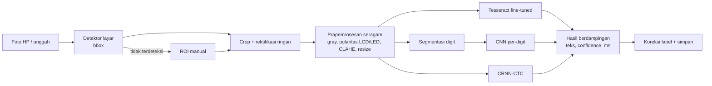

# PRD — Aplikasi OCR Angka Seven Segment (3 Engine: Tesseract Fine-Tuned, CNN Per-Digit, CRNN-CTC)

- **Tanggal:** 5 November 2026 (WIB)
- **Status:** Draft v0.1
- **Owner:** Ikhdan
- **Repo:** https://github.com/ikhdannizarmaulana/riset-seven-segment
- **Pelacak tiket:** [#12 Roadmap](https://github.com/ikhdannizarmaulana/riset-seven-segment/issues/12)
- **Konteks:** Aplikasi untuk skripsi *"Analisis Komparatif Tesseract Fine-Tuned, CNN Per-Digit, dan CRNN-CTC untuk Pengenalan Angka Seven Segment pada Variasi Kondisi Citra"*. Dokumen ini hanya membahas **pembuatan aplikasi sampai siap pakai**. Penulisan naskah skripsi berada di luar lingkup.

Penanda di dokumen ini:
- **[ASUMSI]**: keputusan sementara yang belum dikonfirmasi.
- **[ADA]**: sudah ada di repo dan sudah dijalankan.
- **[BARU]**: belum dikerjakan.

---

## 1. Latar belakang & masalah

Banyak alat ukur menampilkan angka dalam format seven segment (LCD atau LED): pompa BBM, meter listrik dan air, timbangan, tensimeter, termometer. Pencatatannya masih manual, misalnya difoto lalu diketik ulang, sehingga lambat dan rawan salah ketik.

OCR umum seperti Tesseract `eng` gagal membaca seven segment. Segmennya terputus-putus, titik desimalnya kecil, dan foto nyata sering silau, buram, miring, redup, atau terpotong bingkai.

Kondisi repo saat ini:

| Komponen | Status | Catatan |
|---|---|---|
| `pilot/`: generator data sintetis, baseline Tesseract, CNN per-digit, CRNN-CTC | [ADA] | Pada data sintetis: CNN EM 0,995, CRNN 0,988, Tesseract `7seg` 0,618. CNN masih memakai **bbox digit oracle**. Tesseract belum di-fine-tune sendiri. |
| `pipeline/`: penyatuan dataset publik dan generator degradasi | [ADA] | `pipeline/unified/manifest.csv`: 1.841 citra dari 6 sumber |
| `labeling/`: label ulang 858 foto pompa BBM (SachaIZADI) | [ADA] | 779 layak training. Label asli dataset **tidak konsisten**: umumnya desimal dibuang, tetapi 93 foto dinaikkan +1. |
| `app/`: FastAPI + HTML | [ADA] sebagian | Tesseract jalan. CNN dan CRNN masih **stub**. ROI dipilih **manual**. Belum ada mode evaluasi batch. |

**Masalah inti yang diselesaikan PRD ini:** belum ada aplikasi yang bisa menerima **foto asli dari HP** dan **otomatis** membaca angkanya dengan ketiga metode, lalu membandingkan akurasi dan waktunya dengan cara yang adil.

## 2. Tujuan & non-tujuan

### Tujuan
1. **G1 — End-to-end otomatis.** Foto dari HP diproses tanpa ROI manual: deteksi layar → prapemrosesan → OCR → angka. ROI manual tetap tersedia sebagai cadangan.
2. **G2 — Tiga engine aktif:** Tesseract fine-tuned, CNN per-digit dengan segmentasi digit nyata (bukan oracle), dan CRNN-CTC. Ketiganya bisa dipilih atau dijalankan bersamaan.
3. **G3 — Perbandingan adil.** Ketiga engine memakai crop layar, data latih, dan set uji yang sama, lalu diukur di mesin yang sama.
4. **G4 — Mode evaluasi batch.** Satu set uji dijalankan ke ketiga engine sekaligus. Keluarannya CSV prediksi, metrik per engine × kondisi citra, dan uji signifikansi.
5. **G5 — Siap demo.** Bisa dipakai dari HP lewat Wi-Fi yang sama, dengan dokumentasi instalasi yang bisa diikuti orang lain.
6. **G6 — Mudah dipakai orang awam.** Pengguna cukup **unggah foto**, sisanya otomatis. Tidak ada istilah teknis di layar utama, dan UI memakai **design system** yang konsisten (#14, #15).
7. **G7 — Cara kerja metode terlihat.** Selama proses, app menampilkan **langkah demi langkah** pemrosesan dan cara tiap metode membaca angka, memakai gambar antara yang asli dari foto itu (#16). Ini sekaligus bahan demo untuk dosen.

### Non-tujuan
- Penulisan naskah Bab 1–5.
- Aplikasi Android/iOS native dan inference di perangkat (on-device). Ini dicatat sebagai pengembangan lanjutan.
- Hardware IoT (ESP32-CAM, Raspberry Pi).
- Membaca meter jarum/analog atau meter roda mekanik (contoh: `12490ba7…` di dataset SachaIZADI).
- Login, multi-user, dan deploy publik di internet.

### Asumsi
- **[ASUMSI]** Data uji tidak ditambah. Set uji utama adalah 779 foto SachaIZADI yang layak (bagian test-nya), ditambah dataset publik lain sebagai uji eksternal. Sekitar 30–50 foto HP milik sendiri hanya dipakai sebagai uji asap end-to-end, bukan untuk angka utama.
- **[ASUMSI]** Training jalan lokal di MacBook Apple M4 (MPS). Colab hanya cadangan.
- **[ASUMSI]** Model dijalankan di app lewat ONNX Runtime (CPU), supaya app tidak bergantung pada PyTorch.
- **[ASUMSI]** Format angka yang didukung: 1–6 digit, opsional satu titik desimal, tanpa tanda minus.
- **[ASUMSI]** Repo tetap public untuk sementara. Masalah lisensi dataset SachaIZADI dibahas di Risiko R6.

## 3. Persona

| Persona | Kebutuhan |
|---|---|
| **Peneliti (tim repo)** | Melatih dan mengevaluasi tiga engine, melihat hasil per kondisi, dan mengulang eksperimen dengan satu perintah |
| **Penguji / dosen pembimbing** | Melihat demo live: foto diambil, ketiga engine membaca angka berdampingan beserta waktunya. Bisa mengecek bahwa angka di tabel bisa direproduksi. |
| **Pengguna lapangan** (ilustrasi pemakaian nyata, misalnya petugas pencatat meter) | Memotret layar alat dan langsung mendapat angka tanpa mengatur parameter |

## 4. User stories

- **US1** Sebagai pengguna lapangan, saya ingin memotret layar alat dan langsung mendapat angkanya, agar tidak perlu mengetik ulang.
- **US2** Sebagai peneliti, saya ingin layar terdeteksi otomatis dari foto, agar tidak perlu menggambar ROI satu per satu.
- **US3** Sebagai peneliti, saya ingin ketiga engine membaca foto yang sama sekaligus dan hasilnya tampil berdampingan, agar perbedaannya terlihat langsung.
- **US4** Sebagai peneliti, saya ingin melatih ulang setiap engine dengan satu perintah dan hasil yang deterministik (seed), agar eksperimen bisa direproduksi.
- **US5** Sebagai peneliti, saya ingin menjalankan evaluasi batch pada set uji dan mendapat tabel metrik per engine × kondisi plus uji McNemar, agar perbandingannya punya dasar statistik.
- **US6** Sebagai peneliti, saya ingin mengoreksi hasil yang salah dan menyimpannya beserta metadata, agar data sulit bisa ditambahkan ke data latih.
- **US7** Sebagai penguji, saya ingin membuka aplikasi dari HP di jaringan yang sama, agar demo bisa dilakukan di ruang sidang.
- **US8** Sebagai peneliti, saya ingin pembagian train/val/test dikunci dalam file, agar foto yang sama tidak bocor ke set uji.
- **US9** Sebagai pengguna awam, saya ingin cukup mengunggah foto tanpa mengisi parameter apa pun, agar bisa langsung mendapat angka tanpa paham istilah teknis.
- **US10** Sebagai penguji/dosen, saya ingin melihat langkah demi langkah bagaimana foto diproses dan bagaimana tiap metode membaca angka, agar cara kerja metode bisa dipahami secara visual.
- **US11** Sebagai pengguna, saya ingin tampilan yang rapi dan konsisten di HP maupun laptop, agar app nyaman dipakai dan meyakinkan saat demo.

## 5. Acceptance criteria (Given / When / Then)

**US1 / US2 — Deteksi otomatis + baca**
- Given foto 2048×1152 yang memperlihatkan layar pompa BBM, When diunggah tanpa ROI, Then app mengembalikan bbox layar, crop, dan angka dari engine terpilih dalam ≤ 2 detik di laptop **[ASUMSI target]**.
- Given foto tanpa layar seven segment (misalnya foto meja), When diunggah, Then app menampilkan "Layar tidak terdeteksi" dan menawarkan ROI manual, bukan angka acak.
- Given deteksi otomatis meleset, When pengguna menggambar ROI manual, Then ROI manual dipakai dan tercatat `roi_source=manual`.

**US3 — Bandingkan tiga engine**
- Given ketiga model tersedia, When pengguna memilih "Semua engine", Then tampil tiga baris (engine, teks, confidence, ms), dan hasil yang sama dengan label (bila label diisi) ditandai benar.
- Given salah satu file model tidak ada, When halaman dibuka, Then engine itu tampil disabled beserta alasannya dan dua engine lain tetap berjalan.

**US4 — Training reproducible**
- Given `data/splits/*.csv` dan seed yang sama, When `make train-cnn` (atau setara) dijalankan dua kali, Then metrik validasi berbeda ≤ 0,5 poin persen dan file ONNX tersimpan di `app/models/`.
- Given model hasil PyTorch, When diekspor ke ONNX, Then prediksi ONNX dan PyTorch identik pada ≥ 99% citra validasi.

**US5 — Evaluasi batch**
- Given split test, When `python -m eval.run --split test --engines all` dijalankan, Then dihasilkan `results/<timestamp>/predictions.csv` (satu baris per citra × engine) dan `metrics.csv` (EM, CER, akurasi digit, akurasi titik desimal, latency mean/median per engine × kondisi), ditambah tabel McNemar antar-pasangan engine.
- Given citra yang labelnya mengandung `?`, When evaluasi berjalan, Then citra itu tidak dihitung di metrik utama dan dilaporkan terpisah sebagai `excluded_unreadable`.

**US6 — Koreksi & simpan**
- Given hasil OCR salah, When pengguna mengisi label benar lalu menyimpan, Then baris baru tersimpan di `labels.csv` dengan `correct=false` dan gambar asli + crop tersimpan.
- Given label kosong atau mengandung karakter selain `0-9` dan `.`, When disimpan, Then app menolak dengan pesan validasi.

**US7 — Akses dari HP**
- Given laptop dan HP di Wi-Fi yang sama, When HP membuka `http://<IP-laptop>:8000`, Then tombol "Foto" membuka kamera belakang dan alur US1 berjalan.

**US9 — Unggah saja, sisanya otomatis (#14)**
- Given pengguna baru membuka halaman utama, When memilih satu foto, Then angka hasil ketiga metode tampil tanpa pengguna mengisi field apa pun (≤ 2 ketukan).
- Given halaman utama, When diperiksa, Then tidak ada istilah ROI, CLAHE, threshold, Otsu, engine, preprocessing, atau labels.csv. Semua parameter itu hanya ada di "Mode peneliti".
- Given layar tidak terdeteksi, When proses berjalan, Then muncul kotak "area layar" yang bisa diseret, bukan form koordinat.

**US10 — Visualisasi proses step-by-step (#16)**
- Given foto diunggah, When diproses, Then tampil stepper berisi langkah: foto asli → deteksi layar → potong → grayscale → samakan terang-gelap → kontras (CLAHE) → threshold → cara kerja Tesseract / CNN (potongan digit + probabilitas) / CRNN (prediksi per kolom → CTC) → hasil. Setiap langkah memakai gambar asli dari foto itu dan menampilkan waktunya.
- Given mode presentasi, When menekan ←/→ (laptop) atau swipe (HP), Then langkah berpindah maju/mundur.
- Given satu metode belum tersedia, When stepper sampai di langkahnya, Then tampil "Metode belum tersedia" beserta alasan, dan langkah lain tetap jalan.

**US11 — Design system (#15)**
- Given semua halaman app, When diperiksa, Then komponen dan warna berasal dari satu design system dan token yang sama, skor Lighthouse Accessibility ≥ 90 (mobile), dan app tetap jalan tanpa internet.

**US8 — Split terkunci**
- Given manifest final, When skrip split dijalankan, Then setiap `split_group` hanya muncul di satu split, proporsi kualitas HQ/MQ/LQ di train/val/test berbeda ≤ 5 poin persen, dan file split di-commit.

## 6. Alur utama

1. Pengguna memotret atau mengunggah foto.
2. Detektor layar mengembalikan bbox. Kalau confidence di bawah ambang, app meminta ROI manual.
3. Crop diproses dengan prapemrosesan yang **sama** untuk ketiga engine. Hanya ukuran input akhir yang menyesuaikan tiap model.
4. Engine dijalankan, satu atau semuanya, dan waktu tiap tahap diukur terpisah: deteksi, prapemrosesan, OCR.
5. Hasil ditampilkan. Pengguna bisa mengoreksi dan menyimpan.
6. Untuk evaluasi, langkah 2–4 dijalankan offline pada satu split lewat CLI.

## 7. Kebutuhan fungsional (dipetakan ke tiket)

| ID | Modul | Isi | Tiket (GitHub Issue) |
|---|---|---|---|
| F0 | Dataset final & split | Gabungkan `labeling/labels_final.csv` ke manifest, tentukan split train/val/test per `split_group`, dan kunci di `data/splits/` | Tahap 0 (#1) |
| F1 | Anotasi bbox layar | Mode anotasi ROI di app untuk folder foto, target ≥ 300 foto berbox (prioritas SachaIZADI, ditambah sebagian dataset publik) | Tahap 1a (#2) |
| F2 | Detektor layar | Baseline OpenCV (kontur/warna) **dan** detektor ringan terlatih **[ASUMSI: YOLOv8n/YOLO11n via ultralytics, lisensi AGPL-3.0, aman untuk repo akademik public]**. Pilih yang terbaik di val, ekspor ONNX. | Tahap 1b (#3) |
| F3 | Prapemrosesan seragam + segmentasi digit | Satu modul `ocr_core/preprocess.py` untuk pilot dan app. Deteksi polaritas LCD/LED yang andal, CLAHE, dan segmentasi digit (proyeksi kolom/kontur) untuk CNN. | Tahap 2a (#4) |
| F4 | Tesseract fine-tuned | `tesstrain` (lstmtraining) mulai dari `eng` dan `ssd`, data sintetis + crop asli train, hasil `sevenseg_ft.traineddata` | Tahap 2b (#5) |
| F5 | CNN per-digit | Latih ulang di sintetis + crop digit asli, input dari segmentasi F3 (bukan oracle), ekspor ONNX | Tahap 2c (#6) |
| F6 | CRNN-CTC | Latih ulang di sintetis + crop asli, augmentasi kondisi, ekspor ONNX | Tahap 2d (#7) |
| F7 | Integrasi engine di app | Isi `ocr/model_engines.py` (ONNX Runtime), pipeline otomatis `/api/predict` (deteksi → crop → OCR), opsi `engine=all` | Tahap 3 (#8) |
| F8 | UI | Alur satu layar untuk HP: foto → hasil 3 engine berdampingan → koreksi → simpan. Overlay bbox. Fallback ROI manual. | Tahap 4 (#9) |
| F8a | Design system | Satu design system + design token: **Web Awesome Core** (MIT, penerus Shoelace; diputuskan 5 Nov 2026), di-host lokal agar jalan offline, mobile-first | Tahap 4a (#15) |
| F8b | Alur sederhana | Unggah foto saja; deteksi, prapemrosesan, dan ketiga metode berjalan otomatis; metadata otomatis; istilah teknis dipindah ke "Mode peneliti" | Tahap 4b (#14) |
| F8c | Visualisasi proses | `/api/predict?explain=1` mengembalikan gambar antara + waktu per langkah. Stepper auto-play + mode presentasi. Visual khusus CNN (potongan digit + probabilitas) dan CRNN (prediksi per kolom → CTC). | Tahap 4c (#16) |
| F9 | Evaluasi batch | CLI `eval/run.py` dan halaman `/eval`. Metrik EM, CER, akurasi digit, akurasi titik desimal, latency. Per kondisi (`conditions` dari label) dan per kualitas HQ/MQ/LQ. Uji McNemar. | Tahap 5 (#10) |
| F10 | Uji end-to-end & dokumentasi | Uji asap 30–50 foto HP sendiri, pytest dan CI GitHub Actions, README pemakaian, skrip demo | Tahap 6 (#11) |

## 8. Kebutuhan non-fungsional

- **Reproducibility:** semua training memakai seed tetap, versi paket dikunci (`requirements.txt`), dan perintah training/evaluasi tertulis di README. Hasil evaluasi menyimpan hash commit dan hash model.
- **Kinerja [ASUMSI target]:** satu foto, satu engine, total ≤ 2 detik di laptop M4 (CPU). Engine `all` ≤ 4 detik.
- **Keadilan perbandingan:** crop dan prapemrosesan identik, split identik, latency diukur di mesin dan thread yang sama (1 thread, seperti di pilot).
- **Portabilitas:** app jalan di macOS/Linux dengan Python 3.12 dan Tesseract 5.x. Model ONNX ≤ 50 MB total.
- **Data:** foto mentah dan dataset publik tidak di-commit ke repo. Yang di-commit hanya manifest, label, split, dan model kecil.

## 9. Metrik sukses

| Jenis | Metrik | Target |
|---|---|---|
| North star | Exact match end-to-end (foto → angka) engine terbaik pada split test SachaIZADI | ≥ 85% **[ASUMSI]** |
| Detektor | Recall layar pada IoU ≥ 0,5 di split test | ≥ 95% **[ASUMSI]** |
| Per engine | EM, CER, akurasi digit, akurasi titik desimal, per kondisi (glare/blur/cut_off/dim/clean) | Dilaporkan semua, tanpa target. Ini yang dibandingkan. |
| Guardrail | Latency per foto (laptop, CPU) | ≤ 2 detik per engine |
| Guardrail | Selisih prediksi PyTorch vs ONNX | ≤ 1% citra |
| Guardrail | Kebocoran split (grup yang sama di dua split) | 0 |
| Uji eksternal | EM di dataset publik lain (tensimeter `chakibmed`, LED `cramatsu`, LCD meter `2005JIAZHI`) | Dilaporkan, tanpa target. Mengukur generalisasi. |

Catatan: `cramatsu` tidak punya label titik desimal, jadi metriknya dihitung tanpa titik.

## 10. Risiko & dependensi

| # | Risiko | Dampak | Mitigasi |
|---|---|---|---|
| R1 | Foto nyata hanya dari satu domain (LCD pompa BBM). Model bisa overfit ke domain ini. | Klaim generalisasi lemah | Uji eksternal di 3 dataset publik, augmentasi sintetis, laporkan terpisah |
| R2 | Segmentasi digit untuk CNN gagal di foto silau atau terpotong | EM CNN jauh turun dibanding pilot (oracle) | Laporkan galat segmentasi terpisah, coba dua metode segmentasi, bandingkan dengan oracle bila bbox digit tersedia |
| R3 | Fine-tuning Tesseract (`tesstrain`) rumit di macOS | Tahap 2b molor | Jalankan di Docker/Linux (bisa di VPS), batasi iterasi, dan tetap laporkan `7seg`/`ssd` publik sebagai baseline |
| R4 | Anotasi bbox makan waktu | Tahap 1 molor | Mode anotasi cepat di app (drag + Enter), target minimum 300 foto, baseline OpenCV sebagai cadangan |
| R5 | 74 foto masih tidak terbaca dan 3 foto berbeda jauh dari label asli | Bias set uji | Keluarkan dari metrik utama, laporkan sebagai `excluded_unreadable`, verifikasi 3 foto berbeda secara manual |
| R6 | **Lisensi:** SachaIZADI tidak punya LICENSE (semua hak dilindungi). `2005JIAZHI` CC BY-NC. Repo saat ini public dan memuat label turunan SachaIZADI. | Masalah hak cipta | Foto tidak di-commit. Cantumkan atribusi. Pertimbangkan memindahkan label ke repo private atau minta izin pemilik. Keputusan ditunda (lihat Pertanyaan Terbuka). |
| R7 | Lisensi ultralytics (AGPL-3.0) | Membatasi pemakaian komersial | Aman untuk riset public. Alternatif: detektor OpenCV atau SSD-MobileNet. |
| R8 | Latency Tesseract terbebani subprocess `pytesseract` | Perbandingan waktu tidak adil | Ukur juga lewat `tesserocr` (API C) atau laporkan overhead terpisah |

**Dependensi:** Tesseract 5.x + `tesstrain`, PyTorch (MPS) untuk training, `onnxruntime` untuk app, ultralytics **[ASUMSI]**, dataset publik di `data/` (unduh ulang mengikuti `strategi_data.md`).

## 11. Pertanyaan terbuka

1. Detektor: cukup baseline OpenCV, atau wajib detektor terlatih (YOLO)? Usulan default: dua-duanya dicoba, dan yang terbaik di val dipakai di app.
2. Apakah perlu bbox **per digit** (untuk mengukur galat segmentasi CNN vs oracle), atau cukup bbox layar? Usulan default: cukup bbox layar. Bbox digit dibuat untuk ±100 foto saja bila waktu cukup.
3. Lisensi SachaIZADI: minta izin pemilik, atau pindahkan `labeling/` ke repo private?
4. Angka negatif dan tanda minus (ada di dataset `7SEG_OCR`) termasuk lingkup atau tidak? Usulan default: tidak.
5. Siapa mengerjakan tahap mana (Ikhdan / Hilma)?

## 12. Referensi

Internal (di repo):
- `survei_literatur_seven_segment_AMR.md`: survei 22 paper (2018–2026).
- `strategi_data.md`: verifikasi dataset publik dan lisensinya.
- `pilot/README_pilot.md`: hasil pilot (sintetis), keterbatasan, dan rekomendasi.
- `app/README_app.md`: arsitektur MVP app.
- `labeling/labels_final.csv`: label final 858 foto.

Literatur utama (tautan dari survei di repo):
- Laroca dkk., *Convolutional Neural Networks for Automatic Meter Reading*, J. Electronic Imaging 2019: pipeline deteksi counter + CRNN/per-digit.
- Laroca dkk., *Towards Image-based AMR in Unconstrained Scenarios*, IEEE Access 2021: deteksi + rektifikasi + OCR end-to-end.
- Finnegan dkk., *Automated method for detecting and reading seven-segment digits…*, J. Med. Eng. & Tech. 2019: latih di digit sintetis, uji foto nyata.
- *CNN-Based LCD Transcription of Blood Pressure From a Mobile Phone Camera* (Frontiers): CNN vs Tesseract per kualitas foto.
- *Detecting and recognizing seven segment digits using a deep learning approach*, ITM Web Conf 63 (2024): model STR pretrained tanpa fine-tune hanya 56,97%.
- *Enhancing Water Meter Digit Recognition Using YOLO-OCR*, ETASR 16(3) 2026, Telkom Univ. Purwokerto: riset Indonesia serupa (YOLOv8 + PP-OCR).
- Shreeshrii, `tessdata_ssd` (GitHub): traineddata seven segment untuk Tesseract.
