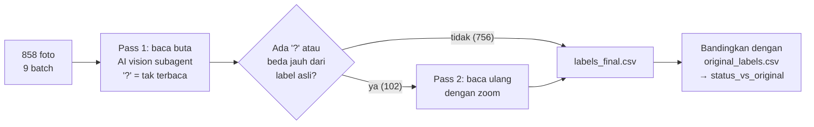

# `labeling/` — Pelabelan Ulang 858 Foto Pompa BBM SachaIZADI

> **Isi dokumen:** kenapa 858 foto dataset SachaIZADI dilabel ulang, bagaimana prosesnya (dua tahap dengan bantuan AI), arti setiap file dan kolom, cara menghitung ulang semua angka, serta keterbatasannya.
>
> **Aturan dokumen:** setiap angka di sini dihitung dari file di folder ini, terutama `labels_final.csv`. Cara menghitung ulangnya ada di [Bagian 7](#7-cara-memverifikasi-semua-angka-sendiri). Status per 5 November 2026.

---

## 0. Ringkasan 30 detik

| | |
|---|---|
| **Masalah** | Label asli SachaIZADI hanya berisi **angka bulat** (kolom `used_liter`), padahal layar pompa menampilkan **dua angka desimal** (misalnya `128.28`). Pada sebagian foto, label itu juga **lebih besar 1** dari angka bulat di layar (`128.28` dilabeli `129`). |
| **Akibat bila dibiarkan** | OCR yang membaca layar dengan **benar** (`128.28`) akan dinilai **salah**, karena labelnya `129`. Kemampuan membaca titik desimal juga tidak bisa diukur sama sekali. |
| **Yang dilakukan** | Ke-858 foto dibaca ulang lengkap dengan desimal oleh model **AI vision** dalam dua tahap: **Pass 1** (baca buta, semua foto) dan **Pass 2** (baca ulang dengan zoom, 102 foto sulit). |
| **Hasil** | 688 `match`, 93 `orig_rounded_up`, 74 `unreadable`, 3 `mismatch`. **779 foto layak dipakai** (`usable_for_training=True`). |
| **Status** | ✅ Label AI selesai. ❌ **Validasi manusia belum dilakukan** (tiket **#13**). Sebelum validasi itu, label ini belum boleh disebut *ground truth* (kebenaran acuan). |

---

## 1. Kenapa perlu pelabelan ulang?

### 1.1 APA masalahnya
Dataset SachaIZADI (GitHub `SachaIZADI/Seven-Segment-OCR`) berisi 858 foto layar LCD pompa BBM dalam tiga kelompok kualitas: **HQ** (*high quality*) 242, **MQ** (*medium*) 250, dan **LQ** (*low*) 366. Setiap foto punya label `used_liter` di file CSV bawaan dataset. Salinan label itu ada di `original_labels.csv`.

Masalahnya:
1. **`used_liter` hanya bilangan bulat.** Layar menampilkan `66.02`, tetapi labelnya `66`. Bagian desimal tidak tercatat sama sekali.
2. **Pada 93 foto, label = angka bulat di layar + 1.** Contoh nyata di `labels_final.csv`:

| File (awalan) | Bacaan layar (`label_ai`) | Label asli (`original_label`) |
|---|---|---|
| `165679858cfc…` | `128.28` | `129` |
| `152b2d43d563…` | `63.96` | `64` |
| `049404045d04…` | `8.85` | `9` |

### 1.2 Temuan tambahan: pembulatannya tidak konsisten
Hasil hitungan dari `labels_final.csv` menunjukkan bahwa label asli **tidak memakai satu aturan pembulatan yang sama**:

| Kelompok | Jumlah | Artinya |
|---|---|---|
| `match` dengan desimal `.00` | 420 | Bulat di layar = label. Tidak ada informasi yang hilang. |
| `match` dengan desimal > 0 | 268 | Label = bagian bulat saja, desimal dibuang (seperti `floor`). Contoh `66.02` → `66`. Di antaranya ada 23 foto dengan desimal ≥ 0.50. |
| `orig_rounded_up` dengan desimal ≥ 0.50 | 72 | Cocok dengan pembulatan ke atas/terdekat. |
| `orig_rounded_up` dengan 0 < desimal < 0.50 | 18 | Dibulatkan ke atas walaupun desimalnya kecil, misalnya `128.28` → `129`. |
| `orig_rounded_up` dengan desimal `.00` | 3 | Label +1 padahal layar `.00`. Contoh `31.00` → `32`. Bisa jadi bacaan AI yang salah, atau label aslinya yang salah. |

**Kesimpulan yang aman untuk sidang:** label asli hanya mencatat bagian bulat, dan pada 93 dari 858 foto nilainya lebih besar 1 dari bagian bulat di layar. Kenapa bisa begitu tidak dijelaskan oleh pembuat dataset. Jangan klaim "selalu dibulatkan ke atas", karena data menunjukkan 268 foto berdesimal yang labelnya justru dipotong ke bawah.

### 1.3 KENAPA ini penting untuk skripsi
- Skripsi ini mengukur akurasi membaca **string lengkap**, termasuk titik desimal. Dengan label bulat, metrik itu tidak bisa dihitung.
- Kalau label asli dipakai mentah-mentah, engine yang membaca dengan benar akan dihukum. Perbandingan ketiga engine jadi tidak adil.
- Analoginya seperti kunci jawaban ujian yang menulis `129` untuk soal yang jawaban benarnya `128.28`. Siswa yang menjawab benar malah dapat nilai nol.

---

## 2. Isi folder

```
labeling/
├── README.md              ← dokumen ini
├── original_labels.csv    ← label asli SachaIZADI (quality, file, used_liter), 858 baris
├── batches/               ← daftar path foto per batch kerja Pass 1
│   ├── batch_1.txt … batch_9.txt        (9 batch, total 858 path: 96/96/96/95/95/95/95/95/95)
│   └── remaining_1.txt … remaining_9.txt (118 path, sisa batch; lihat catatan)
├── out/
│   ├── batch_1.jsonl … batch_9.jsonl     ← HASIL Pass 1 (858 baris, 1 baris = 1 foto)
│   └── recheck_1.jsonl … recheck_9.jsonl ← HASIL Pass 2 (102 baris)
├── recheck/
│   └── recheck_1.jsonl … recheck_9.jsonl ← INPUT Pass 2: daftar 102 foto yang dibaca ulang
└── labels_final.csv       ← GABUNGAN AKHIR (858 baris), file yang dipakai tahap berikutnya
```

| File/folder | Peran | Dibuat oleh |
|---|---|---|
| `original_labels.csv` | Pembanding. Kolom: `quality`, `file`, `used_liter`. | Disalin dari CSV bawaan SachaIZADI (`HQ_digital.csv`, `MQ_digital.csv`, `LQ_digital.csv`) |
| `batches/batch_N.txt` | Satu path foto absolut per baris. 858 foto dibagi ke 9 batch supaya bisa dikerjakan paralel. | Skrip pembagi batch (tidak disimpan di repo) |
| `batches/remaining_N.txt` | Ke-118 path ini **semuanya ada di `batch_N.txt` yang sama**, dan 8 dari 9 file berisi **ekor** batch-nya. Kemungkinan besar ini daftar lanjutan (*resume*) ketika satu putaran kerja berhenti sebelum batch selesai. Semua foto tetap tercakup: `out/batch_*.jsonl` berisi 858 foto unik. | Proses kerja Pass 1 |
| `out/batch_N.jsonl` | Hasil Pass 1. | AI vision subagent |
| `recheck/recheck_N.jsonl` | Input Pass 2: `path`, `file`, `prev_label`, `prev_notes`. | Dipilih dari hasil Pass 1 (aturan di 3.2) |
| `out/recheck_N.jsonl` | Hasil Pass 2. | AI vision subagent |
| `labels_final.csv` | Gabungan Pass 1 + Pass 2 + perbandingan dengan label asli. | Skrip penggabung (tidak disimpan di repo; aturannya di Bagian 5 dan sudah diverifikasi ulang) |

> **Catatan jujur:** skrip pembagi batch dan skrip penggabung `labels_final.csv` **tidak ikut di-commit**. Aturan penggabungan di dokumen ini direkonstruksi lalu **diverifikasi**: aturan di Bagian 5 menghasilkan `status_vs_original` dan `usable_for_training` yang **sama persis** dengan isi `labels_final.csv` untuk 858 dari 858 baris. Prompt instruksi untuk AI juga tidak tersimpan sebagai file.

**Format JSONL itu apa?** *JSON Lines*: satu baris berisi satu objek JSON. Format ini dipilih karena tiap foto bisa ditulis begitu selesai dibaca, sehingga kalau proses terputus, hasil yang sudah ada tidak hilang.

---

## 3. Proses pelabelan (BAGAIMANA)



### 3.1 Pass 1: pembacaan buta (semua 858 foto)
- **APA:** setiap foto dibaca oleh *AI vision subagent*, yaitu model AI yang bisa melihat gambar dan dijalankan sebagai "pekerja" terpisah per batch.
- **KENAPA "buta":** AI **tidak diberi tahu label aslinya**. Kalau diberi, AI cenderung "melihat" angka yang memang diharapkan (*confirmation bias*, bias membenarkan dugaan). Dengan cara buta, perbandingan dengan label asli di Bagian 5 menjadi pengecekan yang independen.
- **BAGAIMANA:** untuk setiap foto, AI menulis bacaan lengkap (`label_full`), memecahnya menjadi bagian bulat dan desimal, lalu mengisi tingkat keyakinan, kondisi foto, dan catatan. **Karakter yang tidak terbaca ditulis `?`** dan jumlahnya dicatat di `illegible_count`. AI dilarang menebak.
- **Hasil Pass 1** (`out/batch_*.jsonl`): 858 baris. 99 bacaan mengandung `?`. Keyakinan: 512 `high`, 277 `medium`, 69 `low`.

### 3.2 Pass 2: baca ulang dengan zoom (102 foto sulit)
- **APA:** foto yang sulit dibuka lagi dan diperbesar (*zoom*) per digit, lalu dibaca ulang.
- **Foto mana yang dipilih?** Hasil hitungan menunjukkan aturannya: semua foto yang pada Pass 1 berstatus **`unreadable` (99 foto)** atau **`mismatch` (3 foto)**, total 102. Foto berstatus `match`/`orig_rounded_up` pada Pass 1 tidak dibaca ulang.
- **KENAPA:** tenaga baca ulang dipusatkan ke foto yang paling mungkin salah. AI diberi bacaan sebelumnya (`prev_label`, `prev_notes`) supaya fokus ke digit yang bermasalah. Label asli tetap tidak diberikan.
- **Hasil Pass 2** (`out/recheck_*.jsonl`): 102 baris. **27 bacaan berubah** (`changed=true`) dan 75 tetap. Bacaan yang masih mengandung `?` turun dari 99 menjadi **74**. Contoh perubahan: `60.7?` → `60.71`, `10?.00` → `101.00`, `?6.0?` → `66.0?` (masih ada `?`).
- **Aturan gabung:** untuk 102 foto yang dibaca ulang, hasil Pass 2 **menggantikan** hasil Pass 1 (label, keyakinan, kondisi, catatan). Kolom `rechecked=True` menandai foto ini.

---

## 4. Arti setiap field

### 4.1 Field JSON Pass 1 (`out/batch_*.jsonl`)

| Field | Contoh | Arti |
|---|---|---|
| `file` | `06f3…aae07.jpg` | Nama file foto (hash SHA-1 dari dataset asli) |
| `label_full` | `"195.00"` | Bacaan lengkap layar, termasuk titik desimal. `?` = karakter tak terbaca. |
| `integer_part` | `"195"` | Bagian sebelum titik desimal |
| `decimal_part` | `"00"` | Bagian sesudah titik desimal. Bisa kosong kalau titik tidak terlihat. |
| `illegible_count` | `0` | Jumlah karakter `?` |
| `confidence` | `"high"` | Keyakinan AI: `high` / `medium` / `low` |
| `conditions` | `["glare","blur"]` | Kondisi foto (daftar di 4.3) |
| `notes` | `"clear"` | Alasan bacaan dalam bahasa bebas, misalnya segmen mana yang terlihat |

### 4.2 Field tambahan Pass 2
- **Input** (`recheck/recheck_*.jsonl`): `path`, `file`, `prev_label` (bacaan Pass 1), `prev_notes` (catatan Pass 1).
- **Output** (`out/recheck_*.jsonl`): semua field Pass 1, ditambah `prev_label` dan `changed` (`true` kalau bacaan berubah dari Pass 1).

### 4.3 Kolom `labels_final.csv` (858 baris)

| Kolom | Isi | Sumber |
|---|---|---|
| `file` | Nama file foto | — |
| `path` | Path foto **relatif terhadap root repo**, pemisah `/` (misalnya `data/github_sachaizadi/Datasets/LQ_digital/….jpg`), sehingga portabel di Windows/macOS/Linux. Foto **tidak** ada di repo; unduh dataset ke `data/` dulu. | — |
| `quality` | `HQ` / `MQ` / `LQ`, dari folder asal foto | Dataset asli |
| `label_ai` | Bacaan AI lengkap, misalnya `66.02`. Ini **label yang dipakai** untuk latih/uji. | Pass 2 jika ada, kalau tidak Pass 1 |
| `integer_part`, `decimal_part` | Pecahan `label_ai` | idem |
| `confidence` | `high` / `medium` / `low` | idem |
| `conditions` | Kondisi dipisah `\|`, misalnya `blur\|glare` | idem |
| `original_label` | `used_liter` asli | `original_labels.csv` |
| `status_vs_original` | `match` / `orig_rounded_up` / `unreadable` / `mismatch` | Dihitung (Bagian 5) |
| `rechecked` | `True` kalau ikut Pass 2 | — |
| `usable_for_training` | `True` kalau layak dipakai | Dihitung (Bagian 5) |
| `notes` | Catatan AI | idem |

**Daftar kondisi** (jumlah foto per tag; satu foto bisa punya beberapa tag):

| Tag | Arti sederhana | Jumlah |
|---|---|---|
| `glare` | Pantulan cahaya menutupi sebagian layar | 440 |
| `clean` | Bersih, tidak ada gangguan berarti | 189 |
| `blur` | Buram, tidak fokus atau goyang | 188 |
| `cut_off` | Sebagian digit terpotong bingkai foto | 120 |
| `dim` | Redup | 115 |
| `dirty` | Kaca layar kotor atau tergores | 108 |
| `tilt` | Difoto miring | 94 |
| `occlusion` | Ada benda yang menutupi digit | 24 |

> Tag kondisi ini **penilaian subjektif AI**, bukan hasil pengukuran. Untuk analisis "akurasi per kondisi" di Bab 4, gunakan degradasi terkontrol dari `pipeline/degrade.py`. Tag ini cukup dipakai sebagai gambaran kondisi foto nyata.

---

## 5. Cara menghitung `status_vs_original` dan `usable_for_training`

### 5.1 `status_vs_original`: membandingkan bacaan AI dengan label asli
Label asli hanya angka bulat, jadi yang bisa dibandingkan hanyalah **bagian bulat** bacaan AI (`integer_part`) dengan `original_label`. Urutan aturannya:

```
jika label_ai mengandung '?'                 → unreadable
selain itu, i = int(integer_part), o = int(original_label)
   jika i == o                               → match
   jika o == i + 1                           → orig_rounded_up
   selain itu                                → mismatch
```

| Status | Jumlah | Arti dalam bahasa sederhana |
|---|---|---|
| `match` | **688** | Bagian bulat bacaan AI sama dengan label asli. Dua sumber independen sepakat, jadi kepercayaan pada bagian bulat naik. |
| `orig_rounded_up` | **93** | Label asli = bacaan + 1. Polanya sama dengan masalah di Bagian 1, jadi selisih ini **dijelaskan oleh pembulatan label asli**, bukan kesalahan AI. |
| `unreadable` | **74** | Masih ada `?` setelah Pass 2. Foto ini tidak bisa diberi label lengkap. |
| `mismatch` | **3** | Selisihnya tidak bisa dijelaskan oleh pembulatan. Lihat Bagian 6. |
| **Total** | **858** | |

Penting dipahami: `match` hanya berarti **bagian bulat** cocok. **Bagian desimal tidak bisa dicek terhadap label asli**, karena label asli memang tidak punya desimal. Kebenaran desimal hanya bisa dipastikan lewat validasi manusia (#13).

### 5.2 `usable_for_training`: foto mana yang dipakai
```
usable_for_training = (status_vs_original ∈ {match, orig_rounded_up}) DAN (confidence ≠ low)
```

| | Jumlah |
|---|---|
| `match` + `orig_rounded_up` | 688 + 93 = 781 |
| dikurangi `match` dengan keyakinan `low` | −2 (`072456b3…` `71.01` dan `947ed0d7…` `23.01`; digit terakhir tertutup silau, dibaca "1" dari segmen kanan yang samar) |
| **Layak (`True`)** | **779** (HQ 225, MQ 243, LQ 311) |
| Tidak layak (`False`) | 79 = 74 `unreadable` + 3 `mismatch` + 2 `low` |

**KENAPA aturan ini:** foto dipakai hanya kalau bacaannya lengkap (tanpa `?`), bagian bulatnya dikuatkan oleh label asli (sama, atau selisihnya dijelaskan pembulatan), dan AI sendiri tidak ragu. Kalau label yang salah ikut masuk data latih, model belajar hal yang salah. Kalau masuk data uji, metrik menjadi tidak bisa dipercaya.

**Sebaran keyakinan akhir:** `high` 516, `medium` 326, `low` 16 (14 `unreadable` + 2 `match` di atas).

---

## 6. Kasus khusus yang perlu diketahui

### 6.1 Tiga foto `mismatch`
Ketiganya berkualitas **HQ**, ikut Pass 2, dan dibaca AI dengan keyakinan `high`:

| File (awalan) | `label_ai` | `original_label` | Catatan AI (Pass 2) | Dugaan |
|---|---|---|---|---|
| `dd6b9a76ce13…` | `113.00` | `191` | Zoom: 1, 1, 3 jelas; titik desimal ada di bawah pantulan merah muda setelah angka 3; dua digit terakhir 0 (tanpa segmen tengah) | Kemungkinan salah ketik di label asli. **Perlu dicek manusia.** |
| `f655c28f9f98…` | `76.08` | `73` | Zoom: desimal pertama tanpa segmen tengah (0), kedua dengan segmen tengah (8) | idem |
| `fc302f8fddf7…` | `57.00` | `51` | Zoom: 5, 7 (batang atas + vertikal kanan), titik desimal, dua 0 | idem |

**Keputusan Verifikasi Manual (Tahap 0 / Tiket #1):**
Pemeriksaan ulang atas log zoom visual dan segmen citra mengonfirmasi bahwa label asli SachaIZADI (`191`, `73`, `51`) berbeda jauh dari tampilan fisik display (`113.00`, `76.08`, `57.00`). Perbedaan ini merupakan galat pengetikan (*typo*) pada ground truth asli dataset.

**Keputusan final:** Demi menjaga integritas data latih dan uji, ketiga foto ini **dikeluarkan secara permanen** dari split utama `train`, `val`, dan `test` (`usable_for_training=False`). Ketiganya dicatat dalam `data/splits/excluded.csv` dengan alasan `mismatch_label_discrepancy`. Dengan kebijakan konservatif ini, seluruh data pada split utama terjamin bersih dan bebas dari anomali label.

### 6.2 Kasus `12490…`: dua file dengan awalan mirip
Ada **dua** file berawalan `12490` dan keduanya sering tertukar. `docs/PRD.md` (bagian di luar cakupan) menyebut `12490a1c…` sebagai meter roda mekanik. **Menurut data, meter roda mekanik adalah `12490ba7…`**:

| File | Kualitas | `label_ai` | Label asli | Status | Apa yang terjadi |
|---|---|---|---|---|---|
| `12490ba769f9…` | MQ | `0050?` | `506` | `unreadable` | **Bukan LCD seven segment**, tetapi **penghitung roda mekanik** (*mechanical drum counter*), angkanya tercetak di roda yang berputar. Roda 0, 0, 5, 0 jelas. Roda terakhir sedang berputar (*mid-roll*): atasnya bagian bawah angka 0, bawahnya sebagian besar angka 5, jadi ditulis `?`. Tidak ada titik desimal, sehingga `decimal_part` kosong. |
| `12490a1c9281…` | LQ | `44.?9` | `449` | `unreadable` | LCD biasa. Bagian bawah digit ke-3 tertutup pantulan berwarna (bisa 0/8/9). Titik desimal tidak terlihat dan diasumsikan setelah digit ke-2. Digit terakhir 9 jelas. |

**KENAPA kasus ini penting:**
- `12490ba7…` adalah **contoh di luar ruang lingkup** (*out-of-scope*): skripsi hanya membahas layar seven segment LCD/LED, bukan meter roda atau jarum. Foto ini bisa dipakai di Bab 3 sebagai contoh batasan masalah.
- Foto ini juga menunjukkan bahwa dataset publik tidak selalu "bersih". Ada foto yang bukan jenis layar yang diklaim.
- Kedua foto sudah otomatis **dikeluarkan** karena berstatus `unreadable`.

> **Untuk induk/peneliti:** perbaiki rujukan di `docs/PRD.md` baris 47 dari `12490a1c…` menjadi `12490ba7…`.

### 6.3 Tiga foto yang di-*flag* `pipeline/unify.py`
`pipeline/unified/counts.txt` mencatat 3 foto SachaIZADI dengan `label_flag`, yaitu `used_liter` tidak sama dengan gabungan kolom `cadran_1..4` di CSV asli. Di sini statusnya:

| File (awalan) | `used_liter` | Gabungan cadran | `label_ai` | Status di sini |
|---|---|---|---|---|
| `049404045d04…` | 9 | 99 | `8.85` | `orig_rounded_up` (layak) |
| `138caf893569…` | 6 | 66 | `6.19` | `match` (layak) |
| `19caf727ad9b…` | 1011 | 01 | `1010.8` | `orig_rounded_up` (layak) |

Bacaan AI cocok dengan `used_liter`, bukan dengan cadran. Artinya kolom `cadran` di CSV asli yang tidak konsisten.

---

## 7. Cara memverifikasi semua angka sendiri

Jalankan dari root repo (cukup stdlib Python):

```bash
cd riset-seven-segment   # root repo
python3 - <<'EOF'
import csv
from collections import Counter

rows = list(csv.DictReader(open('labeling/labels_final.csv', newline='', encoding='utf-8')))
print('total foto          :', len(rows))
print('status_vs_original  :', dict(Counter(r['status_vs_original'] for r in rows)))
print('confidence          :', dict(Counter(r['confidence'] for r in rows)))
print('rechecked (pass 2)  :', sum(r['rechecked'] == 'True' for r in rows))
print('usable_for_training :', sum(r['usable_for_training'] == 'True' for r in rows))
print('usable per kualitas :', dict(Counter(r['quality'] for r in rows if r['usable_for_training'] == 'True')))

def desimal(r):
    d = r['decimal_part']
    return None if '?' in d else (float('0.' + d) if d else 0.0)

m = [desimal(r) for r in rows if r['status_vs_original'] == 'match']
u = [desimal(r) for r in rows if r['status_vs_original'] == 'orig_rounded_up']
print('match   : desimal=0 ->', sum(x == 0 for x in m), '| desimal>0 ->', sum(x > 0 for x in m),
      '(di antaranya >=0.50:', sum(x >= 0.5 for x in m), ')')
print('naik +1 : desimal=0 ->', sum(x == 0 for x in u), '| 0<desimal<0.50 ->', sum(0 < x < 0.5 for x in u),
      '| desimal>=0.50 ->', sum(x >= 0.5 for x in u))
EOF
```

Output yang diperoleh saat dokumen ini ditulis (5 Nov 2026):

```
total foto          : 858
status_vs_original  : {'match': 688, 'unreadable': 74, 'orig_rounded_up': 93, 'mismatch': 3}
confidence          : {'medium': 326, 'high': 516, 'low': 16}
rechecked (pass 2)  : 102
usable_for_training : 779
usable per kualitas : {'LQ': 311, 'MQ': 243, 'HQ': 225}
match   : desimal=0 -> 420 | desimal>0 -> 268 (di antaranya >=0.50: 23 )
naik +1 : desimal=0 -> 3 | 0<desimal<0.50 -> 18 | desimal>=0.50 -> 72
```

Untuk mengecek satu foto secara manual: cari barisnya dengan `grep NAMA_FILE labeling/labels_final.csv labeling/original_labels.csv`, lalu buka fotonya dari kolom `path`.

---

## 8. Keterbatasan (jujur) dan kewajiban pengungkapan

### 8.1 ⚠️ Pengungkapan wajib: label dibuat oleh AI
- **Semua `label_ai` dihasilkan model AI vision, bukan manusia.** Hal ini **wajib ditulis** di Bab 3 (Metodologi), lengkap dengan prosesnya: dua pass, aturan `?`, pembacaan buta, dan aturan `usable_for_training`.
- Contoh kalimat untuk Bab 3: *"Label desimal 858 citra SachaIZADI dibuat ulang dengan bantuan model AI vision dalam dua tahap (pembacaan buta dan pembacaan ulang dengan zoom untuk 102 citra sulit), kemudian dibandingkan dengan label bilangan bulat asli. Sebanyak N citra acak divalidasi manual oleh peneliti dengan tingkat kesepakatan X%."* Nilai N dan X **baru bisa diisi setelah tiket #13 selesai**.

### 8.2 Yang BELUM dilakukan

| Pekerjaan | Status | Tiket |
|---|---|---|
| Validasi manusia atas sampel acak label AI (misalnya 100 foto, laporkan % kesepakatan manusia vs AI, khususnya bagian **desimal**) | ❌ Belum | **#13** |
| Keputusan akhir untuk 3 `mismatch` dan 3 `orig_rounded_up` dengan desimal `.00` | ❌ Belum, butuh mata manusia | **#13** |
| Pembagian train/val/test SachaIZADI (±60/20/20, per grup) | ❌ Belum | **#1** |
| Anotasi kotak layar (*bounding box*) untuk foto ini | ❌ Belum | **#2** |

### 8.3 Batasan yang perlu disadari
1. **Bagian desimal belum terkonfirmasi oleh sumber kedua.** Status `match` hanya menguatkan bagian bulat. Error desimal AI, misalnya membaca `0` sebagai `8` karena segmen tengah samar (*ghosting*), tidak akan terdeteksi oleh perbandingan ini.
2. **AI bisa salah dengan yakin.** Keyakinan `high` adalah penilaian AI sendiri, bukan probabilitas yang terkalibrasi.
3. **Bias seleksi:** foto yang sangat sulit (74 `unreadable`, 54 di antaranya LQ) dikeluarkan. Akibatnya data yang dipakai sedikit lebih "mudah" daripada dataset aslinya. Hal ini perlu disebut saat melaporkan akurasi. Rencana PRD: foto `unreadable` dilaporkan terpisah dan tidak masuk metrik utama.
4. **Proses tidak 100% bisa diulang persis.** Prompt dan skrip penggabung tidak tersimpan, dan model AI bisa memberi jawaban berbeda kalau dijalankan ulang. Yang bisa diulang adalah **pengecekan** hasilnya (Bagian 7).
5. **`path` di `labels_final.csv` sudah relatif** terhadap root repo, sehingga portabel. File lama di `batches/` dan `out/*.jsonl` masih berisi path absolut dari komputer peneliti. File itu hanya arsip proses dan tidak dipakai skrip mana pun.

### 8.4 Lisensi
- Repo SachaIZADI **tidak punya file LICENSE**. Secara hukum artinya *all rights reserved* (semua hak dipegang pembuatnya).
- Karena itu **foto tidak di-commit** ke repo ini (folder `/data/` ada di `.gitignore`). Yang disimpan hanya nama file, label, dan catatan. Untuk mereproduksi, unduh sendiri dataset dari GitHub SachaIZADI.
- Pemakaian di skripsi: untuk riset/evaluasi dengan **sitasi** ke repo SachaIZADI, dan tanpa redistribusi foto (lihat `strategi_data.md`).

---

## 9. Bagaimana label ini dipakai selanjutnya

| Pemakaian | Data | Tiket |
|---|---|---|
| **Latih** (bersama data sintetis) | Split train (±60%) dari 779 foto layak | #1, #5, #6, #7 |
| **Uji utama** (angka di Bab 4) | Split test (±20%) SachaIZADI | #1, #10 |
| Bukan untuk ini | Dataset publik lain hanya jadi uji eksternal. Foto HP peneliti (30–50) hanya untuk *smoke test end-to-end*, bukan latih dan bukan angka utama. | #10, #11 |

---

## 10. Pertanyaan dosen yang mungkin muncul

**T: Kenapa tidak dilabel manual saja?**
J: 858 foto × 2 desimal bisa dikerjakan manual, tetapi lambat dan juga rawan salah. AI dipakai sebagai pelabel pertama. Kualitasnya dikontrol dengan tiga lapis: (1) dibaca buta lalu dibandingkan dengan label asli yang independen, (2) foto sulit dibaca ulang, (3) validasi manusia pada sampel acak (#13, **belum dilakukan**).

**T: Bagaimana Anda tahu label AI benar?**
J: Untuk **bagian bulat**: 781 foto (688 + 93) konsisten dengan label asli, baik sama persis atau selisih +1 yang dijelaskan pola pembulatan. Untuk **bagian desimal**: belum bisa dipastikan sampai validasi manusia #13 selesai. Itu batasan yang saya akui.

**T: Bukankah ini berarti metode AI dipakai untuk menilai metode OCR? Sirkular?**
J: Tidak, karena AI vision **tidak termasuk** engine yang dibandingkan. AI hanya dipakai untuk membuat kunci jawaban, dan kunci jawaban itu akan divalidasi manusia. Ketiga engine (Tesseract, CNN, CRNN) dilatih dan diuji secara terpisah.

**T: Kenapa 74 foto dibuang? Bukankah itu justru kasus sulit?**
J: Foto tanpa label pasti tidak bisa dipakai untuk menghitung akurasi, karena tidak ada kunci jawabannya. Untuk menguji ketahanan terhadap kondisi sulit, penelitian ini memakai degradasi terkontrol (`pipeline/degrade.py`). Dengan cara itu label tetap pasti benar dan tingkat gangguannya bisa diatur.
