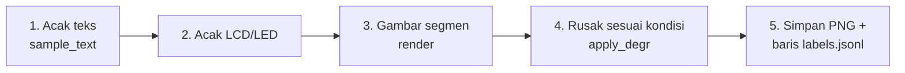
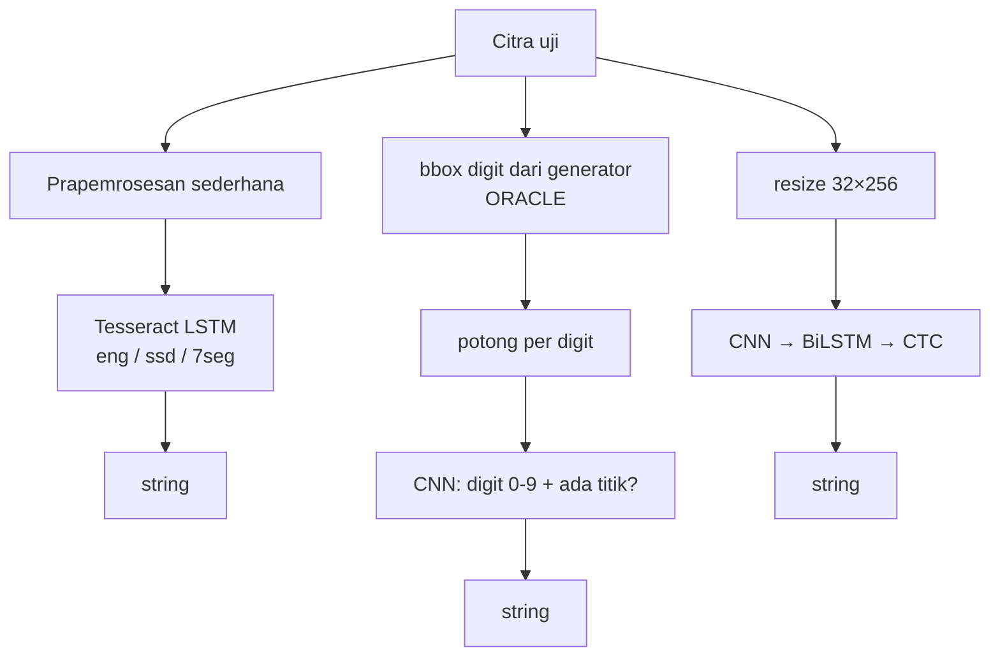

# Pilot / Studi Kelayakan: Pengenalan Angka Seven Segment

> **Konteks:** skripsi *"Analisis Komparatif Tesseract Fine-Tuned, CNN Per-Digit, dan CRNN-CTC untuk Pengenalan Angka Seven Segment pada Variasi Kondisi Citra"*.
>
> **Status:** pilot **SELESAI**, dijalankan nyata pada 4 Nov 2026. Semua angka di dokumen ini disalin dari file di folder `pilot/`: `results.csv`, `results_ood_dseg.csv`, `results.json`, `logs/*.log`, `results/*_predictions.jsonl`, dan kode `*.py`. Sumber setiap angka ditulis di dekatnya.
>
> **Peringatan utama:** semua data pilot adalah **data sintetis** (gambar buatan program). Angka akurasi ~99% untuk CNN/CRNN **bukan** hasil skripsi, melainkan **batas atas yang optimistis** (lihat [§9](#9-keterbatasan-dijelaskan-dengan-bahasa-sederhana)).

---

## Daftar isi

1. [Ringkasan 1 menit](#1-ringkasan-1-menit)
2. [Tujuan pilot](#2-tujuan-pilot)
3. [Lingkungan](#3-lingkungan)
4. [Generator data sintetis (`generator.py`)](#4-generator-data-sintetis-generatorpy)
5. [Tiga metode di pilot](#5-tiga-metode-di-pilot)
6. [Metrik (`metrics.py`)](#6-metrik-metricspy)
7. [Cara menjalankan dan isi folder](#7-cara-menjalankan)
8. [Hasil dan cara membaca setiap tabel](#8-hasil-dan-cara-membacanya)
9. [Keterbatasan (dijelaskan dengan bahasa sederhana)](#9-keterbatasan-dijelaskan-dengan-bahasa-sederhana)
10. [Yang TIDAK dibuktikan pilot dan tiket yang menanganinya](#10-yang-tidak-dibuktikan-pilot-dan-tiket-yang-menanganinya)
11. [Kesimpulan kelayakan dan rekomendasi](#11-kesimpulan-kelayakan-dan-rekomendasi)
12. [Bekal tanya-jawab sidang tentang pilot](#12-bekal-tanya-jawab-sidang-tentang-pilot)

---

## 1. Ringkasan 1 menit

> "Sebelum skripsi penuh, saya menjalankan **pilot** untuk memastikan seluruh alur penelitian bisa jalan di laptop saya: membuat data, menjalankan tiga keluarga metode, dan menghitung metrik per kondisi citra. Datanya **sintetis**, yaitu angka seven segment yang digambar program dalam 8 kondisi (bersih, noise, blur, miring, redup, silau, ghost, gabungan).
>
> Hasilnya: Tesseract `eng` bawaan buruk (exact match 0,139), model Tesseract khusus seven segment buatan pihak ketiga lebih baik (0,537–0,618), dan CNN per-digit serta CRNN-CTC yang saya latih mendekati sempurna (0,995 dan 0,988). Tetapi angka 99% itu **optimistis**. Data latih dan ujinya berasal dari generator yang sama, CNN masih diberi posisi digit secara gratis (oracle), dan Tesseract belum saya fine-tune sendiri. Jadi kesimpulan pilot hanya satu: **penelitian ini layak secara teknis**. Perbandingan sebenarnya dilakukan pada foto nyata (tiket #1–#10)."

Sumber angka: `results.csv`, baris `*,ALL`.

---

## 2. Tujuan pilot

### APA itu pilot?
Pilot atau **studi kelayakan** (*feasibility study*) adalah percobaan kecil dan cepat sebelum penelitian utama. Analoginya seperti **gladi bersih**: semua alat dicoba sekali dari awal sampai akhir untuk melihat apakah ada yang macet, tetapi hasil gladi tidak dipakai sebagai hasil akhir.

### KENAPA pilot dibuat?
Ada empat pertanyaan yang perlu dijawab sebelum berkomitmen pada judul:

| Pertanyaan | Jawaban pilot |
|---|---|
| Bisakah data sintetis seven segment dibuat sendiri, lengkap dengan label dan variasi kondisi? | **Ya.** `generator.py` membuat 2.400 citra uji (≈1 detik) dan 12.000 citra latih (≈4 detik). |
| Bisakah ketiga keluarga metode (Tesseract, CNN per-digit, CRNN-CTC) dijalankan dan dilatih di laptop, tanpa GPU server? | **Ya.** Latih CNN 62,6 detik, CRNN 120,9 detik di Apple M4 (MPS). Sumber: `logs/train_cnn.log`, `logs/train_crnn.log`. |
| Bisakah metrik per kondisi dihitung otomatis? | **Ya.** `metrics.py` + `make_report.py` → `results.csv`. |
| Adakah sinyal awal bahwa kinerja ketiga metode berbeda, sehingga perbandingannya layak diteliti? | **Ya.** Selisihnya besar dan polanya berbeda per kondisi (§8). |

### Yang TIDAK dicari pilot
Pilot **tidak** dimaksudkan untuk menentukan metode terbaik. Untuk itu dibutuhkan foto nyata, Tesseract yang di-fine-tune sendiri, segmentasi digit nyata, dan uji statistik. Semuanya ada di tiket #1–#10 (§10).

---

## 3. Lingkungan

- macOS, Apple M4 (10 core), Python 3.9.6 (venv `.venv`)
- Tesseract 5.5.4 (leptonica 1.87.0), dipasang via `brew install tesseract` (hanya `eng` + `osd`)
- torch 2.8.0 (MPS tersedia), opencv-python-headless 5.0.0, numpy 2.0.2, Pillow 11.3.0, pytesseract
- Traineddata tambahan dari `github.com/Shreeshrii/tessdata_ssd`: `ssd.traineddata`, `7seg.traineddata`, `ssd_plus.traineddata` → `tessdata_extra/` (unduhan berhasil)
- Font DSEG v0.46 (`github.com/keshikan/DSEG`, lisensi OFL) → `fonts/`, hanya dipakai untuk uji generalisasi (OOD)

**Istilah:**
- **MPS** (*Metal Performance Shaders*): jalur akselerasi GPU bawaan Apple Silicon yang dipakai PyTorch. Fungsinya mirip CUDA di GPU NVIDIA, tetapi untuk Mac.
- **traineddata**: file model Tesseract. Satu file mewakili satu "bahasa" atau gaya tulisan yang dikenali, misalnya `eng` untuk teks cetak Inggris.
- **venv** (*virtual environment*): folder berisi Python dan paket yang terpisah dari sistem, supaya versi paket tidak bercampur dengan proyek lain.

---

## 4. Generator data sintetis (`generator.py`)

### 4.1 APA
Program yang **menggambar** angka seven segment dari nol, lalu merusaknya dengan sengaja sesuai kondisi tertentu (blur, silau, dll.). Setiap citra disimpan bersama metadatanya di `labels.jsonl`, satu baris JSON per citra.

### 4.2 KENAPA menggambar sendiri, bukan memakai font?
1. **Label 100% benar dan gratis**, karena program tahu persis angka apa yang digambar.
2. **Posisi tiap digit (bounding box) diketahui pasti.** Segmen digambar sebagai poligon, jadi koordinat tiap digit bisa dicatat. Ini dibutuhkan CNN per-digit (§5.2).
3. **Kondisi bisa dikontrol.** Kita bisa memesan "300 citra silau" dan membandingkan metode secara adil per kondisi.
4. **Font bisa dipakai terpisah untuk uji OOD.** Karena data latih tidak memakai font, font DSEG berfungsi sebagai "gaya yang belum pernah dilihat" model (§8.5).

### 4.3 BAGAIMANA: langkah demi langkah



**Langkah 1: acak teks (`sample_text`).**
- Panjang 1–6 digit, tiap digit acak 0–9.
- Bila panjang ≥2, dengan peluang 0,5 disisipkan **satu titik desimal** setelah salah satu digit (tidak pernah setelah digit terakhir). Contoh label: `204.84`, `9`, `11068`.

**Langkah 2: pilih jenis layar**, `lcd` atau `led`, masing-masing 50%.

**Langkah 3: gambar segmen (`render` + `digit_polys`).**
Setiap digit punya 7 segmen bernama a–g:

```
 aaa
f   b
 ggg
e   c
 ddd  .   ← titik desimal (DP)
```

Tabel `SEG` di kode menentukan segmen mana yang menyala, misalnya `'1': 'bc'` dan `'8': 'abcdefg'`. Setiap segmen digambar sebagai **heksagon** (poligon 6 sudut, ujungnya runcing seperti segmen asli) dengan `cv2.fillPoly` *anti-aliased*, sehingga tepinya halus dan tidak bergerigi.

Parameter yang diacak per citra:

| Parameter | Rentang di kode | Arti sederhana |
|---|---|---|
| tinggi digit `h` | 36–80 px | ukuran angka |
| lebar digit `w` | `h` × 0,45–0,6 | angka ramping atau lebar |
| tebal segmen `t` | `h` × 0,10–0,16 | garis tipis atau tebal |
| celah ujung segmen `gap` | `t` × 0,05–0,25 | jarak kecil antar-segmen di sudut |
| kemiringan `slant` | 0, atau 0,05–0,15 (peluang 50:50) | angka tegak atau miring (*italic*) |
| jarak antar-digit `spacing` | `t` × 1,6–2,6 | rapat atau renggang |
| margin | x: `h` × 0,25–0,7; y: `h` × 0,2–0,5 | ruang kosong di sekitar angka |

Segmen dibagi menjadi dua "lapisan":
- **`on`**: segmen yang menyala dan membentuk angka.
- **`off`**: segmen yang mati. Titik desimal **selalu** digambar di setiap sel digit, sebagai `on` bila memang ada titik dan sebagai `off` bila tidak. Lapisan `off` hanya terlihat pada kondisi `ghost`, dengan transparansi `ghost_alpha`.

Pewarnaan per jenis layar:

| | LCD | LED |
|---|---|---|
| Latar | abu-kehijauan terang (R 150–195, G 165–210, B 130–175) + gradasi kecerahan vertikal | gelap (5–35) |
| Segmen | gelap (15–60), di-blur tipis 0,6 px | merah atau hijau terang |
| Efek khas | — | **glow** (pendaran, blur Gaussian dari segmen, kekuatan 0,3–0,8) + inti segmen memutih untuk meniru *overexposure* kamera |

**Langkah 4: rusak sesuai kondisi (`apply_degr`).** Ada 8 kondisi:

| Kondisi | Yang dilakukan kode | Meniru situasi nyata |
|---|---|---|
| `clean` | tidak ada degradasi | foto ideal |
| `noise` | noise Gaussian σ 12–30, lalu kompresi JPEG kualitas 20–60 | kamera HP murah, cahaya kurang, kiriman WhatsApp |
| `blur` | 50% blur Gaussian (σ 1,2–2,5, diskalakan ke tinggi digit), 50% *motion blur* (kernel garis 5–11 px, arah acak) | fokus meleset atau tangan goyang |
| `perspective` | rotasi ±12° + pergeseran keempat sudut 4–10% (transformasi perspektif) | foto diambil miring, tidak tegak lurus layar |
| `dim` | koreksi gamma 1,6–2,6 × kecerahan 0,3–0,6 | ruangan atau layar redup |
| `glare` | elips putih yang di-blur, ditimpa dengan α 0,35–0,75 | pantulan lampu atau matahari di kaca layar |
| `ghost` | segmen mati ikut terlihat samar, α 0,15–0,35 | LCD murah atau tua yang memperlihatkan bayangan "8" di belakang angka |
| `combined` | 2–3 degradasi acak dari 6 di atas | kondisi lapangan yang biasanya bercampur |

Catatan teknis: urutan penerapan di kode selalu `perspective → glare → dim → blur → noise`, sedangkan ghost diterapkan saat render. Pada `perspective`, koordinat kotak digit ikut ditransformasi sehingga bbox tetap akurat.

**Langkah 5: simpan.** PNG disimpan ke `images/` dan metadata ke `labels.jsonl`. Metadatanya berisi `label`, `digits`, `dp_index` (posisi titik, −1 bila tidak ada), `condition`, `degradations`, `display`, `params` (semua nilai acak yang terpakai), ukuran citra, dan **`digit_bboxes`** (kotak tiap digit, termasuk area titik desimalnya).

### 4.4 Dua mode pembuatan
| Mode | Perintah | Hasil | Tujuan |
|---|---|---|---|
| Set uji | `--per-condition 300 --seed 2026` | 8 × 300 = **2.400** citra, seimbang per kondisi (LCD 1.205 / LED 1.195) | membandingkan kinerja per kondisi secara adil |
| Set latih | `--n 12000 --mixed --seed 1` | **12.000** citra, kondisi diacak seragam | melatih CNN/CRNN pada semua kondisi |

**Kenapa seed berbeda?** *Seed* adalah angka awal bagi pengacak. Seed yang sama menghasilkan data yang persis sama, sehingga hasil bisa direproduksi. Seed berbeda (2026 vs 1) menghasilkan citra yang berbeda, jadi data uji tidak identik dengan data latih. Tetapi **aturan pembuatannya tetap sama**, dan inilah sumber keterbatasan utama pilot (§9).

Contoh citra ada di `contoh_gambar/`. Nama filenya memuat label, misalnya `clean_led_label-832.3.png`.

---

## 5. Tiga metode di pilot

Gambaran besar:



### 5.1 Tesseract (`eval_tesseract.py`)

**APA.** Tesseract adalah mesin OCR (*Optical Character Recognition*, mengubah gambar tulisan menjadi teks) yang open-source. Sejak versi 4, intinya adalah jaringan **LSTM** (*Long Short-Term Memory*): jaringan saraf yang membaca urutan dan "mengingat" konteks sebelumnya. LSTM ini membaca satu baris teks dari kiri ke kanan.

**KENAPA dipakai.** Tesseract adalah baseline OCR yang paling umum dan matang. Judul skripsi membandingkan versi *fine-tuned*-nya dengan dua model deep learning khusus.

**BAGAIMANA di pilot.** Ada 4 varian:

| Varian | Model (traineddata) | Prapemrosesan? | Asal model |
|---|---|---|---|
| `eng_raw` | `eng` | tidak (citra RGB mentah) | bawaan Tesseract, dilatih untuk teks cetak biasa |
| `eng_pre` | `eng` | ya | sama |
| `ssd_pre` | `ssd` | ya | **pihak ketiga** (Shreeshrii/tessdata_ssd), di-fine-tune dari `eng` dengan 3 font seven segment |
| `7seg_pre` | `7seg` | ya | pihak ketiga, versi lebih lama dari repo yang sama |

`ssd_plus.traineddata` ikut diunduh tetapi **tidak dievaluasi** karena tidak tercantum di `VARIANTS` dalam kode.

Konfigurasi semua varian sama: `--oem 1 --psm 7 -c tessedit_char_whitelist=0123456789.`
- `--oem 1`: pakai mesin LSTM saja, bukan mesin lama berbasis pola.
- `--psm 7`: anggap gambar berisi **satu baris teks**. Ini cocok karena citra hanya berisi satu deret angka.
- *whitelist*: Tesseract hanya boleh mengeluarkan karakter `0–9` dan `.`.

**Prapemrosesan sederhana (`preprocess`), langkah demi langkah:**
1. **Grayscale**: buang warna.
2. **Deteksi polaritas (heuristik)**: ambil piksel 3 px di tepi gambar. Bila rata-ratanya < 100 (tepi gelap), anggap LED, lalu **balik warna** (*invert*) agar menjadi teks gelap di latar terang, sesuai kebiasaan Tesseract.
3. **Resize** ke tinggi 80 px (interpolasi kubik).
4. **Blur Gaussian 3×3** untuk meredam noise.
5. **Threshold Otsu**: ubah menjadi hitam-putih, dengan ambang yang dipilih otomatis dari histogram.
6. **Padding putih** 15 px di keempat sisi, karena Tesseract bekerja lebih baik bila ada ruang kosong di sekitar teks.

Langkah 2 ini **naif**, dan kelemahannya terlihat di hasil (§8.4): LCD yang diredupkan juga punya tepi gelap, sehingga ikut dibalik secara keliru.

**Cara pengukuran:** akurasi dihitung paralel dengan 8 proses. Latency diukur **terpisah dan serial** pada 10 citra per kondisi (80 per varian), supaya waktunya tidak terdistorsi oleh perebutan CPU.

### 5.2 CNN per-digit (`train_cnn.py`)

**APA.** CNN (*Convolutional Neural Network*) adalah jaringan saraf yang mengenali pola visual dengan "menggeser" filter kecil di atas gambar, seperti kaca pembesar yang menyapu gambar untuk mencari garis dan sudut. Pendekatan **per-digit** berarti gambar dipotong per digit terlebih dahulu, lalu tiap potongan diklasifikasi sendiri-sendiri.

**KENAPA.** Ini cara paling sederhana dan mudah dijelaskan. Masalah "baca string" dipecah menjadi banyak masalah kecil "ini angka berapa?", yaitu klasifikasi 10 kelas. Kelemahannya, hasilnya **bergantung pada pemotongan (segmentasi)** yang benar.

**BAGAIMANA.**

1. **Segmentasi ORACLE.** Kotak tiap digit diambil langsung dari `digit_bboxes` di `labels.jsonl`, yaitu jawaban yang sudah diketahui generator. *Oracle* berarti "peramal yang selalu benar": model mendapat informasi sempurna yang **tidak akan tersedia** pada foto nyata. Analoginya, ujian membaca yang posisi setiap angkanya sudah dilingkari oleh guru.
2. **Crop.** Setiap kotak diperlebar 8% ke samping dan 6% ke atas-bawah, di-resize ke **64×40 px** (tinggi×lebar), lalu distandardisasi per crop (dikurangi rata-rata, dibagi simpangan baku). Standardisasi membuat crop LCD dan LED berada pada skala nilai yang mirip.
3. **Arsitektur `DigitCNN`:**

| Lapisan | Ukuran keluaran | Keterangan |
|---|---|---|
| input | 1 × 64 × 40 | satu crop grayscale |
| blok 1: Conv 3×3 (32) → BatchNorm → ReLU → MaxPool 2 | 32 × 32 × 20 | deteksi tepi atau garis sederhana |
| blok 2: Conv 3×3 (64) → BN → ReLU → MaxPool 2 | 64 × 16 × 10 | pola segmen |
| blok 3: Conv 3×3 (128) → BN → ReLU → MaxPool 2 | 128 × 8 × 5 | kombinasi segmen |
| Flatten → Dropout 0,3 → Linear 5120→256 → ReLU | 256 | ringkasan fitur |
| **Head digit**: Linear 256→10 | 10 | kelas 0–9 |
| **Head titik**: Linear 256→2 | 2 | ada/tidak ada titik desimal di kanan digit |

   Total **1.407.180 parameter** (≈1,41 juta; `logs/train_cnn.log`). Istilah:
   - *BatchNorm*: menormalkan nilai di tengah jaringan agar training stabil.
   - *ReLU*: fungsi aktivasi `max(0, x)`.
   - *MaxPool*: memperkecil gambar 2× dengan mengambil nilai terbesar.
   - *Dropout*: mematikan neuron secara acak saat latih supaya model tidak menghafal.
   - **Dua head**: satu tubuh jaringan dengan dua "kepala" keluaran. Titik desimal ditangani sebagai pertanyaan ya/tidak per digit, karena letaknya selalu di kanan bawah sel digit.
4. **Training.** Ada 10.800 citra latih (12.000 dikurangi 1.200 untuk validasi), yang menghasilkan **37.805 crop latih** dan **4.186 crop validasi**. Loss = *cross-entropy* digit + *cross-entropy* titik. Optimizer Adam dengan jadwal OneCycle (LR puncak 3e-3), batch 256, 6 epoch, augmentasi ringan berupa noise Gaussian 0,1, seed 0, device MPS. Lama latih 62,6 detik.
5. **Rekonstruksi string.** Prediksi per digit digabung dari kiri ke kanan. Bila head titik menjawab "ada", tambahkan `.` setelah digit itu.

Kurva training (`logs/train_cnn.log`): akurasi validasi digit naik dari 0,9928 (epoch 1) ke 0,9990 (epoch 6), dan akurasi titik dari 0,9945 ke 1,0000.

### 5.3 CRNN-CTC (`train_crnn.py`)

**APA.** CRNN (*Convolutional Recurrent Neural Network*) menggabungkan **CNN** untuk melihat fitur visual dan **RNN** (di sini BiLSTM) untuk membaca urutan. Hasilnya diterjemahkan menjadi teks dengan **CTC** (*Connectionist Temporal Classification*).

**KENAPA.** CRNN membaca **satu baris sekaligus tanpa memotong per digit**, seperti mata yang menyapu dari kiri ke kanan, sehingga tidak ada risiko galat segmentasi. Label latihnya cukup berupa teks (`"204.84"`), tanpa posisi tiap digit.

**BAGAIMANA.**
1. **Input.** Citra grayscale di-resize ke tinggi 32 px dengan rasio dipertahankan (lebar maksimal 256), dipad ke kanan hingga **32×256**, lalu distandardisasi.
2. **CNN** memadatkan tinggi gambar menjadi 1 dan mempertahankan lebarnya sebagai "waktu":

| Tahap | Ukuran (tinggi × lebar) |
|---|---|
| input | 32 × 256 |
| Conv 32 → MaxPool 2 | 16 × 128 |
| Conv 64 → MaxPool 2 | 8 × 64 |
| Conv 128 → Conv 128 → MaxPool (2,1) | 4 × 64 |
| Conv 128 → MaxPool (4,1) | **1 × 64** |

   Hasilnya **64 "kolom" (T = 64)**. Tiap kolom adalah vektor 128 fitur yang mewakili satu irisan vertikal gambar. MaxPool (2,1) dan (4,1) hanya memperkecil tinggi, tidak lebar, supaya resolusi horizontal cukup untuk membedakan digit.
3. **BiLSTM** (LSTM dua arah, 96 unit per arah, total 192) membaca ke-64 kolom dari kiri ke kanan **dan** dari kanan ke kiri, sehingga tiap kolom "tahu" konteks tetangganya.
4. **Linear 192 → 12 kelas**: 11 karakter (`0123456789.`) + 1 **blank**.
5. **CTC, dengan analogi.** Model menebak satu karakter untuk **setiap** kolom dari 64 kolom, misalnya:
   ```
   _ _ 2 2 _ 0 0 _ 4 . . _ 8 8 _ 4 _ _ ...
   ```
   Decoding *greedy* (fungsi `decode`) punya dua aturan: (a) gabungkan karakter berulang yang berurutan, lalu (b) buang blank `_`. Hasilnya `204.84`. Blank diperlukan agar angka kembar seperti `11` bisa ditulis `1 _ 1` dan tidak tergabung menjadi `1`.
   Saat **training**, *CTC loss* menjumlahkan peluang **semua** kemungkinan penjajaran (*alignment*) 64 kolom yang menghasilkan label benar. Karena itu model tidak perlu diberi tahu di kolom mana tiap digit berada.
6. **Training.** 10.800 citra latih, batch 128, Adam + OneCycle (LR puncak 3e-3), *gradient clipping* 5 (membatasi lonjakan update), augmentasi noise 0,1, 10 epoch, seed 0. CNN dan LSTM berjalan di MPS, sedangkan loss CTC dihitung di CPU. Lama latih 120,9 detik. Total **564.684 parameter** (≈0,56 juta; `logs/train_crnn.log`).

Kurva training (`logs/train_crnn.log`): exact match validasi 0,0000 (epoch 1), lalu 0,5767 (epoch 2), 0,9533 (epoch 3), dan 0,9892 (epoch 10). Nilai 0 di epoch 1 adalah pola normal CTC: awalnya model cenderung hanya mengeluarkan blank sebelum mulai "menemukan" karakter.

Catatan: *docstring* `train_crnn.py` menulis contoh `--epochs 15`, yang juga nilai default-nya. Run yang dilaporkan di sini memakai **`--epochs 10`** (`logs/train_crnn.log`).

### 5.4 Perbandingan ringkas ketiga metode di pilot

| | Tesseract (pilot) | CNN per-digit (pilot) | CRNN-CTC (pilot) |
|---|---|---|---|
| Butuh posisi digit? | tidak | **ya (diberi oracle)** | tidak |
| Dilatih pada data pilot? | **tidak** (model jadi) | ya, 10.800 citra | ya, 10.800 citra |
| Parameter | — | 1.407.180 | 564.684 |
| Lama latih | — | 62,6 s | 120,9 s |

---

## 6. Metrik (`metrics.py`)

Setiap prediksi dibandingkan dengan label oleh fungsi `score(gt, pred)`, lalu dirangkum per kondisi oleh `aggregate`.

### 6.1 Exact Match (EM)
- **APA:** proporsi citra yang string prediksinya **persis sama** dengan label, termasuk titik desimal.
- **KENAPA:** pada pompa BBM atau meteran, satu digit salah atau titik yang hilang membuat seluruh bacaan salah (`20.48` vs `204.8`). EM adalah metrik paling ketat dan paling relevan untuk aplikasi.
- **BAGAIMANA:** `exact = 1` bila `gt == pred`, lalu dirata-rata. EM 0,995 dari 2.400 citra berarti 12 citra salah.

### 6.2 CER (*Character Error Rate*)
- **APA:** berapa banyak "perbaikan karakter" yang dibutuhkan, relatif terhadap panjang label.
- **KENAPA:** EM tidak membedakan "salah 1 karakter" dari "salah semua". CER memberi nilai sebagian.
- **BAGAIMANA:**
  1. Hitung **jarak Levenshtein**, yaitu jumlah minimum operasi *sisip*, *hapus*, atau *ganti* satu karakter agar prediksi sama dengan label. Titik desimal ikut dihitung sebagai karakter. Contoh: label `204.84` dan prediksi `20484` berjarak 1 (sisip `.`).
  2. CER kelompok = **Σ jarak ÷ Σ panjang label** untuk semua citra di kelompok itu, bukan rata-rata CER per citra.
  3. Lebih **kecil** lebih baik. CER bisa > 1 bila prediksi jauh lebih panjang dari label.

### 6.3 Akurasi per digit
- **APA:** proporsi digit label yang terbaca benar, **dengan titik desimal diabaikan**.
- **KENAPA:** untuk memisahkan "kemampuan mengenali bentuk digit" dari masalah titik desimal.
- **BAGAIMANA:**
  1. Buang semua `.` dari label dan prediksi.
  2. Cari penjajaran Levenshtein optimal (jarak minimum). Bila ada beberapa penjajaran sama baik, pilih yang jumlah karakter cocoknya terbanyak.
  3. Akurasi = Σ digit cocok ÷ Σ digit label.

  Contoh: `204.84` vs `20484` menghasilkan 5/5 = 1,0, walaupun EM = 0.
- **Catatan jujur:** metrik ini bersifat seperti *recall*. Digit **ekstra** yang disisipkan prediksi tidak menurunkan nilainya; galat seperti itu tertangkap oleh CER dan EM. Karena itu ketiga metrik selalu dibaca bersama.

### 6.4 Latency
- **APA:** waktu memproses satu citra, dalam milidetik.
- **BAGAIMANA:** CPU 1 thread (Tesseract `OMP_THREAD_LIMIT=1`; torch `set_num_threads(1)`), 1 citra per panggilan, **termasuk** baca file dan prapemrosesan. Dilaporkan rata-rata dan median dari 80 citra (10 per kondisi).
- **KENAPA 1 thread:** agar adil. Semua metode mendapat sumber daya yang sama, mirip kondisi perangkat lemah.

### 6.5 Contoh membaca ketiga metrik bersama
Pada `7seg_pre` kondisi `clean`, EM 0,82, CER 0,046, dan akurasi digit 0,9869 (`results.csv`). Artinya bentuk digit hampir selalu terbaca benar, tetapi 18% string tetap salah. Penyebab utamanya adalah titik desimal yang hilang (§8.4).

---

## 7. Cara menjalankan

```bash
cd ~/riset-seven-segment/pilot
python3 -m venv .venv && .venv/bin/pip install numpy pillow opencv-python-headless pytesseract torch
brew install tesseract            # bila belum ada
# (tessdata_extra/ dan fonts/ sudah berisi file unduhan)

.venv/bin/python generator.py --out data/test  --per-condition 300 --seed 2026   # 2400 citra uji (≈1 detik)
.venv/bin/python generator.py --out data/train --n 12000 --mixed --seed 1        # 12000 citra latih (≈4 detik)
OMP_THREAD_LIMIT=1 .venv/bin/python eval_tesseract.py                            # ≈100 detik total, 4 varian
.venv/bin/python train_cnn.py --epochs 6                                         # CNN per-digit (62.6 s latih, MPS)
.venv/bin/python train_crnn.py --epochs 10                                       # CRNN-CTC (120.9 s latih, MPS)
OMP_THREAD_LIMIT=1 .venv/bin/python eval_ood_dseg.py --per-condition 50          # uji OOD font DSEG7
.venv/bin/python make_report.py                                                  # results.json/csv + contoh_gambar/
```

**Urutan wajib:** generator, lalu Tesseract/CNN/CRNN, lalu OOD, lalu report. `eval_ood_dseg.py` memuat bobot `results/cnn_perdigit.pt` dan `results/crnn_ctc.pt`, jadi harus dijalankan setelah training. `make_report.py` membaca semua `results/*.json`.

**Kenapa `OMP_THREAD_LIMIT=1`?** Tesseract memakai OpenMP (multi-thread). Tanpa batas ini, 8 proses paralel yang masing-masing memakai banyak thread akan saling berebut CPU. Akibatnya proses lambat dan latency tidak akurat.

### Isi folder

| File | Fungsi |
|---|---|
| `generator.py` | Generator sintetis: 7 segmen + titik desimal digambar sebagai poligon (OpenCV, anti-alias). Variasi: 1–6 digit, titik desimal (p=0,5), LCD (latar abu-hijau, segmen gelap) vs LED (latar gelap, merah/hijau + glow), kemiringan (italic), tebal segmen, dan degradasi per kondisi. Metadata per citra (label, kondisi, parameter, bbox tiap digit) → `labels.jsonl` |
| `metrics.py` | Exact match, CER (Levenshtein/panjang label, termasuk titik), akurasi per digit (jumlah digit GT yang cocok dalam alignment Levenshtein optimal setelah titik dibuang ÷ jumlah digit GT) |
| `eval_tesseract.py` | Baseline Tesseract (`--oem 1 --psm 7`, whitelist `0123456789.`), 4 varian |
| `train_cnn.py` | CNN per-digit (3 blok conv, 1,41 jt parameter), 2 head: digit 0–9 + titik desimal |
| `train_crnn.py` | CRNN-CTC (CNN + BiLSTM, 0,56 jt parameter), input 32×256, tanpa segmentasi |
| `eval_ood_dseg.py` | Uji OOD: citra dirender dengan font DSEG7 (bentuk glyph berbeda dari data latih) |
| `make_report.py` | Menggabungkan hasil + menyalin contoh citra |
| `results.json`, `results.csv`, `results_ood_dseg.csv` | Hasil akhir; prediksi per citra di `results/*_predictions.jsonl` |
| `results/*.pt` | Bobot model CNN dan CRNN hasil pilot |
| `contoh_gambar/` | 10 contoh (1 per kondisi + 2 DSEG); nama file memuat label |
| `logs/` | Output konsol asli setiap tahap |
| `tessdata_extra/` | Traineddata `eng`, `ssd`, `7seg`, `ssd_plus` + README asli Shreeshrii (`README_ssd.md`) |
| `fonts/` | Font DSEG v0.46 (hanya untuk OOD) |

---

## 8. Hasil dan cara membacanya

### 8.1 Exact match per kondisi (set uji in-distribution, n=2400, 300 per kondisi)

*In-distribution* berarti data uji dibuat oleh generator yang sama dengan data latih. Kebalikannya, yaitu OOD, dibahas di §8.5.

| metode | clean | noise | blur | perspective | dim | glare | ghost | combined | ALL |
|---|---|---|---|---|---|---|---|---|---|
| Tesseract eng_raw | 0.180 | 0.157 | 0.193 | 0.137 | 0.173 | 0.063 | 0.137 | 0.073 | 0.139 |
| Tesseract eng_pre | 0.180 | 0.203 | 0.177 | 0.157 | 0.110 | 0.040 | 0.187 | 0.107 | 0.145 |
| Tesseract ssd_pre | 0.690 | 0.753 | 0.683 | 0.547 | 0.423 | 0.143 | 0.710 | 0.347 | 0.537 |
| Tesseract 7seg_pre | 0.820 | 0.850 | 0.743 | 0.633 | 0.523 | 0.110 | 0.867 | 0.397 | 0.618 |
| CNN per-digit | 1.000 | 1.000 | 1.000 | 0.990 | 1.000 | 0.997 | 1.000 | 0.973 | 0.995 |
| CRNN-CTC | 1.000 | 1.000 | 1.000 | 0.960 | 1.000 | 0.997 | 1.000 | 0.947 | 0.988 |

Sumber: `results.csv`, kolom `exact_match`, dibulatkan 3 desimal. Nilai penuhnya misalnya `0.1392`, `0.5371`, `0.6179`, `0.9879`.

**Cara membaca:**
- Setiap sel adalah proporsi citra yang terbaca persis benar. Contoh: 0,820 pada `7seg_pre`/`clean` berarti 246 dari 300 citra benar.
- **Baris** membandingkan satu metode antar-kondisi: kondisi mana yang paling merusak metode itu?
- **Kolom** membandingkan metode pada kondisi yang sama: metode mana yang paling tahan?

**Yang terlihat:**
1. **`eng` tanpa adaptasi gagal** (EM ≈0,14). Prapemrosesan saja (`eng_pre`) hampir tidak membantu (0,139 → 0,145). Jadi masalah utamanya ada pada **model**, yang tidak mengenal bentuk seven segment, bukan pada kualitas gambar.
2. **Model khusus seven segment** (`ssd`, `7seg`) menaikkan EM ke 0,537–0,618. Ini sinyal awal bahwa **fine-tuning Tesseract memang berguna**, dan akan diuji sungguhan di tiket #5.
3. **CNN dan CRNN** mencapai ≈99%. Galat yang tersisa ada di `perspective` dan `combined`. Menurut `results/*_predictions.jsonl`, CNN salah pada 12 citra (combined 8, perspective 3, glare 1) dan CRNN salah pada 29 citra (combined 16, perspective 12, glare 1).
4. **`glare` adalah kondisi terberat untuk Tesseract** (EM 0,04–0,14), tetapi hampir tidak berpengaruh pada CNN/CRNN (0,997). Dugaan penyebabnya: threshold Otsu dengan satu ambang global "membakar" area silau, sedangkan model DL melihat input yang distandardisasi dan sudah dilatih dengan contoh silau. Dugaan ini belum diuji.

### 8.2 Ringkasan keseluruhan (ALL) + latency

| metode | CER | akurasi per digit | latency rata-rata (ms/citra) | median (ms) |
|---|---|---|---|---|
| Tesseract eng_raw | 0.5267 | 0.5219 | 53.4 | 52.3 |
| Tesseract eng_pre | 0.5025 | 0.5461 | 52.3 | 52.0 |
| Tesseract ssd_pre | 0.2320 | 0.8366 | 25.2 | 24.6 |
| Tesseract 7seg_pre | 0.2040 | 0.8331 | 24.7 | 24.1 |
| CNN per-digit | 0.0016 | 0.9992 | 3.89 | 3.11 |
| CRNN-CTC | 0.0037 | 0.9980 | 8.39 | 5.92 |

Sumber: field `ALL` di `results/tesseract.json`, `results/cnn_perdigit.json`, dan `results/crnn_ctc.json`. CER dan akurasi digit juga ada di `results.csv`.

**Cara membaca:**
- **CER**: lebih kecil lebih baik. 0,2040 berarti kira-kira 1 dari 5 karakter perlu diperbaiki.
- **Akurasi per digit**: lebih besar lebih baik.
- **Perhatikan `ssd_pre` vs `7seg_pre`:** `7seg` unggul di EM dan CER, tetapi `ssd` sedikit unggul di akurasi digit (0,8366 vs 0,8331). Inilah alasan satu metrik saja tidak cukup.
- **Latency:** bila rata-rata lebih besar dari median, ada beberapa citra yang jauh lebih lambat (ekor distribusi). Median lebih mewakili citra "biasa".

**Catatan latency:** diukur di CPU 1 thread, 1 citra per panggilan, termasuk baca file dan prapemrosesan. Tesseract diukur pada 80 citra per varian (10 per kondisi), dan angkanya **termasuk overhead `pytesseract`**, yang memanggil proses `tesseract` baru untuk setiap citra. Memanggil Tesseract lewat API C atau tesserocr akan lebih cepat. CNN/CRNN diukur pada 80 citra yang tersebar merata di semua kondisi. **CNN per-digit memakai bbox oracle, jadi biaya segmentasi tidak termasuk**, sehingga latency CNN di sini lebih rendah dari kenyataan.

### 8.3 CER dan akurasi per digit per kondisi

**CER per kondisi** (`results.csv`, kolom `cer`):

| metode | clean | noise | blur | perspective | dim | glare | ghost | combined | ALL |
|---|---|---|---|---|---|---|---|---|---|
| eng_raw | 0.4614 | 0.5089 | 0.3963 | 0.511 | 0.4476 | 0.7056 | 0.5252 | 0.6667 | 0.5267 |
| eng_pre | 0.4031 | 0.413 | 0.393 | 0.4563 | 0.6036 | 0.7394 | 0.3764 | 0.649 | 0.5025 |
| ssd_pre | 0.0805 | 0.0853 | 0.0841 | 0.1853 | 0.4484 | 0.489 | 0.0829 | 0.4171 | 0.232 |
| 7seg_pre | 0.046 | 0.0409 | 0.0691 | 0.1486 | 0.393 | 0.511 | 0.0374 | 0.4039 | 0.204 |
| cnn_perdigit | 0.0 | 0.0 | 0.0 | 0.0024 | 0.0 | 0.0008 | 0.0 | 0.0097 | 0.0016 |
| crnn_ctc | 0.0 | 0.0 | 0.0 | 0.0122 | 0.0 | 0.0017 | 0.0 | 0.0159 | 0.0037 |

**Akurasi per digit per kondisi** (`results.csv`, kolom `digit_acc`):

| metode | clean | noise | blur | perspective | dim | glare | ghost | combined | ALL |
|---|---|---|---|---|---|---|---|---|---|
| eng_raw | 0.5924 | 0.5393 | 0.6632 | 0.546 | 0.5944 | 0.3241 | 0.5298 | 0.3752 | 0.5219 |
| eng_pre | 0.6595 | 0.6378 | 0.6726 | 0.6062 | 0.4287 | 0.2784 | 0.6751 | 0.3912 | 0.5461 |
| ssd_pre | 0.9813 | 0.9582 | 0.9878 | 0.8888 | 0.6098 | 0.6092 | 0.972 | 0.6647 | 0.8366 |
| 7seg_pre | 0.9869 | 0.9821 | 0.985 | 0.9125 | 0.6378 | 0.5129 | 0.9874 | 0.6367 | 0.8331 |
| cnn_perdigit | 1.0 | 1.0 | 1.0 | 0.9991 | 1.0 | 0.999 | 1.0 | 0.995 | 0.9992 |
| crnn_ctc | 1.0 | 1.0 | 1.0 | 0.9945 | 1.0 | 0.999 | 1.0 | 0.99 | 0.998 |

Versi 3 desimal dari kedua tabel ini juga tercetak di `logs/report.log`.

**Cara membaca:** bandingkan dengan tabel EM. Pada `7seg_pre`/`clean`, akurasi digit 0,9869 tetapi EM hanya 0,820. Selisih sebesar ini berarti digit dikenali dengan baik, tetapi **titik desimal** sering hilang. Pada `dim` dan `glare`, akurasi digit Tesseract ikut anjlok (0,51–0,64), artinya bentuk digitnya sendiri gagal terbaca.

### 8.4 Analisis galat Tesseract

Sumber: `results/tesseract_predictions.jsonl`, dicek ulang dengan skrip kecil.
- **`7seg_pre` kondisi `clean`:** 54 dari 300 salah. **41 dari 54 hanya salah karena titik desimal hilang** (mis. `204.84` → `20484`). Sisanya antara lain digit tunggal yang menghasilkan string kosong; di antara 54 galat ini ada 9 prediksi kosong.
  → *Kenapa penting:* titik desimal seven segment sangat kecil dan terpisah dari digit, sehingga model OCR umum menganggapnya noise. Karena itu PRD menambahkan metrik **akurasi titik desimal** secara terpisah (#10).
- **`7seg_pre` kondisi `dim`:** LCD hanya 33/154 benar, sedangkan LED 124/146. Penyebabnya heuristik prapemrosesan (§5.1 langkah 2). LCD yang diredupkan punya tepi gelap (< 100), sehingga ikut di-*invert* secara keliru dan teksnya menjadi terang di atas latar gelap. Ini menunjukkan baseline Tesseract **sangat bergantung pada prapemrosesan**, dan menjadi dasar tiket #4 (deteksi polaritas yang andal + CLAHE).
- **`glare` paling berat untuk semua varian Tesseract** (EM 0,04–0,14).

### 8.5 Uji generalisasi OOD: font DSEG7 (n=400, 50/kondisi)

**APA itu OOD?** *Out-of-distribution*, yaitu data uji yang **gayanya berbeda** dari data latih. Analoginya, siswa belajar dari buku guru A lalu diuji dengan soal buatan guru B. Materinya sama (angka 0–9 seven segment), tetapi tampilannya berbeda.

**KENAPA perlu?** Set uji in-distribution (§8.1) dibuat oleh generator yang sama dengan data latih, sehingga model bisa saja hanya "hafal gaya generator". Uji OOD memeriksa apakah model benar-benar memahami bentuk angka.

**BAGAIMANA (`eval_ood_dseg.py`):**
- Angka digambar dengan **font DSEG7** (Classic Regular, Classic Bold, Modern Regular, Classic Italic), yang bentuk segmennya berbeda dari poligon `generator.py`.
- Teks acak, LCD/LED, dan 8 kondisi degradasi memakai **fungsi yang sama** (`sample_text`, `apply_degr`). Yang berubah hanya bentuk glyph dan sedikit pewarnaan.
- Model CNN/CRNN **tidak pernah melihat** glyph DSEG saat latih. Bobotnya diambil apa adanya dari `results/*.pt`.
- CNN tetap diberi bbox oracle, yaitu kotak sel `8.` dari font ± 2 px.
- `eng_raw` tidak diuji di OOD.

| metode | clean | noise | blur | perspective | dim | glare | ghost | combined | ALL EM | ALL CER | ALL digit acc |
|---|---|---|---|---|---|---|---|---|---|---|---|
| Tesseract eng_pre | 0.160 | 0.180 | 0.160 | 0.120 | 0.100 | 0.000 | 0.120 | 0.080 | 0.115 | 0.5187 | 0.5445 |
| Tesseract ssd_pre | 0.380 | 0.580 | 0.520 | 0.380 | 0.220 | 0.080 | 0.500 | 0.300 | 0.370 | 0.2938 | 0.8229 |
| Tesseract 7seg_pre | 0.440 | 0.500 | 0.500 | 0.420 | 0.400 | 0.060 | 0.440 | 0.300 | 0.383 | 0.2797 | 0.7898 |
| CNN per-digit | 1.000 | 1.000 | 0.980 | 0.780 | 1.000 | 1.000 | 1.000 | 0.860 | 0.953 | 0.0154 | 0.9876 |
| CRNN-CTC | 0.960 | 0.960 | 0.900 | 0.760 | 0.880 | 0.920 | 0.860 | 0.840 | 0.885 | 0.0356 | 0.9807 |

Sumber: `results_ood_dseg.csv`, `results/ood_dseg.json`, `logs/eval_ood_dseg.log`. Kolom per kondisi berisi EM.

**Cara membaca:** bandingkan setiap baris dengan baris yang sama di §8.1.

| metode | EM in-distribution | EM OOD DSEG |
|---|---|---|
| CNN per-digit | 0.995 | 0.953 |
| CRNN-CTC | 0.988 | 0.885 |
| Tesseract 7seg_pre | 0.618 | 0.383 |

- Saat gaya font berganti, CNN/CRNN turun. Penurunan paling jelas ada di `perspective` (0,780 / 0,760) dan `combined` (0,860 / 0,840).
- **CNN per-digit tetap dibantu bbox oracle.** Jadi ketahanannya yang lebih baik daripada CRNN di sini **belum bisa** disebut keunggulan metode, karena CNN mendapat "contekan" posisi digit.
- Tesseract juga turun walaupun tidak dilatih pada generator. Dugaan penyebabnya: font DSEG berbeda dari 3 font yang dipakai Shreeshrii, ditambah n per kondisi yang kecil. Dugaan ini belum diuji.
- Contoh menarik: `ssd_pre`/`blur` punya akurasi digit **1,0**, tetapi EM hanya 0,52. Semua digit label terbaca, jadi galatnya ada di titik desimal atau karakter tambahan.
- **Peringatan ukuran sampel:** dengan 50 citra per kondisi, satu citra bernilai 0,02 EM. Selisih kecil antar-kondisi di tabel ini belum bermakna secara statistik.

---

## 9. Keterbatasan (dijelaskan dengan bahasa sederhana)

> Baca bagian ini sebelum mengutip angka pilot di skripsi atau saat sidang.

### 9.1 Kenapa 99% adalah batas atas yang optimistis?

Ada empat alasan, dan semuanya membuat angka **lebih tinggi** dari kenyataan:

| # | Alasan | Analogi | Dampak |
|---|---|---|---|
| a | **Sintetis ≠ nyata.** Data latih dan uji berasal dari generator yang sama (in-distribution); hanya seed-nya yang berbeda. | Ujian dengan soal yang dibuat mesin yang sama dengan latihan soal, sehingga siswa hafal gayanya. | Foto nyata punya hal yang tidak dimodelkan generator: bingkai, stiker, pantulan kompleks, digit terpotong, bentuk segmen yang beda tiap merek. Pada OOD DSEG saja, CRNN sudah turun ke 0,885. |
| b | **CNN memakai bbox oracle.** | Ujian membaca yang posisi setiap angkanya sudah dilingkari guru. | Pada foto nyata, segmentasi bisa salah potong (digit terbelah atau dua digit tergabung), dan kesalahan itu langsung menjadi galat CNN. Waktu segmentasi juga belum dihitung dalam latency. |
| c | **Degradasi buatan bersifat "rapi".** Silau berupa elips putih, blur berupa kernel ideal. | Simulator mengemudi vs jalan sungguhan. | Kondisi nyata lebih bervariasi dan sering bercampur. |
| d | **Citra sudah ter-crop rapat** di sekitar angka. | — | Foto nyata berukuran 2048×1152 berisi badan pompa dan latar. Layar harus dideteksi dulu (#2, #3), dan galat deteksi ikut terbawa. |

### 9.2 Daftar keterbatasan lengkap

1. **Sintetis ≠ nyata.** Semua data dibuat program. Angka ~99% CNN/CRNN adalah **batas atas yang optimistis**: data latih dan uji berasal dari generator yang sama (in-distribution). Validasi pada **foto nyata** (meteran listrik/air, timbangan, termometer, SPBU, dsb.) wajib dilakukan sebelum menarik kesimpulan.
2. **CNN per-digit memakai segmentasi oracle** (bbox diketahui dari generator). Pada foto nyata, segmentasi digit (proyeksi kolom/kontur/detektor) akan menjadi sumber galat tambahan dan harus diukur. CRNN-CTC tidak membutuhkan segmentasi.
3. **Tesseract di pilot ini belum di-fine-tune sendiri.** `ssd`/`7seg` adalah model hasil fine-tuning pihak ketiga (Shreeshrii) dengan font lain ("DB LCD Temp Heavy", "SF Digital Readout Heavy", "Seven Segment"; lihat `tessdata_extra/README_ssd.md`), bukan model yang dilatih pada data skripsi. Fine-tuning Tesseract dengan `tesstrain` (lstmtraining dari `eng`/`ssd`) belum dicoba. Akibatnya perbandingan pilot **tidak adil bagi Tesseract**: CNN/CRNN dilatih pada domain yang sama dengan data uji, sedangkan Tesseract tidak.
4. **Prapemrosesan Tesseract masih naif** (heuristik inversi gagal pada LCD redup). Perbandingan yang adil membutuhkan prapemrosesan yang sama-sama dioptimalkan.
5. **Ukuran uji kecil** (300/kondisi; OOD 50/kondisi). Belum ada interval kepercayaan dan belum ada pengulangan dengan seed berbeda. Model DL dilatih sekali (seed 0). Jadi selisih seperti CNN 0,995 vs CRNN 0,988 (12 vs 29 citra salah) **belum diuji signifikansinya**.
6. **Latency diukur di Apple M4** (CPU 1 thread). Di perangkat target (Raspberry Pi/HP Android) angkanya akan berbeda. Tesseract juga terbebani overhead *subprocess* dari pytesseract.
7. **Catatan proses:** percobaan pertama CRNN di CPU (~60 detik/epoch) terhenti oleh batas waktu tool setelah 6 epoch. Versi final memakai MPS untuk CNN/LSTM dan menghitung loss CTC di CPU (~12 detik/epoch).
8. **Akurasi per digit tidak menghukum digit ekstra** (§6.3), jadi selalu baca bersama CER dan EM.

---

## 10. Yang TIDAK dibuktikan pilot dan tiket yang menanganinya

| Yang belum terbukti | Kenapa pilot tidak bisa membuktikannya | Tiket GitHub | Status |
|---|---|---|---|
| Kinerja pada **foto nyata** | Pilot hanya memakai data sintetis | **#1** dataset final & split (SachaIZADI: 858 foto, 779 layak; train ~60% / test ~20%) | BELUM |
| Label foto nyata benar | Relabel SachaIZADI dibantu AI dan belum divalidasi manusia | **#13** fitur validasi manusia untuk label AI | BELUM |
| Pipeline bisa menemukan layar di foto penuh | Citra pilot sudah ter-crop | **#2** anotasi bbox layar, **#3** detektor layar | BELUM |
| CNN per-digit bekerja **tanpa oracle** | Pilot memberi bbox dari generator | **#4** prapemrosesan seragam + segmentasi digit, **#6** CNN retrain + ONNX | BELUM |
| Prapemrosesan yang adil dan seragam untuk semua engine | Heuristik pilot naif dan hanya dipakai Tesseract | **#4** | BELUM |
| Kinerja **Tesseract fine-tuned** (sesuai judul) | Pilot hanya memakai traineddata pihak ketiga | **#5** fine-tuning Tesseract (tesstrain) | BELUM |
| CRNN-CTC pada data campuran sintetis + nyata | Pilot dilatih hanya pada sintetis | **#7** CRNN-CTC retrain + ONNX | BELUM |
| Selisih antar-metode bermakna secara statistik | n kecil, satu seed, tanpa uji statistik | **#10** evaluasi batch + McNemar | BELUM |
| Akurasi titik desimal sebagai metrik terpisah | `metrics.py` pilot belum punya metrik ini | **#10** | BELUM |
| Generalisasi ke jenis perangkat lain | OOD pilot hanya mengganti font | **#1/#10**: dataset publik lain (tensimeter, LED, LCD meter) dipakai sebagai **uji eksternal** saja | BELUM |
| Ketiga engine berjalan di aplikasi nyata | Pilot hanya berupa skrip | **#8** integrasi 3 engine, **#9** UI, **#11** E2E/CI/rilis | BELUM |

Roadmap keseluruhan ada di **#12**.

**Keputusan data saat ini:**
- **Training:** data sintetis + split latih (~60%) foto SachaIZADI.
- **Uji utama:** split test (~20%) SachaIZADI.
- **Dataset publik lain:** uji eksternal saja.
- **30–50 foto HP milik peneliti:** hanya **smoke test end-to-end**, bukan data latih dan bukan sumber angka utama.
- Tidak ada rencana pengumpulan data baru.

---

## 11. Kesimpulan kelayakan dan rekomendasi

### 11.1 Kesimpulan
**Layak secara teknis.** Generator, ketiga keluarga metode, metrik per kondisi, dan pengukuran latency semuanya berjalan lokal dalam kurang dari ~10 menit komputasi total. Pilot ini juga memberi sinyal awal:
- Tesseract `eng` tanpa adaptasi buruk untuk seven segment (EM 0,14).
- Model khusus seven segment menaikkannya (EM 0,54–0,62).
- Model DL kecil yang dilatih pada domain yang sama mendekati sempurna pada data sintetis.

Sinyal ini **bukan** jawaban atas pertanyaan penelitian. Ini hanya bukti bahwa pertanyaannya bisa dijawab dengan alat yang ada.

### 11.2 Rekomendasi asli pilot (4 Nov 2026) dan status sekarang

Kolom tengah adalah teks rekomendasi asli dan tidak diubah. Kolom kanan mencatat keputusan atau tiket yang berlaku sekarang.

| # | Rekomendasi asli pilot | Status / keputusan sekarang |
|---|---|---|
| 1 | **Kumpulkan dataset foto nyata** (target ≥500–1000 citra, beberapa jenis perangkat LCD/LED, dianotasi label string + kondisi). Pakai sebagai set uji utama; data sintetis untuk latih/pra-latih. | **Diubah:** tidak ada pengumpulan data baru. Foto nyata = 858 foto SachaIZADI (779 layak setelah relabel AI), split train ~60% / test ~20% (#1). Dataset publik lain = uji eksternal. Foto HP sendiri (30–50) = smoke test saja. |
| 2 | **Fine-tune Tesseract sungguhan** (tesstrain, start dari `eng` dan/atau `ssd`) pada data sintetis yang sama dengan CNN/CRNN agar perbandingan adil sesuai judul ("Tesseract Fine-Tuned"). | #5, BELUM |
| 3 | **Ganti bbox oracle dengan segmentasi nyata** untuk CNN per-digit (atau deteksi ROI display + segmentasi digit), lalu laporkan galat end-to-end. | #2, #3, #4, #6, BELUM |
| 4 | Perlakukan **titik desimal** sebagai metrik terpisah (dalam pilot ini menjadi sumber galat utama Tesseract). | #10 (metrik akurasi titik desimal di PRD F9), BELUM |
| 5 | Rancang eksperimen: train sintetis → uji nyata; sintetis + sebagian nyata → uji nyata; ablation per kondisi; ulangi ≥3 seed; laporkan mean ± std dan uji signifikansi (mis. McNemar untuk exact match). | #10, BELUM |
| 6 | Seragamkan prapemrosesan (deteksi polaritas LCD/LED yang lebih andal, CLAHE untuk kondisi redup) dan laporkan dengan/tanpa prapemrosesan. | #4, BELUM |
| 7 | Ukur latency di perangkat target bila skripsi mengklaim aplikasi real-time/edge. | Bergantung pada klaim aplikasi (#8, #11), BELUM |

Istilah di tabel:
- **Ablation:** eksperimen "copot satu bagian" untuk melihat seberapa besar pengaruh bagian itu, misalnya menjalankan tanpa prapemrosesan.
- **McNemar:** uji statistik untuk dua metode yang diuji pada **citra yang sama**. Uji ini membandingkan jumlah citra yang benar di metode A tetapi salah di metode B, dan sebaliknya.
- **ROI** (*Region of Interest*): area penting di gambar, di sini area layar.
- **ONNX:** format file model yang bisa dijalankan di luar PyTorch, misalnya di aplikasi web.

---

## 12. Bekal tanya-jawab sidang tentang pilot

**T: Hasil CNN 99,5%. Kenapa tidak langsung disimpulkan CNN terbaik?**
J: Ada tiga alasan. (1) Datanya sintetis, dan data uji dibuat oleh generator yang sama dengan data latih. (2) CNN diberi posisi digit secara gratis (oracle). (3) Tesseract belum saya fine-tune sendiri, jadi perbandingannya belum adil. Pada uji OOD dengan font DSEG saja angkanya sudah turun (CNN 0,953, CRNN 0,885). Perbandingan sebenarnya dilakukan pada foto nyata dengan uji McNemar (#10).

**T: Untuk apa pilot kalau hasilnya tidak dipakai?**
J: Untuk membuktikan alurnya bisa berjalan dan menemukan masalah sejak awal. Pilot menemukan tiga hal yang kini masuk rencana: titik desimal sebagai sumber galat utama (metrik terpisah, #10), heuristik polaritas yang gagal pada LCD redup (#4), dan ketergantungan CNN pada segmentasi (#4, #6).

**T: Kenapa Tesseract `eng` sangat buruk?**
J: `eng` dilatih pada huruf cetak yang garisnya menyambung, sedangkan digit seven segment terputus-putus. Prapemrosesan tidak menolong (0,139 → 0,145), tetapi model yang di-fine-tune untuk seven segment langsung naik ke 0,618. Jadi masalahnya ada di model, dan karena itulah judul memakai Tesseract *fine-tuned*.

**T: Apa bedanya CNN per-digit dan CRNN-CTC?**
J: CNN per-digit memotong gambar per digit lalu menebak satu per satu, sehingga bergantung pada hasil pemotongan. CRNN membaca seluruh baris sekaligus, dan CTC memungkinkan training hanya dengan teks label tanpa posisi digit.

**T: Kenapa exact match CRNN di epoch pertama 0?**
J: Itu pola normal CTC. Di awal training, model cenderung hanya mengeluarkan blank. Setelah epoch 2–3 model mulai mengeluarkan karakter, dan EM validasi naik ke 0,9533 (`logs/train_crnn.log`).

**T: Bagaimana memastikan angka pilot bisa direproduksi?**
J: Seed generator (2026 untuk uji, 1 untuk latih), seed model (0), perintah lengkap di §7, dan log asli di `logs/`. Pengulangan dengan ≥3 seed belum dilakukan (§9.2 poin 5) dan direncanakan di #10.
