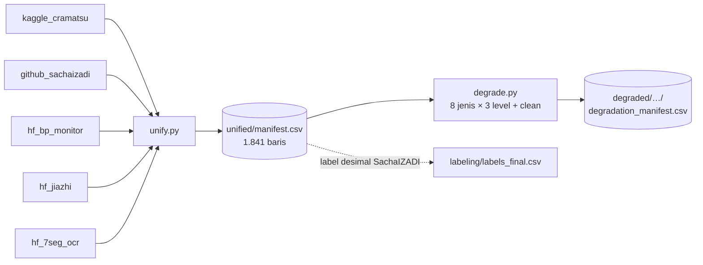

# `pipeline/` — Penyatuan Dataset (`unify.py`) dan Degradasi Terkontrol (`degrade.py`)

> **Isi dokumen:** dua skrip penyiapan data. `unify.py` menyatukan beberapa dataset publik yang formatnya berbeda-beda ke **satu tabel** (*manifest*). `degrade.py` membuat versi foto yang **sengaja dirusak** (buram, silau, redup, dan lain-lain) secara terukur, untuk menguji ketahanan ketiga engine OCR.
>
> Semua angka diambil dari `pipeline/unified/counts.txt`, `pipeline/unified/manifest.csv`, `pipeline/degraded/demo/degradation_manifest.csv`, atau kode. Status per 5 November 2026.

---

## 0. Ringkasan

| Skrip | APA | KENAPA | Output |
|---|---|---|---|
| `unify.py` | Membaca 5 dataset publik (+1 turunan per-digit), mengubah labelnya ke format seragam, menandai label yang meragukan, dan membuat grup anti-bocor. | Setiap dataset punya format label sendiri (CSV, YOLO, XML, nama file). Tanpa disatukan, setiap engine dan evaluasi harus menulis pembaca sendiri, dan itu rawan beda perlakuan. | `unified/manifest.csv` (1.841 baris), `unified/counts.csv`, `unified/counts.txt` |
| `degrade.py` | Menerapkan 8 jenis degradasi × 3 level pada citra, dengan hasil yang **sama persis** setiap kali dijalankan. | Untuk menjawab pertanyaan inti skripsi, "engine mana paling tahan pada kondisi X?", dibutuhkan kondisi yang **terkontrol**: label pasti benar dan tingkat gangguannya diketahui. | Folder citra + `degradation_manifest.csv` |

Analogi: `unify.py` itu seperti **menyalin rapor dari 5 sekolah** yang formatnya berbeda ke satu buku induk yang kolomnya sama. `degrade.py` itu seperti **ujian ketahanan di laboratorium**: barang yang sama dijatuhkan dari ketinggian 1, 2, dan 3 meter supaya bisa dibandingkan.



> **Penting:** di `manifest.csv`, label SachaIZADI masih **label asli (bilangan bulat)**. Label desimal hasil pelabelan ulang ada di `labeling/labels_final.csv` (lihat `labeling/README.md`). Penggabungan keduanya termasuk pekerjaan tiket **#1** dan **belum dilakukan**.

---

## 1. `unify.py`: menyatukan dataset

### 1.1 Cara menjalankan
```bash
cd pipeline   # dari root repo (Windows: cd pipeline)
../pilot/.venv/bin/python unify.py
```
- Butuh `Pillow` (sudah ada di `pilot/.venv`).
- Dataset harus sudah diunduh ke `data/`. Folder ini **tidak ada di repo** (di-`.gitignore`). Cara mengunduhnya ada di `strategi_data.md`.
- **Citra tidak disalin.** Manifest hanya menyimpan **path relatif terhadap root repo** dengan pemisah `/`, misalnya `data/kaggle_cramatsu/.../00_06.jpg`. Dengan begitu manifest yang sama bisa dipakai di Windows, macOS, dan Linux, di folder clone mana pun, asalkan dataset sudah diunduh ke `data/`. Skrip yang membaca manifest menggabungkan path ini dengan root repo (lihat `resolve_path()` di `degrade.py`).
- Skrip memeriksa dua hal sebelum menulis: tidak ada `id` ganda, dan setiap `image_path` benar-benar ada (`assert`). Kalau salah satu gagal, skrip berhenti.

### 1.2 Kolom `manifest.csv`

| Kolom | Arti | Contoh |
|---|---|---|
| `id` | ID unik baris | `sacha_LQ_12490a1c9281`, `cramatsu_05_10`, `bp_reading_033` |
| `source_dataset` | Asal dataset | `github_sachaizadi` |
| `unit` | `string` = satu layar utuh, `digit` = potongan satu digit | `string` |
| `original_split` | Pembagian bawaan dataset (bukan split kita) | `HQ`, `train`, `dev` |
| `split_group` | **Kunci grup anti-bocor**: baris dengan grup sama harus masuk split yang sama | `sacha:dup0124` |
| `image_path` | Path citra **relatif terhadap root repo**, pemisah `/` (portabel Windows/macOS/Linux) | `data/kaggle_cramatsu/…/00_06_jpg….jpg` |
| `label` | Label teks yang dipakai | `449` |
| `label_source` | Dari mana label diambil | `original_integer`, `filename` |
| `label_flag` | Kosong = aman. Terisi = ada yang janggal (alasan dipisah `\|`) | `cadran_mismatch:66` |
| `label_parts` | Label per bagian (untuk layar banyak baris) | `137;88;85` |
| `label_alt` | Bentuk label alternatif | `05.10` |
| `display_type` | `LCD` atau `LED` | `LCD` |
| `is_synthetic` | 1 = sintetis, 0 = foto nyata | `0` |
| `license` | Lisensi dataset | `MIT` |
| `width`, `height` | Ukuran citra (piksel) | `2048`, `1152` |
| `crop_x1..crop_y2` | Kotak area layar (*bounding box*), kalau dataset menyediakannya | — |
| `notes` | Catatan bebas | `dhash_cluster_size=1` |

**Kenapa ada `label_flag`, bukan langsung membuang baris yang janggal?** Supaya keputusan membuang data **tercatat dan bisa diperdebatkan**. Data tidak hilang diam-diam. `degrade.py --exclude-flagged` bisa membuang baris ber-flag kalau memang diinginkan.

**Kenapa ada `split_group`?** Untuk mencegah **kebocoran data** (*data leakage*): foto yang hampir sama tidak boleh muncul sekaligus di data latih dan data uji. Kalau itu terjadi, akurasi uji terlihat tinggi palsu, karena model hanya "mengingat" dan bukan benar-benar membaca. Analoginya seperti soal ujian yang bocor.

### 1.3 Per dataset: bagaimana label dibaca

#### a) `kaggle_cramatsu`: LED 4 digit, MIT
- **Sumber label:** nama file `{AB}_{CD}_jpg.rf.<hash>.jpg` menyandikan angka di layar, sehingga `label = ABCD` (`label_source=filename`). Di kode tercatat bahwa nama file sudah dicek visual pada 6 sampel, termasuk 4 yang berbeda dengan kotak YOLO, dan nama file yang benar.
- **Titik desimal:** tampak menyala setelah digit ke-2, tetapi dataset tidak punya kelas "titik". Karena itu bentuk `AB.CD` disimpan di `label_alt`, bukan di `label`.
- **Deduplikasi:** Roboflow (alat anotasi) membuat beberapa salinan augmentasi per foto sumber. 670 file disaring menjadi **390 sumber unik**: yang disimpan hanya file pertama per sumber, dan salinan lain dicatat di `notes`.
- **Pengecekan silang:** kotak YOLO (kotak per digit beserta kelasnya) diurutkan dari kiri ke kanan lalu dibandingkan dengan nama file. **20 baris** diberi flag. Jenis flag (satu baris bisa punya lebih dari satu): `yolo_mismatch` 20, `yolo_incomplete_3boxes` 12, `_2boxes` 2, `_1boxes` 1, `_0boxes` 1.
- **Crop:** gabungan semua kotak digit YOLO (389 dari 390 baris punya crop). Kalau kotak YOLO tidak lengkap, crop bisa memotong digit.
- **`split_group`:** per sumber (`cramatsu:AB_CD`). Semua foto berasal dari satu modul LED, jadi ini grup terbaik yang tersedia.

#### b) `github_sachaizadi`: LCD pompa BBM, TANPA lisensi
- **Sumber label:** kolom `used_liter` di `HQ/MQ/LQ_digital.csv`. Isinya **bilangan bulat saja** (`label_source=original_integer`). CSV-nya memakai pemisah `;` dan akhir baris `\r` saja, sehingga perlu fungsi khusus `read_csv_any`.
- **Pengecekan silang:** `used_liter` dibandingkan dengan gabungan kolom `cadran_1..4` (`X` = kosong). **3 baris** berbeda dan diberi flag `cadran_mismatch`. Ketiganya dibahas di `labeling/README.md` §6.3.
- **`split_group` dengan dHash:** dataset ini tidak punya info perangkat atau sesi foto. Untuk mendeteksi foto yang **nyaris identik**, dipakai **dHash** (*difference hash*):
  1. Ubah foto ke abu-abu dan perkecil ke 9×8 piksel.
  2. Bandingkan setiap piksel dengan tetangga kanannya: lebih terang = 1, selain itu 0. Hasilnya **sidik jari 64 bit**.
  3. Dua foto dianggap kembar kalau sidik jarinya berbeda **≤ 4 bit** (jarak Hamming ≤ 4).
  4. Foto-foto kembar digabung ke satu grup dengan algoritma **union-find**: kalau A kembar dengan B dan B kembar dengan C, maka A, B, dan C satu grup.
- **Hasil:** 858 foto menjadi **856 grup**. Hanya 2 grup yang berisi 2 foto: `sacha:dup0124` (label 242 & 247) dan `sacha:dup0603` (label 18 & 73). Labelnya berbeda, jadi keduanya kemungkinan foto berbeda yang kebetulan mirip di resolusi 9×8. Pengelompokan ini tetap aman karena sifatnya hati-hati: yang dikorbankan hanya keacakan 2 pasang foto.
- **Lisensi:** `NONE (no LICENSE file; all rights reserved - evaluation with citation only)`.

#### c) `hf_bp_monitor`: LCD tensimeter, MIT
- **Layar 3 baris** (sistolik, diastolik, nadi). Label = gabungan digit dari atas ke bawah, misalnya 137/88/85 → `1378885`. Bagian per baris disimpan di `label_parts` (`137;88;85`) dan bentuk `137/88/85` di `label_alt`.
- **55 foto pembacaan** (dev 29, test 26), `split_group` per `reading_id`. Semua foto berasal dari satu alat dan satu orang.

#### d) `hf_bp_monitor_digits`: turunan per-digit dari (c)
- **388 potongan digit** 24×32 piksel (dev 201, test 187), `unit=digit`. Data ini hanya relevan untuk **CNN per-digit**.
- `split_group` = `reading_id` asal. Dengan begitu digit dari foto yang sama tidak bocor ke dua split, sehingga jumlah grupnya 55.

#### e) `hf_jiazhi_utility_lcd`: LCD meteran utilitas, 50 sampel
- **Sumber label:** anotasi XML format VOC. Label = kotak digit `0`–`9` dan `comma` yang **titik pusatnya berada di dalam kotak `scoreboard`** (area layar), diurutkan dari kiri ke kanan. `comma` ditulis sebagai `.` (format desimal Eropa memakai koma). Digit nomor seri (`s0`..`s9`) diabaikan.
- **Crop** = kotak `scoreboard`. **1 baris** diberi flag (`multiple_commas`).
- **Lisensi:** tag HF CC BY-NC 4.0 (non-komersial), dan README dataset **melarang redistribusi file mentah**. Citranya tidak boleh diunggah ulang.

#### f) `hf_7seg_ocr_synthetic`: sintetis, MIT
- 100 baris pertama dari `MiXaiLL76/7SEG_OCR`. Label teks asli, boleh berisi `.` dan `-`.
- Semua baris satu grup (`7seg:synthetic`). Kartu dataset menyebut **TRAIN ONLY** (hanya untuk latih).

### 1.4 Ringkasan jumlah (`unified/counts.txt`)

| source_dataset | unit | display | sintetis | n_images | n_split_groups | n_label_flagged | lisensi |
|---|---|---|---|---|---|---|---|
| github_sachaizadi | string | LCD | 0 | 858 | 856 | 3 | NONE (tanpa LICENSE) |
| hf_7seg_ocr_synthetic | string | LED | 1 | 100 | 1 | 0 | MIT |
| hf_bp_monitor | string | LCD | 0 | 55 | 55 | 0 | MIT |
| hf_bp_monitor_digits | digit | LCD | 0 | 388 | 55 | 0 | MIT |
| hf_jiazhi_utility_lcd | string | LCD | 0 | 50 | 50 | 1 | CC BY-NC 4.0; dilarang redistribusi |
| kaggle_cramatsu | string | LED | 0 | 390 | 390 | 20 | MIT |
| **TOTAL** | | | | **1.841** | | | |
| **Foto nyata level string** | | | | **1.353** | | | |

1.353 = 858 + 55 + 50 + 390. Angka ini tidak menghitung 388 potongan digit dan 100 citra sintetis.

### 1.5 Peran tiap dataset dalam skripsi (keputusan saat ini)

| Dataset | Peran |
|---|---|
| `github_sachaizadi` | **Latih** (split train ±60%, bersama data sintetis generator sendiri) dan **uji utama** (split test ±20%). Label memakai `labeling/labels_final.csv`. Split: tiket #1. |
| `kaggle_cramatsu`, `hf_bp_monitor`, `hf_jiazhi_utility_lcd` | **Uji eksternal saja** (generalisasi ke jenis layar lain). Tidak untuk latih. |
| `hf_bp_monitor_digits` | Opsional, untuk analisis CNN per-digit. Tetap tidak untuk latih kalau `hf_bp_monitor` dipakai sebagai uji eksternal, karena keduanya dari foto yang sama. |
| `hf_7seg_ocr_synthetic` | Sintetis pihak ketiga. Kalau dipakai, hanya untuk latih (sesuai kartu dataset). |
| Foto HP peneliti (30–50) | Tidak lewat `unify.py`. Hanya *smoke test end-to-end*, bukan latih dan bukan angka utama. |

---

## 2. `degrade.py`: degradasi terkontrol

### 2.1 KENAPA perlu degradasi buatan?
Foto nyata memang punya kondisi buruk, tetapi **tidak terkontrol**: satu foto bisa sekaligus buram, silau, dan miring, dengan tingkat yang tidak diketahui. Dengan degradasi buatan:
- **Label pasti benar**, karena citra aslinya sama dan hanya kondisinya yang diubah.
- **Satu faktor diubah dalam satu waktu**, jadi penurunan akurasi bisa dikaitkan langsung ke faktor itu.
- **Tingkat keparahan** bisa diatur (level 1, 2, 3). Hasilnya bisa digambar sebagai kurva "akurasi vs level" per engine.

### 2.2 Delapan jenis degradasi

Parameter diskalakan **relatif terhadap sisi terpendek citra** `s = min(tinggi, lebar)`. Tujuannya supaya "buram level 2" terlihat sama parahnya pada citra kecil maupun besar.

| Jenis | Meniru kondisi | Cara kerja (sederhana) | Level 1 | Level 2 | Level 3 |
|---|---|---|---|---|---|
| `gaussian_blur` | Kamera tidak fokus | Setiap piksel dirata-rata dengan tetangganya (filter Gauss). Makin besar σ, makin buram. Minimal σ = 0,3 px. | σ = 0,004·s | 0,008·s | 0,016·s |
| `motion_blur` | Tangan goyang | Kernel berbentuk garis lurus dengan arah acak 0–180°. Panjang garis dibulatkan ke bilangan ganjil, minimal 3 px. | panjang 0,02·s | 0,04·s | 0,07·s |
| `low_light` | Tempat redup | `I' = brightness × (I/255)^gamma × 255`. Gamma > 1 menggelapkan area gelap lebih kuat, brightness < 1 menggelapkan semuanya. | γ 1,5; b 0,6 | γ 2,2; b 0,4 | γ 3,0; b 0,25 |
| `glare` | Pantulan lampu/matahari | Bercak putih berbentuk elips dengan tepi lembut (Gauss). Pusatnya acak **di dalam area layar** kalau crop tersedia. Bagian intinya dibuat jenuh (×1,6) supaya mirip pantulan. | radius 0,12·s; intensitas 0,5 | 0,20·s; 0,8 | 0,30·s; 1,0 |
| `perspective` | Difoto miring | Empat sudut citra digeser acak ke arah dalam, lalu citra di-*warp*. Tepi kosong diisi piksel tepi (*border replicate*). | geser ≤ 5% | ≤ 10% | ≤ 18% lebar/tinggi |
| `gaussian_noise` | Sensor berbintik (ISO tinggi) | Nilai acak berdistribusi normal ditambahkan ke setiap piksel dan kanal | σ = 8 | 18 | 32 (skala 0–255) |
| `jpeg` | Kompresi (kirim lewat chat) | Citra di-*encode* ulang ke JPEG berkualitas rendah sehingga muncul artefak kotak-kotak | kualitas 30 | 12 | 5 |
| `occlusion` | Ada yang menutupi layar | Persegi panjang abu-gelap (nilai 20–80) dengan rasio lebar/tinggi 0,3–1,0 (cenderung tegak, sehingga menutup sebagian digit), diletakkan acak di dalam area layar | 6% luas layar | 12% | 20% |

Selain itu selalu ditulis **level 0 = `clean`**: citra yang sama, dengan resize/crop yang sama, tanpa degradasi. **KENAPA:** pembandingnya harus melewati langkah persiapan yang persis sama. Kalau `clean` diambil dari file asli tanpa resize, perbedaan akurasi bisa saja disebabkan oleh resize, bukan oleh degradasinya.

Hubungan dengan kondisi di PRD: kondisi **bersih, silau, buram, miring, redup, terpotong** dipetakan ke `clean`, `glare`, `gaussian_blur`/`motion_blur`, `perspective`, `low_light`, dan `occlusion`. `gaussian_noise` dan `jpeg` adalah kondisi tambahan.

### 2.3 Determinisme: hasil selalu sama
**APA:** menjalankan ulang `degrade.py` dengan argumen yang sama menghasilkan citra yang **identik**.

**KENAPA:** supaya eksperimen bisa diulang oleh penguji, dan supaya ketiga engine diuji pada citra yang **persis sama**. Ini prinsip keadilan perbandingan.

**BAGAIMANA:** setiap kombinasi (citra, jenis, level) punya *seed* (benih angka acak) sendiri:
```
seed = 16 digit hex pertama dari sha256(f"{global_seed}|{id}|{degradasi}|{level}")
```
- `global_seed` default **2026** (`--seed`).
- Seed tercatat di kolom `seed` pada `degradation_manifest.csv`, dan parameter aktual (misalnya sudut motion blur, posisi glare, sudut perspektif) tercatat di kolom `params` (JSON).
- **Kenapa memakai hash, bukan satu generator acak berurutan?** Dengan hash, hasil untuk citra X **tidak bergantung** pada citra lain yang ikut diproses. Menambah atau mengurangi citra, atau memilih jenis degradasi tertentu saja, tidak mengubah hasil citra X.

### 2.4 Cara menjalankan
```bash
cd pipeline   # dari root repo (Windows: cd pipeline)
PY=../pilot/.venv/bin/python   # butuh opencv-python-headless + numpy (sudah ada)

# contoh dari docstring: 5 citra per dataset, semua degradasi, level 1-3
$PY degrade.py --datasets kaggle_cramatsu hf_bp_monitor --n-per-dataset 5 --out degraded/demo

# contact sheet (satu gambar grid berisi semua degradasi × level) untuk satu citra
$PY degrade.py --contact-sheet cramatsu_05_10 --out degraded/demo
```

| Argumen | Default | Arti |
|---|---|---|
| `--manifest` | `unified/manifest.csv` | Sumber daftar citra |
| `--out` | `degraded/run` | Folder output |
| `--datasets` | semua | Filter `source_dataset` |
| `--ids` | semua | Filter `id` tertentu |
| `--unit` | `string` | `string` atau `digit` |
| `--n-per-dataset` | 0 (= semua) | Ambil N citra acak per dataset (acak dengan seed) |
| `--exclude-flagged` | mati | Buang baris yang `label_flag`-nya terisi |
| `--degradations` | semua 8 | Pilih jenis tertentu |
| `--levels` | 1 2 3 | Pilih level |
| `--seed` | 2026 | Global seed |
| `--use-crop` | mati | Potong ke kotak layar (+ `--pad` 15%) kalau ada |
| `--max-side` | 1024 | Perkecil sisi terpanjang ke nilai ini (0 = ukuran asli) |
| `--format` | `png` | `png` lossless (±0,4 MB/file pada 1024 px), atau `jpg` q95 yang hemat disk tetapi menambah artefak ringan |
| `--contact-sheet ID` | — | Buat contact sheet satu citra saja |

**Output:**
- `OUT/images/<id>/<degradasi>_L<level>.png`, misalnya `glare_L2.png` atau `clean_L0.png`.
- `OUT/degradation_manifest.csv` dengan kolom `id, source_dataset, label, degradation, level, params, seed, path, orig_image_path`.
- Jumlah file = jumlah citra × (1 + jumlah_jenis × jumlah_level) = citra × 25 untuk setelan default.

### 2.5 Yang sudah ada: demo
`degraded/demo/` (di-`.gitignore`, jadi hanya ada di komputer peneliti) berisi:
- `degradation_manifest.csv`: **200 baris** = 8 citra × 25 kondisi. Citranya 2 per dataset: `sacha_HQ_840502a0ad0e`, `sacha_LQ_083b86985e38`, `bp_reading_033`, `bp_reading_042`, `jiazhi_00007`, `jiazhi_00015`, `cramatsu_84_06`, `cramatsu_88_03`. Semuanya tanpa `--use-crop`.
- 3 contact sheet: `contact_sheet_bp_reading_001.png`, `contact_sheet_cramatsu_05_10.png`, `contact_sheet_sacha_HQ_e104664ba179.png`.

Demo ini hanya untuk mengecek visual bahwa level 1→3 memang makin parah. **Belum ada** run degradasi penuh untuk evaluasi.

### 2.6 Keterbatasan
- Degradasi buatan **mendekati** kondisi nyata, tetapi tidak sama persis. Glare buatan, misalnya, berupa bercak putih simetris, sedangkan glare nyata di foto SachaIZADI sering berwarna (merah muda/kemerahan, menurut catatan AI di `labeling/`). Karena itu, hasil degradasi buatan perlu dilaporkan **berdampingan** dengan hasil pada foto nyata.
- Tanpa `--use-crop`, glare dan occlusion diletakkan di seluruh citra untuk dataset yang tidak punya crop (SachaIZADI, bp_monitor). Akibatnya gangguan bisa jatuh di luar layar dan tidak berpengaruh. Untuk SachaIZADI, crop baru tersedia setelah anotasi bbox (tiket #2).
- Level dipilih secara visual. Belum ada kalibrasi terhadap ukuran fisik (misalnya lux untuk redup).

---

## 3. Status: sudah vs belum

| Pekerjaan | Status | Sumber/tiket |
|---|---|---|
| `unify.py` berjalan, manifest 1.841 baris | ✅ Selesai | `unified/counts.txt` |
| Flag label janggal (cramatsu 20, SachaIZADI 3, jiazhi 1) | ✅ Selesai | `unified/counts.txt` |
| Grup anti-bocor dHash SachaIZADI (856 grup) | ✅ Selesai | `unified/counts.txt` |
| `degrade.py` + demo 200 file + 3 contact sheet | ✅ Selesai | `degraded/demo/` |
| Gabungkan label desimal `labeling/labels_final.csv` ke manifest + split 60/20/20 | ❌ Belum | #1 |
| Crop layar SachaIZADI (bbox) | ❌ Belum | #2, #3 |
| Prapemrosesan seragam untuk ketiga engine | ❌ Belum | #4 |
| Run degradasi penuh pada split test + evaluasi batch + uji McNemar | ❌ Belum | #10 |

---

## 4. Pertanyaan dosen yang mungkin muncul

**T: Kenapa level degradasinya 1–3 dengan nilai-nilai itu?**
J: Supaya ada rentang dari ringan (masih mudah dibaca manusia) sampai berat (sulit). Nilainya dicek visual lewat contact sheet. Pilihan ini memang subjektif dan saya sebut sebagai batasan. Yang penting, ketiga engine diuji pada citra yang identik.

**T: Bagaimana menjamin ketiga engine diuji pada citra yang sama?**
J: Seed tiap citra diturunkan dari hash (`sha256`) id, jenis, dan level, lalu dicatat di `degradation_manifest.csv`. Menjalankan ulang menghasilkan file yang identik.

**T: Kenapa SachaIZADI perlu dHash, sedangkan dataset lain tidak?**
J: SachaIZADI tidak punya info perangkat atau sesi, padahal foto dari pompa dan waktu yang sama bisa sangat mirip. dHash mendeteksi foto kembar secara otomatis. Hasilnya hanya 2 pasang yang mirip (856 grup dari 858 foto), jadi risiko bocor kecil.
